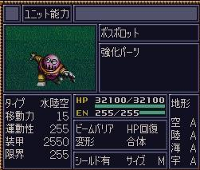
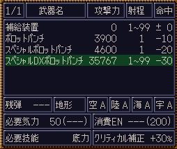

.. meta::
   :description: 修改 (第四次机器人大战) 静态修改 第四次金手指 人物修改 机体修改 芯片修改 精神修改 武器修改 变形修改 变身修改 第四次S金手指 用金手指添加机师的时候要注意，按照隐藏要素推荐的路线走剧情的话（这样打两遍就可以基本走完剧情），第四次的A路线到最后有59名机师，58个机体，B路线

.. _srw4_cheat:

修改 (第四次机器人大战)
==============================

.. contents::

作弊文件用法：把文件放到模拟器的cheat文件夹下，并改名为和游戏一样的名字（如果不确定文件名，手动输入一个作弊码之后退出模拟器）。

* :download:`下载 SLPS-00196_duckstation.cht <SLPS-00196_duckstation.cht>` 
* :download:`下载 Dai 4 Ji Super Robot Taisen (V1.1) (J)_snes9x.cht <Dai 4 Ji Super Robot Taisen (V1.1) (J)_snes9x.cht>`
* :download:`下载 Dai 4 Ji Super Robot Taisen (V1.1) (J)_bsnes.cht <Dai 4 Ji Super Robot Taisen (V1.1) (J)_bsnes.cht>`

用金手指添加机师的时候要注意，按照\ :ref:`隐藏要素 <srw4_missable>`\ 推荐的路线走剧情的话（这样打两遍就可以基本走完剧情），第四次的A路线到最后有59名机师，58个机体，B路线55名机师，52个机体(但是最多只能比真实系多增加5台，因为在\ :ref:`コンバトラーV <srw4_unit_combattler_v>`\ 或者\ :ref:`ダンクーガ <srw4_unit_dancouga>`\ 离队之前就会造成机体溢出)，C路线的话比A路线少一个机师。不管走哪条路线，都可以至少添加5名机师，6个机体。不走推荐的路线的话，也可以根据人物机体的加入离开算一下自己想走的路线最后会有多少人物和机体，用64减去最后的数量就是可以利用的空位。第四次S的话，机体和机师最多可以有80个，但是因为强制离队事件少了很多的原因，新增的空位并没有那么多。如果使用的是非官方ROM，需要打通一遍看看最后有多少机师和机体，因为非官方ROM可能会修改剧情导致加入和离队事件变化。

添加机师会出的问题是一些人物有剧情强制出场。比如如果在一开头把クワトロ改出来了，之后走宇宙路线クワトロ登场的时候会无限失败，因为改出来的机体和机师会被划到地上分队去，导致这一话クワトロ登不了场。在这一话之前把クワトロ改到宇宙分队是没有用的，把クワトロ改成别的人物才行。为了安全起见可以添加NPC、敌方或者你选择的路线不会入手的机师。如果改出来的是只会临时参战的人物或者机体，在参战完之后改出来的人物或者机体也会离队。

添加机体会需要连武器数量那一段数据一起改，只添加机体的代码的话，加的机体不能改造。另外游戏本身需要一些机体离队以腾出空间容纳新加入的机体，如果改掉了会中途离队的机体，可能导致机体溢出，后面人物加入时没有对应的机体或者现存人物的机体被顶掉。

-------------------
静态修改
-------------------

第四次的以C开头的金手指地址减去C00000即为ROM地址，至于以7开头的，因为是只在RAM里面才有的数据，所以不能够静态修改。对于第四次S，800xyyyy的x减去2再加上yyyy就是静态地址，例如8007xxxx的静态地址是0x5xxxx。

数据结构列表:

* :ref:`机体 <srw4_units_cheat>`
* :ref:`人物 <srw4_pilots_cheat>`
* :ref:`武器 <srw4_weapon_cheat>`
* :ref:`芯片 <srw4_items_cheat>`
* :ref:`改造参数 <srw4_remodeling_cheat>`
* :ref:`特殊诞生日精神和SP消耗 <srw4_mechanics_sprit_command_cheat>`

-------------------
第四次金手指
-------------------

^^^^^^^^^^^^^^^^^
全局设置
^^^^^^^^^^^^^^^^^
借鉴了西XX和BTSG的心得

.. grid::

    .. grid-item-card:: 跳关
      :columns: auto
      
      | 7E1000=xx
      | xx:下一话代码

    .. grid-item-card:: 当前话数
      :columns: auto

      | 7E1001=xx 

    .. grid-item-card:: 当前话代码
      :columns: auto

      | 7E1002=xx 

    .. grid-item-card:: 生日
      :columns: auto

      | 7E1086=xx
      | 7E1087=yy
      | xx:月 yy:日

    .. grid-item-card:: 最大\ :ref:`资金 <srw4_remodeling_cheat>`
      :columns: auto

      | 7E1055=7F
      | 7E1056=96
      | 7E1057=98
  
    .. grid-item-card:: 战斗动画关，地图坐标开
      :columns: auto

      | 7E1058=60 

    .. grid-item-card:: 战斗动画开，地图坐标关
      :columns: auto

      | 7E1058=00 

    .. grid-item-card:: 总回合数最小 
      :columns: auto

      | 7e1053=01
      | 7e1054=00

    .. grid-item-card:: 总回合数最大
      :columns: auto

      | 7e1053=0f
      | 7e1054=27

    .. grid-item-card:: :ref:`经验倍率 <srw4_exp>`
      :columns: auto

      | 7E0EE1=7E 

    .. grid-item-card:: 基础经验值
      :columns: auto

      | 7e0eda=ff 
      | 7e0edb=ff  

    .. grid-item-card:: 地图武器自残有经验
      :columns: auto

      | c3d848=00

    .. grid-item-card:: 1级全精神
      :columns: auto

      | 7e0eba=ff

    .. grid-item-card:: 精神不減
      :columns: auto

      | 7e0ebb=ff

    .. grid-item-card:: 气合效果最大
      :columns: auto

      | 829bcf=fd
      | 使用脱力时关掉
      | 击落敌军时气力会溢出
      | 255→4
      | 实际上没什么用

    .. grid-item-card:: 恒定幸運
      :columns: auto

      | c0b85b=00
      | 不用时关掉

    .. grid-item-card:: 激怒伤害最大
      :columns: auto

      | 7E0EC3=FF
      | 7E0EC4=FF

    .. grid-item-card:: 恋爱度最大
      :columns: auto

      | 7E1068=F0 

    .. grid-item-card:: 恋爱度最小
      :columns: auto

      | 7E1068=00 

    .. grid-item-card:: 演示动画开
      :columns: auto      

      | 7E1069=ff
      | 7E106a=40

    .. grid-item-card:: 控制敌军
      :columns: auto

      | c392cd=0b

    .. grid-item-card:: 控敌探宝
      :columns: auto

      | C2B07D=00

    .. grid-item-card:: 无需侦察
      :columns: auto

      | C2C23C=80

    .. grid-item-card:: 诞生月
      :columns: auto

      7e1206=xx

    .. grid-item-card:: 诞生日
      :columns: auto

      7e1207=xx

    .. grid-item-card:: 换乘无视
      :columns: auto

      | C2D3BE=80

    .. grid-item-card:: 无限移动
      :columns: auto

      | 7E1566=44
      | 7E1568=44
      | 7E156a=44
      | 7E156c=44
      | 7E156e=44
      | 7E1570=44
      | 7E1572=44

    .. grid-item-card:: 出击数锁定
      :columns: auto

      | 7E0EEC=18      
      | 比如同时可以
      | 出击两台母舰，
      | 但总出击数固定，
      | 多选的会被覆盖，
      | 而且剧情预留位
      | 占了会出bug，
      | 比如战场之爱
      | 击落蕾西之后
      | 她本来会重新
      | 作为友军增援，
      | 但是开了之后
      | 会作为敌军出击。
      | \ :ref:`マサキ·アンドー <srw4_pilot_masaki_andoh>`\  （ 
      | 安藤正树）这样本应
      | 加入的也只会
      | 作为NPC出场。

    .. grid-item-card:: 强化配件各9个
      :columns: auto

      | 7e1078=99
      | 7e1079=99
      | 7e107a=99
      | 7e107b=99
      | 7e107c=99
      | 7e107d=99
      | 7e107e=99
      | 7e107f=99

    .. grid-item-card:: 武器追加      
      :columns: auto

      | Snes9x/Bsnes支持条件启用
      | Snes9x Bug:
      | 游戏启动时无效化条件启用
      | 需要在读盘之后禁用/启用一次
      | 如果模拟器不支持，需要在开局之后开启，
      | 第一话过关之后存盘之后关闭再读盘，
      | 7E105E=00?01 
      | コン・バトラーV
      | 7E105F=00?86
      | イオン
      | アトミックバズーカ
      | グランダッシャー
      | 7E1060=00?1A
      | ダイモス
      | 7E1061=00?30
      | 計都羅喉剣暗剣殺
      | ブラックホールキャノン'
    .. grid-item-card:: 全单位改造
      :columns: auto

      | 7e1288=00?ff
      | 7e1289=00?7f
      | 7e128a=00?ff
      | 7e128b=00?7f
      | 7e128c=00?ff
      | 7e128d=00?7f
      | 7e128e=00?ff
      | 7e128f=00?7f
      | 7e1290=00?ff
      | 7e1291=00?7f
      | 7e1292=00?ff
      | 7e1293=00?7f
      | 7e1294=00?ff
      | 7e1295=00?7f
      | 7e1296=00?ff
      | 7e1297=00?7f
      | 7e1298=00?ff
      | 7e1299=00?7f
      | 7e129a=00?ff
      | 7e129b=00?7f
      | 7e129c=00?ff
      | 7e129d=00?7f
      | 7e129e=00?ff
      | 7e129f=00?7f
      | 7e12a0=00?ff
      | 7e12a1=00?7f
      | 7e12a2=00?ff
      | 7e12a3=00?7f
      | 7e12a4=00?ff
      | 7e12a5=00?7f
      | 7e12a6=00?ff
      | 7e12a7=00?7f
      | 7e12a8=00?ff
      | 7e12a9=00?7f
      | 7e12aa=00?ff
      | 7e12ab=00?7f
      | 7e12ac=00?ff
      | 7e12ad=00?7f
      | 7e12ae=00?ff
      | 7e12af=00?7f
      | 7e12b0=00?ff
      | 7e12b1=00?7f
      | 7e12b2=00?ff
      | 7e12b3=00?7f
      | 7e12b4=00?ff
      | 7e12b5=00?7f
      | 7e12b6=00?ff
      | 7e12b7=00?7f
      | 7e12b8=00?ff
      | 7e12b9=00?7f
      | 7e12ba=00?ff
      | 7e12bb=00?7f
      | 7e12bc=00?ff
      | 7e12bd=00?7f
      | 7e12be=00?ff
      | 7e12bf=00?7f
      | 7e12c0=00?ff
      | 7e12c1=00?7f
      | 7e12c2=00?ff
      | 7e12c3=00?7f
      | 7e12c4=00?ff
      | 7e12c5=00?7f
      | 7e12c6=00?ff
      | 7e12c7=00?7f
      | 7e12c8=00?ff
      | 7e12c9=00?7f
      | 7e12ca=00?ff
      | 7e12cb=00?7f
      | 7e12cc=00?ff
      | 7e12cd=00?7f
      | 7e12ce=00?ff
      | 7e12cf=00?7f
      | 7e12d0=00?ff
      | 7e12d1=00?7f
      | 7e12d2=00?ff
      | 7e12d3=00?7f
      | 7e12d4=00?ff
      | 7e12d5=00?7f
      | 7e12d6=00?ff
      | 7e12d7=00?7f
      | 7e12d8=00?ff
      | 7e12d9=00?7f
      | 7e12da=00?ff
      | 7e12db=00?7f
      | 7e12dc=00?ff
      | 7e12dd=00?7f
      | 7e12de=00?ff
      | 7e12df=00?7f
      | 7e12e0=00?ff
      | 7e12e1=00?7f
      | 7e12e2=00?ff
      | 7e12e3=00?7f
      | 7e12e4=00?ff
      | 7e12e5=00?7f
      | 7e12e6=00?ff
      | 7e12e7=00?7f
      | 7e12e8=00?ff
      | 7e12e9=00?7f
      | 7e12ea=00?ff
      | 7e12eb=00?7f
      | 7e12ec=00?ff
      | 7e12ed=00?7f
      | 7e12ee=00?ff
      | 7e12ef=00?7f
      | 7e12f0=00?ff
      | 7e12f1=00?7f
      | 7e12f2=00?ff
      | 7e12f3=00?7f
      | 7e12f4=00?ff
      | 7e12f5=00?7f
      | 7e12f6=00?ff
      | 7e12f7=00?7f
      | 7e12f8=00?ff
      | 7e12f9=00?7f
      | 7e12fa=00?ff
      | 7e12fb=00?7f
      | 7e12fc=00?ff
      | 7e12fd=00?7f
      | 7e12fe=00?ff
      | 7e12ff=00?7f
      | 7e1300=00?ff
      | 7e1301=00?7f
      | 7e1302=00?ff
      | 7e1303=00?7f
      | 7e1304=00?ff
      | 7e1305=00?7f
      | 7e1306=00?ff
      | 7e1307=00?7f

    .. grid-item-card:: 全体高性能雷达      
      :columns: auto

      | 7e1308=00
      | 7e1309=00
      | 7e130a=00
      | 7e130b=00
      | 7e130c=00
      | 7e130d=00
      | 7e130e=00
      | 7e130f=00
      | 7e1310=00
      | 7e1311=00
      | 7e1312=00
      | 7e1313=00
      | 7e1314=00
      | 7e1315=00
      | 7e1316=00
      | 7e1317=00
      | 7e1318=00
      | 7e1319=00
      | 7e131a=00
      | 7e131b=00
      | 7e131c=00
      | 7e131d=00
      | 7e131e=00
      | 7e131f=00
      | 7e1320=00
      | 7e1321=00
      | 7e1322=00
      | 7e1323=00
      | 7e1324=00
      | 7e1325=00
      | 7e1326=00
      | 7e1327=00
      | 7e1328=00
      | 7e1329=00
      | 7e132a=00
      | 7e132b=00
      | 7e132c=00
      | 7e132d=00
      | 7e132e=00
      | 7e132f=00
      | 7e1330=00
      | 7e1331=00
      | 7e1332=00
      | 7e1333=00
      | 7e1334=00
      | 7e1335=00
      | 7e1336=00
      | 7e1337=00
      | 7e1338=00
      | 7e1339=00
      | 7e133a=00
      | 7e133b=00
      | 7e133c=00
      | 7e133d=00
      | 7e133e=00
      | 7e133f=00
      | 7e1340=00
      | 7e1341=00
      | 7e1342=00
      | 7e1343=00
      | 7e1344=00
      | 7e1345=00
      | 7e1346=00
      | 7e1347=00
      | 7e1348=00
      | 7e1349=00
      | 7e134a=00
      | 7e134b=00
      | 7e134c=00
      | 7e134d=00
      | 7e134e=00
      | 7e134f=00
      | 7e1350=00
      | 7e1351=00
      | 7e1352=00
      | 7e1353=00
      | 7e1354=00
      | 7e1355=00
      | 7e1356=00
      | 7e1357=00
      | 7e1358=00
      | 7e1359=00
      | 7e135a=00
      | 7e135b=00
      | 7e135c=00
      | 7e135d=00
      | 7e135e=00
      | 7e135f=00
      | 7e1360=00
      | 7e1361=00
      | 7e1362=00
      | 7e1363=00
      | 7e1364=00
      | 7e1365=00
      | 7e1366=00
      | 7e1367=00
      | 7e1368=00
      | 7e1369=00
      | 7e136a=00
      | 7e136b=00
      | 7e136c=00
      | 7e136d=00
      | 7e136e=00
      | 7e136f=00
      | 7e1370=00
      | 7e1371=00
      | 7e1372=00
      | 7e1373=00
      | 7e1374=00
      | 7e1375=00
      | 7e1376=00
      | 7e1377=00
      | 7e1378=00
      | 7e1379=00
      | 7e137a=00
      | 7e137b=00
      | 7e137c=00
      | 7e137d=00
      | 7e137e=00
      | 7e137f=00
      | 7e1380=00
      | 7e1381=00
      | 7e1382=00
      | 7e1383=00
      | 7e1384=00
      | 7e1385=00
      | 7e1386=00
      | 7e1387=00

    .. grid-item-card:: 全机武器数量
      :columns: auto

      | 因为游戏\ :ref:`bug <srw4_bugs>`\ 
      | 因为武器数量过少
      | 特定机体部分武器可能无法改造
      | 例如ダイアナンＡ的
      | スカ－レットビ－ム️
      | 如果启用マジンガーZ（JS）的合体代码
      | 则因为グレンダイザー形态武器过多
      | 而导致部分武器
      | 在合体后处于未改造状态
      | 所以将所有机体武器数量增加
      | 7E1389=58
      | 7E138B=58
      | 7E138D=58
      | 7E138F=58
      | 7E1391=58
      | 7E1393=58
      | 7E1395=58
      | 7E1397=58
      | 7E1399=58
      | 7E139B=58
      | 7E139D=58
      | 7E139F=58
      | 7E13A1=58
      | 7E13A3=58
      | 7E13A5=58
      | 7E13A7=58
      | 7E13A9=58
      | 7E13AB=58
      | 7E13AD=58
      | 7E13AF=58
      | 7E13B1=58
      | 7E13B3=58
      | 7E13B5=58
      | 7E13B7=58
      | 7E13B9=58
      | 7E13BB=58
      | 7E13BD=58
      | 7E13BF=58
      | 7E13C1=58
      | 7E13C3=58
      | 7E13C5=58
      | 7E13C7=58
      | 7E13C9=58
      | 7E13CB=58
      | 7E13CD=58
      | 7E13CF=58
      | 7E13D1=58
      | 7E13D3=58
      | 7E13D5=58
      | 7E13D7=58
      | 7E13D9=58
      | 7E13DB=58
      | 7E13DD=58
      | 7E13DF=58
      | 7E13E1=58
      | 7E13E3=58
      | 7E13E5=58
      | 7E13E7=58
      | 7E13E9=58
      | 7E13EB=58
      | 7E13ED=58
      | 7E13EF=58
      | 7E13F1=58
      | 7E13F3=58
      | 7E13F5=58
      | 7E13F7=58
      | 7E13F9=58
      | 7E13FB=58
      | 7E13FD=58
      | 7E13FF=58
      | 7E1401=58
      | 7E1403=58
      | 7E1405=58
      | 7E1407=58

    .. grid-item-card:: 全武器15段改造
      :columns: auto
      
      | 7e141e=ff
      | 7e141f=ff
      | 7e1420=ff
      | 7e1421=ff
      | 7e1422=ff
      | 7e1423=ff
      | 7e1424=ff
      | 7e1425=ff
      | 7e1426=ff
      | 7e1427=ff
      | 7e1428=ff
      | 7e1429=ff
      | 7e142a=ff
      | 7e142b=ff
      | 7e142c=ff
      | 7e142d=ff
      | 7e142e=ff
      | 7e142f=ff
      | 7e1430=ff
      | 7e1431=ff
      | 7e1432=ff
      | 7e1433=ff
      | 7e1434=ff
      | 7e1435=ff
      | 7e1436=ff
      | 7e1437=ff
      | 7e1438=ff
      | 7e1439=ff
      | 7e143a=ff
      | 7e143b=ff
      | 7e143c=ff
      | 7e143d=ff
      | 7e143e=ff
      | 7e143f=ff
      | 7e1440=ff
      | 7e1441=ff
      | 7e1442=ff
      | 7e1443=ff
      | 7e1444=ff
      | 7e1445=ff
      | 7e1446=ff
      | 7e1447=ff
      | 7e1448=ff
      | 7e1449=ff
      | 7e144a=ff
      | 7e144b=ff
      | 7e144c=ff
      | 7e144d=ff
      | 7e144e=ff
      | 7e144f=ff
      | 7e1450=ff
      | 7e1451=ff
      | 7e1452=ff
      | 7e1453=ff
      | 7e1454=ff
      | 7e1455=ff
      | 7e1456=ff
      | 7e1457=ff
      | 7e1458=ff
      | 7e1459=ff
      | 7e145a=ff
      | 7e145b=ff
      | 7e145c=ff
      | 7e145d=ff
      | 7e145e=ff
      | 7e145f=ff
      | 7e1460=ff
      | 7e1461=ff
      | 7e1462=ff
      | 7e1463=ff
      | 7e1464=ff
      | 7e1465=ff
      | 7e1466=ff
      | 7e1467=ff
      | 7e1468=ff
      | 7e1469=ff
      | 7e146a=ff
      | 7e146b=ff
      | 7e146c=ff
      | 7e146d=ff
      | 7e146e=ff
      | 7e146f=ff
      | 7e1470=ff
      | 7e1471=ff
      | 7e1472=ff
      | 7e1473=ff
      | 7e1474=ff
      | 7e1475=ff
      | 7e1476=ff
      | 7e1477=ff
      | 7e1478=ff
      | 7e1479=ff
      | 7e147a=ff
      | 7e147b=ff
      | 7e147c=ff
      | 7e147d=ff
      | 7e147e=ff
      | 7e147f=ff
      | 7e1480=ff
      | 7e1481=ff
      | 7e1482=ff
      | 7e1483=ff
      | 7e1484=ff
      | 7e1485=ff
      | 7e1486=ff
      | 7e1487=ff
      | 7e1488=ff
      | 7e1489=ff
      | 7e148a=ff
      | 7e148b=ff
      | 7e148c=ff
      | 7e148d=ff
      | 7e148e=ff
      | 7e148f=ff
      | 7e1490=ff
      | 7e1491=ff
      | 7e1492=ff
      | 7e1493=ff
      | 7e1494=ff
      | 7e1495=ff
      | 7e1496=ff
      | 7e1497=ff
      | 7e1498=ff
      | 7e1499=ff
      | 7e149a=ff
      | 7e149b=ff
      | 7e149c=ff
      | 7e149d=ff
      | 7e149e=ff
      | 7e149f=ff
      | 7e14a0=ff
      | 7e14a1=ff
      | 7e14a2=ff
      | 7e14a3=ff
      | 7e14a3=ff
      | 7e14a5=ff
      | 7e14a6=ff
      | 7e14a7=ff
      | 7e14a8=ff
      | 7e14a9=ff
      | 7e14aa=ff
      | 7e14ab=ff
      | 7e14ac=ff
      | 7e14ad=ff
      | 7e14ae=ff
      | 7e14af=ff
      | 7e14b0=ff
      | 7e14b1=ff
      | 7e14b2=ff
      | 7e14b3=ff
      | 7e14b4=ff
      | 7e14b5=ff
      | 7e14b6=ff
      | 7e14b7=ff
      | 7e14b8=ff
      | 7e14b9=ff
      | 7e14ba=ff
      | 7e14bb=ff
      | 7e14bc=ff
      | 7e14bd=ff
      | 7e14be=ff
      | 7e14bf=ff
      | 7e14c0=ff
      | 7e14c1=ff
      | 7e14c2=ff
      | 7e14c3=ff
      | 7e14c4=ff
      | 7e14c5=ff
      | 7e14c6=ff
      | 7e14c7=ff
      | 7e14c8=ff
      | 7e14c9=ff
      | 7e14ca=ff
      | 7e14cb=ff
      | 7e14cc=ff
      | 7e14cd=ff
      | 7e14ce=ff
      | 7e14cf=ff
      | 7e14d0=ff
      | 7e14d1=ff
      | 7e14d2=ff
      | 7e14d3=ff
      | 7e14d4=ff
      | 7e14d5=ff
      | 7e14d6=ff
      | 7e14d7=ff
      | 7e14d8=ff
      | 7e14d9=ff
      | 7e14da=ff
      | 7e14db=ff
      | 7e14dc=ff
      | 7e14dd=ff
      | 7e14de=ff
      | 7e14df=ff
      | 7e14e0=ff
      | 7e14e1=ff
      | 7e14e2=ff
      | 7e14e3=ff
      | 7e14e4=ff
      | 7e14e5=ff
      | 7e14e6=ff
      | 7e14e7=ff
      | 7e14e8=ff
      | 7e14e9=ff
      | 7e14ea=ff
      | 7e14eb=ff

^^^^^^^^^^^^^^^^^
主人公名字修改
^^^^^^^^^^^^^^^^^

.. grid::

    .. grid-item-card:: マオ
      :columns: auto

      | D28963=F5
      | D28964=54
      | マオ→毛

    .. grid-item-card:: リン
      :columns: auto

      | D28935=F3
      | D28936=42
      | リン→林
      

^^^^^^^^^^^^^^^^^
主人公精神修改
^^^^^^^^^^^^^^^^^
具体数据格式参考\ :ref:`第四次精神修改 <srw4_mechanics_sprit_command_cheat>`\ 。

.. grid::

    .. grid-item-card:: リン
      :columns: auto

      | CB8FFF=1E
      | CB9000=01
      | CB9001=0E
      | CB9002=01
      | CB9003=13
      | CB9004=01
      | CB9005=14
      | CB9006=01
      | CB9007=16
      | CB9008=01
      | CB9009=12
      | CB900A=01

    .. grid-item-card:: ヘクトール
      :columns: auto

      | CB9045=1E
      | CB9046=01
      | CB9047=0E
      | CB9048=01
      | CB9049=13
      | CB904A=01
      | CB904B=14
      | CB904C=01
      | CB904D=16
      | CB904E=01
      | CB904F=12
      | CB9050=01

    .. grid-item-card:: ジェス
      :columns: auto

      | CB90C3=1E
      | CB90C4=01
      | CB90C5=0E
      | CB90C6=01
      | CB90C7=13
      | CB90C8=01
      | CB90C9=14
      | CB90CA=01
      | CB90CB=16
      | CB90CC=01
      | CB90CD=12
      | CB90CE=01

    .. grid-item-card:: ミーナ
      :columns: auto

      | CB90FB=1E
      | CB90FC=01
      | CB90FD=0E
      | CB90FE=01
      | CB90FF=13
      | CB9100=01
      | CB9101=14
      | CB9102=01
      | CB9103=16
      | CB9104=01
      | CB9105=12
      | CB9106=01

    .. grid-item-card:: イルム
      :columns: auto

      | CB9179=1E
      | CB917A=01
      | CB917B=0E
      | CB917C=01
      | CB917D=13
      | CB917E=01
      | CB917F=14
      | CB9180=01
      | CB9181=16
      | CB9182=01
      | CB9183=12
      | CB9184=01

    .. grid-item-card:: パット
      :columns: auto

      | CB9221=1E
      | CB9222=01
      | CB9223=0E
      | CB9224=01
      | CB9225=13
      | CB9226=01
      | CB9227=14
      | CB9228=01
      | CB9229=16
      | CB922A=01
      | CB922B=12
      | CB922C=01

    .. grid-item-card:: グレース
      :columns: auto

      | CB923D=1E
      | CB923E=01
      | CB923F=0E
      | CB9240=01
      | CB9241=13
      | CB9242=01
      | CB9243=14
      | CB9244=01
      | CB9245=16
      | CB9246=01
      | CB9247=12
      | CB9248=01

    .. grid-item-card:: ウィン
      :columns: auto

      | CB9267=1E
      | CB9268=01
      | CB9269=0E
      | CB926A=01
      | CB926B=13
      | CB926C=01
      | CB926D=14
      | CB926E=01
      | CB926F=16
      | CB9270=01
      | CB9271=12
      | CB9272=01

    .. grid-item-card:: ８月１２日Ａ型
      :columns: auto

      | CB92D7=1E
      | CB92D8=01
      | CB92D9=0E
      | CB92DA=01
      | CB92DB=13
      | CB92DC=01
      | CB92DD=14
      | CB92DE=01
      | CB92DF=16
      | CB92E0=01
      | CB92E1=12
      | CB92E2=01

^^^^^^^^^^^^^^^^^
阵容修改
^^^^^^^^^^^^^^^^^
Snes9x/Bsnes支持有条件的作弊码，即AAAAAA=BB?CC
但是Snes9x有Bug，在游戏在对应位置写入数据（例如读盘）之后，作弊码即失效。
所以此类代码需要需要在读盘之后禁用+启用一次才可以生效。

对于不支持此类作弊码的模拟器，则应改写为AAAAAA=CC，在开局之后开启，第一话过关之后存盘之后关闭作弊码，再读盘。

"""""""""""""""""""""""""""""
增加机师
"""""""""""""""""""""""""""""
因为机师数据是散列的，这里只列出首地址，特定机师的对应数据地址为序号x2+首地址。

* 7e1088xx xx为机师代号，可以在\ :ref:`机师数据 <srw4_pilots_data_snes>` \ 查到。
* 7e1089xx 等级 (0x01-0x63=99)  

  * 80位为是否副机师，所以副机师需要给等级+0x80。  

* 7E1108xx 分队情况。，每个机师2字节，低位未用。
  
  * 7E110900   表示第一个机师不在部队中。
  * 7E110910   表示第一个机师在第一小队中。
  * 7E110B00   表示第二个机师不在部队中。
  * 7E110B10   表示第二个机师在第一小队中。
  * 如下类推
  * 新增机师的话，需要设置对应分队情况。

 

.. grid::

    .. grid-item-card:: 增加机师(路线AC)
      :columns: auto

      
      | 分歧参考（\ :ref:`隐藏要素 <srw4_missable>`\ 路线A/C）      
      | 走B路线时禁用
      | 不按照路线中的选择可能造成数据溢出
      | 7E1106=36
      | 7e1187=00?10
      | \ :ref:`モンド <srw4_pilot_mondo_agake>`\ (蒙多·雅加凯) 
      | 7E1104=97
      | 7e1185=00?10
      | \ :ref:`ギュネイ <srw4_pilot_günei_gas>`\ (邱尼·盖斯) 
      | 7E1102=92 
      | 7e1183=00?10
      | \ :ref:`グレミー <srw4_pilot_glemy_toto>`\ (古利明·托托) 
      | 7E1100=7F 
      | 7e1181=00?10 
      | \ :ref:`ララァ <srw4_pilot_lala_sun>`\ (拉拉·辛) 
      | 7E10fe=4B 
      | 7e117f=00?10 
      | \ :ref:`ミチル <srw4_pilot_michiru_saotome>`\ (早乙女美智琉) 

    .. grid-item-card:: 增加机师（路线B）
      :columns: auto

      | 分歧参考 （\ :ref:`隐藏要素 <srw4_missable>`\ 路线B）
      | 走A/C路线时禁用
      | 不按照路线中的选择可能造成数据溢出
      | 7E1106=25
      | 7e1187=00?10
      | \ :ref:`セイラ <srw4_pilot_sayla_mass>`\ (莎拉·玛斯) 
      | 7E1104=98
      | 7e1185=00?10
      | \ :ref:`ナナイ <srw4_pilot_nanai_miguel>`\ (娜娜伊·米格尔) 
      | 7E1102=70
      | 7e1183=00?10
      | \ :ref:`バニング <srw4_pilot_south_burning>`\ (绍斯·巴宁格)
      | 7E1100=38 
      | 7e1181=00?10 
      | イーノ(伊诺·阿帕夫)
      | 7E10fe=4B 
      | 7e117f=00?10 
      | \ :ref:`ミチル <srw4_pilot_michiru_saotome>`\ (早乙女美智琉) 
      | 7e10fc=BC
      | 7e117d=00?10 
      | \ :ref:`ゼット <srw4_pilot_zet_light>`\ (杰特·赖特) 
      | 7e10fa=BD
      | 7e117b=00?10
      | \ :ref:`トルストール <srw4_pilot_tolstor_cheshilenko>`\
      | (特鲁斯多鲁·切基雷科) 
      | 7e10f8=3a 
      | 7e1179=00?10 
      | \ :ref:`レズン <srw4_pilot_rezun_schneider>`\ 
      | (列珍·施耐德) 
      | 7e10f6=44 
      | 7e1177=00?10 
      | \ :ref:`モンシア <srw4_pilot_bernard_monsha>`\ 
      | (巴纳德·蒙夏) 

  
    .. grid-item-card:: 增加妖精
      :columns: auto

      | 因为换乘的机师代码也在同一个字节，
      | 一直锁定的话会导致改出来也没法用。
      | 7E1409=00?80
      | チャム·ファウ
      | 7E140D=00?80
      | ベル·アール
      | 7E1411=00?80
      | エル·フィノ
      | 7E1415=00?80
      | リリス·ファウ
      | 7E1419=00?80
      | シルキー·マウ

"""""""""""""""""""""""""""""
增加机体
"""""""""""""""""""""""""""""

因为机体是散列的，这里只列出首地址，特定机体的对应数据地址为序号x2+首地址。

* 7E1208xx xx=a
* 7E1209yy yy=b+cx2+d。

  * 其中a为机体代码低8位，机体代码可以在\ :ref:`机体数据 <srw4_units_data_snes>` \ 查到。
  * 机体代码>=0x100的时候，b为1，否则b为0。
  * c为机体当前驾驶员以0开始的序数。如果没有驾驶员，则c为0。
  * 有驾驶员时d为0x80，否则为0。
  * 例如1F80表示マジンガーZ（JS）（编号1F）由第1个机师驾驶，在前面机师数据区（7e1088开始）查到第一个机师代码为0x55，所以是兜甲児驾驶。

* 7E1288FF 机体改造段数，改满为FF
* 7E12897E 机体改造段数，改满为7E
  
  * 如果锁定为7F，则为阵亡状态，可复活
  * 如果锁定为7E，则为活跃状态，即使被击落也无法复活
  * 为安全起见，可以只在过关时启用
* 7E1308xx 
* 7E1309yy 
  
  * xx和yy是芯片的\ :ref:`序号 <srw4_items>`\ 。
* 7E1388 xx xx为机体的武器改造段数偏移的低8位
* 7E1389 yy 

  * 高7位为机体的武器数量x4
  * 低位为机体的武器改造段数偏移的高2位

.. grid:: 

    .. grid-item-card:: 增加机体(路线AC)
      :columns: auto

      
      | 分歧参考（\ :ref:`隐藏要素 <srw4_missable>`\ 路线A/C）
      | 走B路线时禁用
      | 不按照路线中的选择可能造成数据溢出
      | 7e1287=00?01
      | 7e1286=00?01
      | \ :ref:`ガイラム <srw4_unit_gayrahm>`\ (盖拉姆)
      | 7e1285=00?01
      | 7e1284=00?06
      | \ :ref:`Ξガンダム <srw4_unit_xi_gundam>`\ (柯西高达)
      | 7e1283=00?01
      | 7e1282=00?0C
      | \ :ref:`ニセサイバスター <srw4_unit_fake_cybuster>`\ (伪塞巴斯塔)
      | 7e1280=00?03
      | \ :ref:`ウイングガスト <srw4_unit_wing_gust>`\ (飞翼加斯特)
      | 武器改造段数数量/位移
      | 7e1407=48
      | 7e1406=00 
      | 7e1405=48
      | 7e1404=00 
      | 7e1403=48 
      | 7e1402=00 
      | 7e1401=48
      | 7e1400=00 

    .. grid-item-card:: 增加机体(路线B)
      :columns: auto

      | 分歧参考 （\ :ref:`隐藏要素 <srw4_missable>`\ 路线B）
      | 走A/C路线时禁用
      | 不按照路线中的选择可能造成数据溢出      
      | 7e1287=00?01
      | 7e1286=00?01
      | \ :ref:`ガイラム <srw4_unit_gayrahm>`\ (盖拉姆)
      | 7e1285=00?12
      | 7e1284=00?00
      | \ :ref:`ボール <srw4_unit_ball>`\ (铁球)
      | 7e1283=00?01
      | 7e1282=00?0C
      | \ :ref:`ニセサイバスター <srw4_unit_fake_cybuster>`\ (伪塞巴斯塔)
      | 7e1280=00?03
      | \ :ref:`ウイングガスト <srw4_unit_wing_gust>`\ (飞翼加斯特)
      | 7e127f=00?01
      | 7e127e=00?28
      | \ :ref:`ガラバ(ハイパー可) <srw4_unit_gallaba_hyper_available>`\ (可巨化加拉巴)
      | 7e127d=00?01
      | 7e127c=00?26
      | \ :ref:`ライネック(ハイパー可) <srw4_unit_wryneck_hyper_available>`\ (可巨化莱内克)
      | 7e127b=00?01
      | 7e127a=00?24
      | \ :ref:`レプラカーン(ハイパー可) <srw4_unit_leprechaun_hyper_available>`\ (可巨化雷普拉刚)
      | 7e1279=00?01
      | 7e1278=00?04
      | \ :ref:`Gディフェンサー <srw4_unit_g_defender>`\ (G-防卫号)
      | 7e1276=8C
      | \ :ref:`ビギナ·ギナ <srw4_unit_vigna_ghina>`\  (比基纳·基纳)
      | 武器改造段数数量/位移      
      | 7e1407=1E 
      | 7e1406=00 
      | 7e1405=1E
      | 7e1404=00 
      | 7e1403=1E 
      | 7e1402=00 
      | 7e1401=1E
      | 7e1400=00 
      | 7e13ff=1E 
      | 7e13fe=00 
      | 7e13fd=1E
      | 7e13fc=00 
      | 7e13fb=1E 
      | 7e13fa=00 
      | 7e13f9=1E 
      | 7e13f8=00 
      | 7e13f7=1E 
      | 7e13f6=00 

^^^^^^^^^^^^^^^^^
机师修改
^^^^^^^^^^^^^^^^^

.. _srw4_cheat_pilots_snes_begin:

.. grid::

    .. grid-item-card:: エル·フィノ
      :columns: auto

      | CB7361=12
      | CB7362=01
      | 根性→激励
      | CB7365=0E
      | CB7366=01
      | 足かせ/信頼→覚醒
      | CB7369=08
      | CB736A=01
      | 隠れ身→気合

    .. grid-item-card:: ジャック
      :columns: auto

      | CB73C6=22
      | 乘换ダンバイン系

    .. grid-item-card:: 神隼人
      :columns: auto

      | CB7434=0D
      | CB7435=01
      | 幸運→Lv1

    .. grid-item-card:: 真吾
      :columns: auto

      | CB7465=20
      | 乘换機動戦士系

    .. grid-item-card:: 沙羅
      :columns: auto

      | CB7557=0D
      | CB7558=01
      | 幸運 LV25→1

    .. grid-item-card:: 南原ちずる
      :columns: auto

      | CB7617=0D
      | CB7618=01
      | 幸運 LV25→1

    .. grid-item-card:: マサキ
      :columns: auto

      | CB7686=30
      | 乘换機動戦士系

    .. grid-item-card:: リュ－ネ
      :columns: auto

      | CB76A5=B0
      | 乘换機動戦士系

    .. grid-item-card:: シュウ
      :columns: auto

      | CB76C4=10
      | 乘换機動戦士系
      | CB76D3=0D
      | CB76D4=01
      | 幸運→lv1

    .. grid-item-card:: ブライト
      :columns: auto

      | CB7706=10
      | 乘换可
      | CB770C=44
      | CB770D=44
      | 地形适应
      | CB771B=18
      | CB771C=01
      | 偵察→探索

    .. grid-item-card:: マチルダ
      :columns: auto

      | CB7759=44
      | CB775A=44
      | 地形适应
      | CB7764=12
      | CB7765=01
      | 根性→激励
      | CB776C=3E
      | CB776D=01
      | 激励→
      | ニュータイプ

    .. grid-item-card:: セイラ
      :columns: auto

      | CB7778=44
      | CB7779=44
      | 地形适应
      | CB777A=54
      | CB777B=62
      | CB777C=6C
      | CB777D=59
      | CB777E=6A
      | CB777F=6E
      | 能力
      | CB7780=50
      | SP值
      | CB7781=08
      | CB7782=00
      | 无→気合
      | CB7783=3E
      | CB7784=00
      | 无→
      | ニュータイプ

    .. grid-item-card:: ワッケイン
      :columns: auto

      | CB778F=44
      | CB7790=44
      | 地形适应
      | CB7798=09
      | CB7799=00
      | 根性→加速
      | CB779C=3E
      | CB779D=00
      | 加速→
      | ニュータイプ

    .. grid-item-card:: ティアンム
      :columns: auto

      | CB77A8=44
      | CB77A9=44
      | 地形适应
      | CB77B1=1A
      | CB77B2=00
      | 根性→かく乱
      | CB77B7=3E
      | CB77B8=00
      | かく乱→
      | ニュータイプ

    .. grid-item-card:: エマ
      :columns: auto

      | CB77D8=3E
      | CB77D9=01
      | シールド防御Ｌ1/2
      | →ニュータイプ

    .. grid-item-card:: トーレス
      :columns: auto

      | CB77DE=00
      | 乘换可
      | CB77ED=09
      | CB77EE=01
      | 加速→Lv1
      | CB77F1=18
      | CB77F2=01
      | 偵察→探索

    .. grid-item-card:: ファ
      :columns: auto

      | CB7808=0D
      | CB7809=01
      | 幸運→Lv1
      | CB7812=3E
      | CB7813=01
      | ニュータイプ→Lv1

    .. grid-item-card:: カツ
      :columns: auto

      | CB7835=3E
      | CB7836=01
      | ニュータイプ→Lv1

    .. grid-item-card:: ベルトーチカ
      :columns: auto

      | CB7866=44
      | CB7867=44
      | 地形适应
      | CB7868=4A
      | CB7869=55
      | CB786A=58
      | CB786B=4C
      | CB786C=52
      | CB786D=5F
      | 能力
      | CB786E=80
      | SP值
      | CB786F=08
      | CB7870=00
      | 无→気合
      | CB7871=3E
      | CB7872=00
      | 无→
      | ニュータイプ

    .. grid-item-card:: ル－
      :columns: auto

      | CB78E7=3E
      | CB78E8=01
      | ニュータイプ→Lv1

    .. grid-item-card:: リィナ
      :columns: auto

      | CB7939=44
      | CB793A=44
      | 地形适应
      | CB793B=56
      | CB793C=68
      | CB793D=6E
      | CB793E=4B
      | CB793F=70
      | CB7940=76
      | 能力
      | CB7941=50
      | SP值
      | CB7942=08
      | CB7943=00
      | 无→気合
      | CB7944=3E
      | CB7945=00
      | 无→
      | ニュータイプ

    .. grid-item-card:: ビ－チャ
      :columns: auto

      | CB7948=4E
      | 颜（獣魔将軍→アキ）
      | CB7965=3E
      | CB7966=01
      | ニュータイプ→Lv1

    .. grid-item-card:: モンド
      :columns: auto

      | CB7971=44
      | CB7972=44
      | 地形适应
      | CB797E=0D
      | CB797F=00
      | 幸運→Lv1
      | CB7986=3E
      | CB7987=01
      | ニュータイプ→Lv1

    .. grid-item-card:: エル·ビアンノ
      :columns: auto

      | CB798A=05
      | CB798B=1F
      | 颜（ティターンズ兵士→
      | イザベル·クロンカイト）
      | CB79A7=3E
      | CB79A8=01
      | ニュータイプ→Lv1

    .. grid-item-card:: イ－ノ
      :columns: auto

      | CB79AD=01
      | CB79AE=1F
      | 颜（議員B→
      | 技術者、研究所員）
      | CB79B5=44
      | CB79B6=44
      | 地形适应
      | CB79B7=4E
      | CB79B8=58
      | CB79B9=5E
      | CB79BA=48
      | CB79BB=5C
      | CB79BC=60
      | 能力
      | CB79BD=50
      | SP值
      | CB79BE=12
      | CB79BF=00
      | 无→激励
      | CB79C0=3E
      | CB79C1=00
      | 无→
      | ニュータイプ

    .. grid-item-card:: エマリ－
      :columns: auto

      | CB79CC=44
      | CB79CD=44
      | 地形适应
      | CB79CE=46
      | CB79CF=52
      | CB79D0=55
      | CB79D1=4C
      | CB79D2=50
      | CB79D3=5A
      | 能力
      | CB79D4=50
      | SP值
      | CB79D5=03
      | CB79D6=00
      | 无→補給
      | CB79D7=3E
      | CB79D8=00
      | 无→
      | ニュータイプ

    .. grid-item-card:: クェス
      :columns: auto

      | CB79E3=44
      | CB79E4=44
      | 地形适应

    .. grid-item-card:: チェ－ン
      :columns: auto

      | CB7A04=44
      | CB7A05=44
      | 地形适应
      | CB7A06=4C
      | CB7A07=5F
      | CB7A08=66
      | CB7A09=54
      | CB7A0A=5E
      | CB7A0B=69
      | 能力
      | CB7A0C=50
      | SP值
      | CB7A0D=03
      | CB7A0E=00
      | 无→補給
      | CB7A0F=3E
      | CB7A10=00
      | 无→
      | ニュータイプ

    .. grid-item-card:: ケーラ
      :columns: auto

      | CB7A1B=44
      | CB7A1C=44
      | 地形适应
      | CB7A30=3E
      | CB7A31=00
      | シールド防御Ｌ2/4
      | →ニュータイプ

    .. grid-item-card:: ハサウェイ
      :columns: auto

      | CB7A3C=44
      | CB7A3D=44
      | 地形适应

    .. grid-item-card:: クリス
      :columns: auto

      | CB7A72=3E
      | CB7A73=00
      | シールド防御Ｌ1
      | →ニュータイプ

    .. grid-item-card:: バーニィ
      :columns: auto

      | CB7A93=3E
      | CB7A94=00
      | シールド防御Ｌ1/3
      | →ニュータイプ

    .. grid-item-card:: ニナ
      :columns: auto

      | CB7AC2=44
      | CB7AC3=44
      | 地形适应
      | CB7AC4=46
      | CB7AC5=54
      | CB7AC6=58
      | CB7AC7=4A
      | CB7AC8=53
      | CB7AC9=66
      | 能力
      | CB7ACA=50
      | SP值
      | CB7ACB=03
      | CB7ACC=00
      | 无→補給
      | CB7ACD=3E
      | CB7ACE=00
      | 无→
      | ニュータイプ

    .. grid-item-card:: ガトー
      :columns: auto

      | CB7AEE=3E
      | CB7AEF=01
      | シールド防御Ｌ3/8
      | →ニュータイプ

    .. grid-item-card:: キース
      :columns: auto

      | CB7AFA=44
      | CB7AFB=44
      | 地形适应
      | CB7B03=16
      | CB7B04=01
      | 幸運→脱力
      | CB7B0D=3E
      | CB7B0E=00
      | 脱力→
      | ニュータイプ

    .. grid-item-card:: モンシア
      :columns: auto

      | CB7B19=44
      | CB7B1A=44
      | 地形适应
      | CB7B2E=3E
      | CB7B2F=00
      | シールド防御Ｌ2
      | →ニュータイプ

    .. grid-item-card:: さやか
      :columns: auto

      | CB7B34=A2
      | 乘换ダンバイン系

    .. grid-item-card:: ボス
      :columns: auto

      | CB7B74=22
      | 乘换ダンバイン系
      | CB7B7A=44
      | CB7B7B=44
      | 地形适应

    .. grid-item-card:: 炎ジュン
      :columns: auto

      | CB7B95=92
      | 乘换ダンバイン系
      | CB7B9B=44
      | CB7B9C=44
      | 地形适应

    .. grid-item-card:: マリア
      :columns: auto

      | CB7BB4=B2
      | 乘换ダンバイン系

    .. grid-item-card:: 牧場ひかる
      :columns: auto

      | CB7BD3=82
      | 乘换ダンバイン系

    .. grid-item-card:: ミチル
      :columns: auto

      | CB7BF2=92
      | 乘换ダンバイン系
      | CB7BF8=44
      | CB7BF9=44
      | 地形适应

    .. grid-item-card:: 神宮寺
      :columns: auto

      | CB7C30=10
      | 乘换機動戦士系
      | CB7C36=44
      | CB7C37=44
      | 地形适应

    .. grid-item-card:: 麗
      :columns: auto

      | CB7C4F=90
      | 乘换機動戦士系
      | CB7C55=44
      | CB7C56=44
      | 地形适应

    .. grid-item-card:: マリ
      :columns: auto

      | CB7C6E=80
      | 乘换機動戦士系
      | CB7C74=44
      | CB7C75=44
      | 地形适应

    .. grid-item-card:: コウ
      :columns: auto

      | CB7D27=44
      | CB7D28=44
      | 地形适应
      | CB7D3C=3E
      | CB7D3D=01
      | 切り払いＬ1/2→
      | ニュータイプ
      | CB7D32=0D
      | CB7D33=01
      | 幸運→Lv1

    .. grid-item-card:: 甲児
      :columns: auto

      | CB7D44=32
      | 乘换ダンバイン系

    .. grid-item-card:: ビュ－ティ
      :columns: auto

      | CB7DE0=80
      | 乘换機動戦士系
      | CB7DE6=44
      | CB7DE7=44
      | 地形适应
      | CB7DE8=5E
      | CB7DE9=50
      | CB7DEA=55
      | CB7DEB=52
      | CB7DEC=59
      | CB7DED=5C
      | 能力
      | CB7DEE=80
      | SP值
      | CB7DEF=0D
      | CB7DF0=00
      | 无→幸運
      | CB7DF1=0C
      | CB7DF2=00
      | 无→
      | ひらめき

    .. grid-item-card:: レイカ
      :columns: auto

      | CB7DF7=90
      | 乘换機動戦士系
      | CB7DFD=44
      | CB7DFE=44
      | 地形适应
      | CB7DFF=54
      | CB7E00=62
      | CB7E01=6A
      | CB7E02=5B
      | CB7E03=66
      | CB7E04=62
      | 能力
      | CB7E05=70
      | SP值
      | CB7E06=05
      | CB7E07=00
      | 无→信頼
      | CB7E08=06
      | CB7E09=00
      | 无→
      | 愛

    .. grid-item-card:: 戸田突太
      :columns: auto

      | CB7E0E=00
      | 乘换機動戦士系
      | CB7E14=44
      | CB7E15=44
      | 地形适应
      | CB7E16=4E
      | CB7E17=5C
      | CB7E18=5F
      | CB7E19=55
      | CB7E1A=68
      | CB7E1B=5E
      | 能力
      | CB7E1C=70
      | SP值
      | CB7E1D=09
      | CB7E1E=00
      | 无→加速
      | CB7E1F=1A
      | CB7E20=00
      | 无→
      | かく乱

    .. grid-item-card:: 鉄也
      :columns: auto

      | CB7E25=12
      | 乘换ダンバイン系

    .. grid-item-card:: 京四郎
      :columns: auto

      | CB7E46=10
      | 乘换機動戦士系
      | CB7E4C=44
      | CB7E4D=44
      | 地形适应

    .. grid-item-card:: ナナ
      :columns: auto

      | CB7E67=80
      | 乘换機動戦士系
      | CB7E6D=44
      | CB7E6E=44
      | 地形适应

    .. grid-item-card:: デューク
      :columns: auto

      | CB7E86=02
      | 乘换ダンバイン系

    .. grid-item-card:: 洸
      :columns: auto

      | CB7EC8=10
      | 乘换機動戦士系

    .. grid-item-card:: ニー·ギブン
      :columns: auto

      | CB7F02=16
      | CB7F03=00
      | 根性→脱力
      | CB7F04=32
      | CB7F05=00
      | 脱力→聖戦士

    .. grid-item-card:: キーン
      :columns: auto

      | CB7F23=32
      | CB7F24=00
      | 友情→聖戦士

    .. grid-item-card:: シーラ
      :columns: auto

      | CB7F2F=44
      | CB7F30=44
      | 地形适应

    .. grid-item-card:: エレ
      :columns: auto

      | CB7F4E=44
      | CB7F4F=44
      | 地形适应

    .. grid-item-card:: リムル
      :columns: auto

      | CB7F6D=44
      | CB7F6E=44
      | 地形适应
      | CB7F76=0E
      | 探索→覚醒
      | CB7F80=32
      | CB7F81=00
      | 覚醒→聖戦士

    .. grid-item-card:: エイブ
      :columns: auto

      | CB7F86=22
      | 乘换ダンバイン系
      | CB7F8C=44
      | CB7F8D=44
      | 地形适应
      | CB7F8E=4A
      | CB7F8F=58
      | CB7F90=5C
      | CB7F91=56
      | CB7F92=51
      | CB7F93=5F
      | 能力
      | CB7F94=70
      | SP值
      | CB7F95=03
      | CB7F96=00
      | 无→補給
      | CB7F97=0B
      | CB7F98=00
      | 无→
      | 必中

    .. grid-item-card:: 万丈
      :columns: auto

      | CB7F9D=20
      | 乘换機動戦士系

    .. grid-item-card:: 一矢
      :columns: auto

      | CB7FBE=20
      | 乘换機動戦士系

    .. grid-item-card:: テュッティ
      :columns: auto

      | CB8011=90
      | 乘换機動戦士系

    .. grid-item-card:: バニング
      :columns: auto

      | CB804D=44
      | CB804E=44
      | 地形适应
      | CB804F=4A
      | CB8050=4F
      | CB8051=77
      | CB8052=71
      | CB8053=70
      | CB8054=73
      | 能力
      | CB8055=50
      | SP值
      | CB8056=0A
      | CB8057=00
      | 无→熱血
      | CB8058=3E
      | CB8059=00
      | 无→
      | ニュータイプ

    .. grid-item-card:: ヤンロン
      :columns: auto

      | CB805E=20
      | 乘换機動戦士系

    .. grid-item-card:: プレシア
      :columns: auto

      | CB807D=00
      | 乘换機動戦士系
      | CB8083=44
      | CB8084=44
      | 地形适应
      | CB8085=68
      | CB8086=5E
      | CB8087=52
      | CB8088=66
      | CB8089=6C
      | CB808A=6E
      | 能力
      | CB808B=60
      | SP值
      | CB808C=03
      | CB808D=00
      | 无→補給
      | CB808E=0A
      | CB808F=00
      | 无→
      | 熱血

    .. grid-item-card:: ミオ
      :columns: auto

      | CB8094=80
      | 乘换機動戦士系

    .. grid-item-card:: モニカ
      :columns: auto

      | CB80CA=80
      | 乘换機動戦士系

    .. grid-item-card:: サフィーネ
      :columns: auto

      | CB80E9=B0
      | 乘换機動戦士系

    .. grid-item-card:: ララァ
      :columns: auto

      | CB81F4=90
      | 颜（メキボス→
      | アンナマリー）
      | CB81FC=44
      | CB81FD=44
      | 地形适应

    .. grid-item-card:: グレミー
      :columns: auto

      | CB8447=E0
      | 颜（テリウス
      | →シャア）

    .. grid-item-card:: ナナイ
      :columns: auto

      | CB8509=3B
      | 颜（議長→
      | ニナ）
      | CB8511=44
      | CB8512=44
      | 地形适应
      | CB8524=3E
      | CB8525=00
      | 根性→
      | ニュータイプ

    .. grid-item-card:: レズン
      :columns: auto

      | CB853B=08
      | CB853C=00
      | 根性→気合
      | CB8543=3E
      | CB8544=00
      | 気合→
      | ニュータイプ

    .. grid-item-card:: ゼット
      :columns: auto

      | CB8942=1C
      | 颜（秘書→ハヤト・コバヤシ）
      | CB895F=32
      | CB8960=00
      | 切り払いＬ1→聖戦士

    .. grid-item-card:: トルストール
      :columns: auto

      | CB8974=15
      | CB8975=00
      | 根性→隠れ身
      | CB897E=32
      | CB897F=00
      | 隠れ身→聖戦士

    .. grid-item-card:: テリウス
      :columns: auto

      | CB8EAF=08
      | CB8EB0=00
      | 根性→気合
      | CB8EB1=0E
      | CB8EB2=00
      | ド根性→覚醒

    .. grid-item-card:: 強化兵
      :columns: auto

      | CB8EB5=FE
      | 颜(エリート兵
      | →エリート兵（逆）)

    .. grid-item-card:: 超人工知能
      :columns: auto

      | CB8EED=F3
      | 颜(人工知能改
      | →Now Printing)

    .. grid-item-card:: 超级系男主人公
      :columns: auto

      | CB8F45=3E
      | CB8F46=00
      | 切り払いＬ1→
      | ニュータイプ
      | CB8F47=32
      | CB8F48=00
      | 切り払いＬ2→
      | 聖戦士

    .. grid-item-card:: 超级系女主人公
      :columns: auto

      | CB8F7F=3E
      | CB8F80=00
      | 切り払いＬ1→
      | ニュータイプ
      | CB8F81=32
      | CB8F82=00
      | 切り払いＬ2→
      | 聖戦士

.. _srw4_cheat_pilots_snes_end:

^^^^^^^^^^^^^^^^^
机体修改
^^^^^^^^^^^^^^^^^

下面是修改机体性能的金手指。如果你要修改其他机体的性能，可以参考\ :ref:`机体数据 <srw4_units_data_snes>` \ 找到对应参数，根据参数搜索找到地址，然后修改。关于参数顺序和其他机体数据的相对位移，参考\ :ref:`机体修改 <srw4_units_cheat>` \ 。

.. _srw4_cheat_units_snes_begin:

.. grid::

    .. grid-item-card:: ヒュッケバイン
      :columns: auto

      | CB9575=00
      | CB9576=00
      | 乘换機動戦士系
      | CB9586=01
      | 移动类型空陆
      | CB9587=44
      | CB9588=44
      | 地形适应全A
      | CB958F=0A
      | CB9590=06
      | 武器/弹药槽数量
      | CB9591=4D
      | CB9592=06
      | ６０ミリバルカン→
      | リ－プスラッシャ－
      | CB9594=22
      | CB9595=02
      | プラズマソ－ド
      | →計都羅睺剣
      | CB9596=04
      | プラズマソ－ド
      | 序号→4
      | CB9597=50
      | CB9598=0A
      | ４連ミサイルランチャ－→
      | オメガレ－ザ－
      | CB9599=02
      | ４連ミサイルランチャ－
      | 序号→2
      | CB959A=53
      | CB959B=02
      | ロシュセイバ－→
      | [グルンガスト]ビ－ム
      | (グルンガスト)
      | CB959D=4C
      | CB959E=02
      | リ－プスラッシャ－→
      | ロシュセイバ－
      | CB959F=08
      | リ－プスラッシャ－
      | 序号→8
      | CB95A2=81
      | ブラックホ－ルキャノン
      | 序号→1

    .. grid-item-card:: グルンガスト
      :columns: auto

      | CB95AD=00
      | CB95AE=00
      | 乘换機動戦士系
      | CB95BF=44
      | CB95C0=44
      | 地形适应全A
      | CB95C9=4D
      | CB95CA=06
      | ブ－ストナックル→
      | リ－プスラッシャ－
      | CB95CC=22
      | CB95CD=02
      | オメガレ－ザ－→
      | 計都羅睺剣
      | CB95CE=04
      | オメガレ－ザ－
      | 序号→4
      | CB95CF=50
      | CB95D0=0A
      | ブレイククロス→
      | オメガレ－ザ－
      | CB95D1=02
      | ブレイククロス
      | 序号→2
      | CB95D5=E9
      | CB95D6=00
      | 計都羅睺剣
      | →イビルアイ
      | (ノルス·レイ)
      | CB95D7=07
      | 計都羅睺剣
      | 序号→7

    .. grid-item-card:: ウイングガスト
      :columns: auto

      | CB95E2=00
      | CB95E3=00
      | 乘换機動戦士系
      | CB95F4=44
      | CB95F5=44
      | 地形适应全A

    .. grid-item-card:: ガストランダー
      :columns: auto

      | CB960D=00
      | CB960E=00
      | 乘换機動戦士系
      | CB961F=44
      | CB9620=44
      | 地形适应全A

    .. grid-item-card:: νガンダム
      :columns: auto

      | CB9660=48
      | CB9661=01
      | ミサイルランチャ－
      | →メガ粒子砲️
      | (サザビ－)
      | CB9663=35
      | CB9664=14
      | ビ－ムキャノン
      | →マイクロミサイル
      | (ヒュッケバイン)

    .. grid-item-card:: F-91
      :columns: auto

      | CB9694=17
      | CB9695=0C
      | メガマシンキャノン
      | →ハイパ－バズ－カ
      | (νガンダム)

    .. grid-item-card:: NT-1アレックス
      :columns: auto

      | CB96BC=15
      | CB96BD=04
      | バルカン→
      | バルカン（F-91）
      | CB96BF=08
      | CB96C0=00
      | ビ－ムサ－ベル→
      | ビ－ムサ－ベル（F-91）
      | CB96C5=2B
      | CB96C6=0C
      | ガトリングガン→
      | フィンファンネル
      | (νガンダム）

    .. grid-item-card:: GP-01Fb
      :columns: auto

      | CB96F3=4A
      | CB96F4=0D
      | ビ－ムガン️
      | →ビット

    .. grid-item-card:: ＧＰ－０２Ａ
      :columns: auto

      | CB971B=31
      | CB971C=00
      | ビ－ムサ－ベル→
      | 大型ビ－ムサ－ベル
      | CB971E=4A
      | CB971F=09
      | ビ－ムライフル
      | →ビット

    .. grid-item-card:: GP-03 D
      :columns: auto

      | CB973C=01
      | 移动类型空陆
      | CB973D=44
      | CB973E=44
      | 地形适应全A
      | CB9747=12
      | CB9748=04
      | メガビ－ム砲️→
      | バルカン
      | CB974D=4A
      | CB974E=09
      | ビ－ムライフル
      | →ビット
      | CB9750=2F
      | CB9751=0C
      | フォ－ルディングバズ－カ
      | →アトミックバズ－カ
      | CB9756=30
      | CB9757=14
      | 集束ミサイル→
      | メガビ－ム砲️

    .. grid-item-card:: GP-03ステイメン  (后期)
      :columns: auto

      | CB977E=31
      | CB977F=00
      | ビ－ムサ－ベル
      | →大型ビ－ムサ－ベル
      | CB9780=01
      | ビ－ムサ－ベル
      | 序号→1
      | CB9781=4A
      | CB9782=09
      | ビ－ムライフル
      | →ビット
      | CB9783=02
      | ビ－ムライフル
      | 序号→2
      | CB9784=35
      | CB9785=18
      | フォ－ルディングバズ－カ
      | →マイクロミサイル
      | CB9786=06
      | フォ－ルディングバズ－カ
      | 序号→6

    .. grid-item-card:: ガンキャノン
      :columns: auto

      | CB97AF=4A
      | CB97B0=0D
      | ２４０ミリキャノン
      | →ビット

    .. grid-item-card:: ガンタンク
      :columns: auto

      | CB97D4=4A
      | CB97D5=05
      | １２０ミリキャノン
      | →ビット

    .. grid-item-card:: ボール
      :columns: auto

      | CB97F1=01
      | 移动类型空陆
      | CB97F2=44
      | CB97F3=44
      | 地形适应全A
      | CB97FC=4A
      | CB97FD=05
      | １２０ミリキャノン
      | →ビット

    .. grid-item-card:: ネモ
      :columns: auto

      | CB9827=4A
      | CB9828=09
      | ビームライフル
      | →ビット

    .. grid-item-card:: GM III
      :columns: auto

      | CB9855=4A
      | CB9856=0D
      | 小型ミサイル
      | →ビット

    .. grid-item-card:: ジェガン
      :columns: auto

      | CB987D=13
      | CB987E=04
      | バルカン
      | →バルカン
      | (リ·ガズィ)
      | CB9880=06
      | CB9881=00
      | ビ－ムサ－ベル
      | →ビ－ムサ－ベル
      | (リ·ガズィ)
      | CB9883=4A
      | CB9884=09
      | ビ－ムライフル
      | →ビット
      | CB9886=F7
      | CB9887=0D
      | グレネ－ドランチャ－
      | →メガビ－ムキャノン️
      | CB9889=1F
      | CB988A=00
      | ミサイルランチャ－
      | →ハイパ－メガランチャ－

    .. grid-item-card:: リ·ガズィ（MA）
      :columns: auto

      | CB98A3=01
      | 移动类型空陆
      | CB98A4=44
      | CB98A5=44
      | 地形适应全A
      | CB98B0=03
      | メガビ－ムキャノン️
      | 序号→3
      | CB98B1=4A
      | CB98B2=09
      | ビームキャノン
      | →ビット
      | CB98B3=02
      | ビームキャノン
      | 序号→2
      | CB98B4=1F
      | CB98B5=00
      | ミサイルランチャ－
      | →ハイパ－メガランチャ－
      | CB98B6=04
      | ミサイルランチャ－
      | 序号→4

    .. grid-item-card:: リ·ガズィ（MS）
      :columns: auto

      | CB98CF=44
      | CB98D0=44
      | 地形适应全A
      | CB98DF=4A
      | CB98E0=09
      | ビ－ムライフル
      | →ビット
      | CB98E2=3C
      | CB98E3=0C
      | グレネ－ドランチャ－
      | →ハンドグレネイド
      | CB98E5=F7
      | CB98E6=11
      | ハンドグレネイド
      | →メガビ－ムキャノン️

    .. grid-item-card:: マジンガーZ
      :columns: auto

      | CB9A00=00
      | CB9A01=02
      | 乘换ダンバイン系
      | CB9A25=28
      | ミサイル(5E)→
      | ミサイル(28)

    .. grid-item-card:: マジンガーZ（JS）
      :columns: auto

      | CB9A34=00
      | CB9A35=02
      | 乘换ダンバイン系
      | CB9A4A=B4
      | 限界→180
      | CB9A5C=28
      | ミサイル(5E)→
      | ミサイル(28)

    .. grid-item-card:: グレートマジンガー
      :columns: auto

      | CB9A74=00
      | CB9A75=02
      | 乘换ダンバイン系
      | CB9A8A=B4
      | 限界→180

    .. grid-item-card:: グレンダイザー
      :columns: auto

      | CB9ABA=00
      | CB9ABB=02
      | 乘换ダンバイン系
      | CB9AD0=B4
      | 限界→180
      | CB9AD4=0D
      | CB9AD5=07
      | 武器/弹药槽数量
      | CB9AD9=35
      | ショルダ－ブ－メラン
      | →マイクロミサイル

    .. grid-item-card:: スペイザー
      :columns: auto

      | CB9AEE=00
      | CB9AEF=00
      | 乘换機動戦士系
      | CB9B04=B4
      | 限界→180
      | CB9B08=0D
      | CB9B09=07
      | 武器/弹药槽数量

    .. grid-item-card:: ダブルスペイザー
      :columns: auto

      | CB9B28=00
      | CB9B29=02
      | 乘换ダンバイン系
      | CB9B42=0D
      | CB9B43=07
      | 武器/弹药槽数量

    .. grid-item-card:: ドリルスパイザー
      :columns: auto

      | CB9B53=00
      | CB9B54=02
      | 乘换ダンバイン系
      | CB9B6D=0D
      | CB9B6E=07
      | 武器/弹药槽数量
      | CB9B6F=7E
      | CB9B70=18
      | ドリルミサイル
      | →ダブルカッタ－
      | CB9B71=0A
      | ドリルミサイル
      | 序号→10
      | CB9B72=7D
      | CB9B73=00
      | スパ－クボンバ－️
      | →サイクロンビ－ム️
      | CB9B74=09
      | スパ－クボンバ－️
      | 序号→9
      | CB9B77=0C
      | ドリルアタック
      | 序号→12

    .. grid-item-card:: マリンスペイザー
      :columns: auto

      | CB9B7E=00
      | CB9B7F=02
      | 乘换ダンバイン系
      | CB9B98=0D
      | CB9B99=07
      | 武器/弹药槽数量
      | CB9B9A=7A
      | CB9B9B=10
      | マリンミサイル
      | →スピンドリル
      | CB9B9C=06
      | マリンミサイル
      | 序号→6
      | CB9B9D=7B
      | CB9B9E=0C
      | マリンカッタ－
      | →スピンソ－サ－
      | CB9B9F=07
      | マリンカッタ－
      | 序号→7
      | CB9BA0=7C
      | CB9BA1=14
      | マリンビ－ム️
      | →マリンミサイル
      | CB9BA2=08
      | マリンビ－ム️
      | 序号→8

    .. grid-item-card:: グレンダイザー (WS)
      :columns: auto

      | CB9BBF=B4
      | 限界→180
      | CB9BC3=0D
      | CB9BC4=07
      | 武器/弹药槽数量
      | CB9BC8=35
      | ショルダ－ブ－メラン
      | →マイクロミサイル

    .. grid-item-card:: グレンダイザー (DS)
      :columns: auto

      | CB9BFC=B4
      | 限界→180
      | CB9C00=0D
      | CB9C01=07
      | 武器/弹药槽数量
      | CB9C05=35
      | ショルダ－ブ－メラン
      | →マイクロミサイル
      | CB9C14=7E
      | CB9C15=18
      | ドリルミサイル
      | →ダブルカッタ－
      | CB9C16=0A
      | ドリルミサイル
      | 序号→10
      | CB9C17=7D
      | CB9C18=00
      | スパ－クボンバ－️
      | →サイクロンビ－ム️
      | CB9C19=09
      | スパ－クボンバ－️
      | 序号→9
      | CB9C1C=0C
      | ドリルアタック
      | 序号→12

    .. grid-item-card:: グレンダイザー (MS)
      :columns: auto

      | CB9C39=B4
      | 限界→180
      | CB9C3D=0D
      | CB9C3E=07
      | 武器/弹药槽数量
      | CB9C42=35
      | ショルダ－ブ－メラン
      | →マイクロミサイル
      | CB9C51=7A
      | CB9C52=10
      | マリンミサイル
      | →スピンドリル
      | CB9C53=06
      | マリンミサイル
      | 序号→6
      | CB9C54=7B
      | CB9C55=0C
      | マリンカッタ－
      | →スピンソ－サ－
      | CB9C56=07
      | マリンカッタ－
      | 序号→7
      | CB9C57=7C
      | CB9C58=14
      | マリンビ－ム️
      | →マリンミサイル
      | CB9C59=08
      | マリンビ－ム️
      | 序号→8

    .. grid-item-card:: アフロダイA
      :columns: auto

      | CB9C60=00
      | CB9C61=02
      | 乘换ダンバイン系
      | CB9C76=B4
      | 限界→180
      | CB9C82=83
      | CB9C83=08
      | アフロダイミサイル
      | →ダイアナンミサイル
      | CB9C7A=04
      | CB9C7B=02
      | 武器/弹药槽数量

    .. grid-item-card:: ダイアナンA
      :columns: auto

      | CB9C8B=00
      | CB9C8C=02
      | 乘换ダンバイン系
      | CB9CA1=B4
      | 限界→180

    .. grid-item-card:: ボスボロット
      :columns: auto

      | CB9CB9=00
      | CB9CBA=02
      | 乘换ダンバイン系
      | CB9CCA=01
      | 移动类型空陆
      | CB9CCB=44
      | CB9CCC=44
      | 地形适应全A
      | CB9CCF=B4
      | 限界→180
      | CB9CDB=54
      | CB9CDC=01
      | スペシャルボロットパンチ
      | →光子力ビ－ム️
      | (ビュ－ナスＡ)

    .. grid-item-card:: ビューナスA
      :columns: auto

      | CB9CE7=00
      | CB9CE8=02
      | 乘换ダンバイン系
      | CB9CFD=B4
      | 限界→180
      | CB9D0C=87
      | CB9D0D=00
      | 光子力ミサイル
      | スペシャルＤＸボロットパンチ
      | (ボスボロット)
      | CB9D0F=88
      | CB9D10=0C
      | フィンガ－ミサイル
      | →光子力ミサイル

    .. grid-item-card:: ライディーン
      :columns: auto

      | CB9E40=00
      | CB9E41=00
      | 乘换機動戦士系

    .. grid-item-card:: ブルーガー
      :columns: auto

      | CB9E89=00
      | CB9E8A=00
      | 乘换機動戦士系
      | CB9E9A=01
      | 移动类型空陆
      | CB9E9B=44
      | CB9E9C=44
      | 地形适应全A

    .. grid-item-card:: ダイモス
      :columns: auto

      | CB9EB7=00
      | CB9EB8=00
      | 乘换機動戦士系

    .. grid-item-card:: ガルバーFXⅡ
      :columns: auto

      | CB9F03=00
      | CB9F04=00
      | 乘换機動戦士系
      | CB9F14=01
      | 移动类型空陆
      | CB9F15=44
      | CB9F16=44
      | 地形适应全A

    .. grid-item-card:: ダイターン3
      :columns: auto

      | CB9F2E=00
      | CB9F2F=00
      | 乘换機動戦士系

    .. grid-item-card:: ダイファイタ－
      :columns: auto

      | CB9F68=00
      | CB9F69=00
      | 乘换機動戦士系

    .. grid-item-card:: ダイタンク
      :columns: auto

      | CB9F96=00
      | CB9F97=02
      | 乘换ダンバイン系

    .. grid-item-card:: ビルバイン
      :columns: auto

      | CBA0FE=33
      | CBA0FF=0A
      | オーラキャノン→
      | ハイパ－オ－ラキャノン

    .. grid-item-card:: ゴーショーグン
      :columns: auto

      | CBA150=44
      | CBA151=44
      | 地形适应全A
      | CBA13E=00
      | CBA13F=00
      | 乘换機動戦士系

    .. grid-item-card:: ダンク－ガ
      :columns: auto

      | CBA186=01
      | 移动类型空陆

    .. grid-item-card:: サイバスター
      :columns: auto

      | CBA418=00
      | CBA419=00
      | 乘换機動戦士系
      | CBA434=1E
      | CBA435=01
      | ディスカッター→
      | グランワ－ムソ－ド
      | CBA437=1F
      | CBA438=05
      | カロリックミサイル
      | →グラビトロンカノン
      | CBA43D=21
      | CBA43E=09
      | ハイファミリア→
      | ブラックホ－ルクラスタ－

    .. grid-item-card:: サイバード
      :columns: auto

      | CBA44C=00
      | CBA44D=02
      | 乘换ダンバイン系
      | CBA45D=01
      | 移动类型空陆
      | CBA45E=44
      | CBA45F=44
      | 地形适应全A
      | CBA468=1F
      | CBA469=05
      | カロリックミサイル→
      | グラビトロンカノン
      | CBA46E=21
      | CBA46F=09
      | ハイファミリア→
      | ブラックホ－ルクラスタ－

    .. grid-item-card:: グランゾン
      :columns: auto

      | CBA477=00
      | CBA478=00
      | 乘换機動戦士系

    .. grid-item-card:: ネオ·グランゾン
      :columns: auto

      | CBA4A5=00
      | CBA4A6=00
      | 乘换機動戦士系
      | CBA4CA=E9
      | ブラックホ－ルクラスタ－
      | →イビルアイ
      | (ノルス·レイ)

    .. grid-item-card:: ヴァルシオーネR
      :columns: auto

      | CBA4D6=00
      | CBA4D7=00
      | 乘换機動戦士系
      | CBA4F8=E9
      | CBA4F9=00
      | クロスソ－サ－
      | →イビルアイ
      | (ノルス·レイ)

    .. grid-item-card:: ザムジード
      :columns: auto

      | CBA507=00
      | CBA508=02
      | 乘换ダンバイン系
      | CBA526=2A
      | CBA527=05
      | リニアレ－ルガン
      | →対空ミサイル
      | CBA529=2D
      | CBA52A=01
      | 対空ミサイル
      | →フレイムカッタ－
      | (グランヴェール)

    .. grid-item-card:: グランヴェール
      :columns: auto

      | CBA538=00
      | CBA539=00
      | 乘换機動戦士系
      | CBA557=31
      | CBA558=05
      | パルスレ－ザ－
      | →ハイファミリア
      | CBA560=28
      | CBA561=01
      | ハイファミリア
      | →超振動拳
      | （ザムジード)

    .. grid-item-card:: ガッデス
      :columns: auto

      | CBA56C=00
      | CBA56D=00
      | 乘换機動戦士系
      | CBA58B=E1
      | CBA58C=04
      | ハイファミリア
      | →ドライシュトラ－ル
      | CBA58E=E2
      | CBA58F=08
      | ハイドロプレッシャ－
      | →エレメンタルフュ－ジョン
      | (ノルス·レイ)

    .. grid-item-card:: ウィーゾル改
      :columns: auto

      | CBA59A=00
      | CBA59B=00
      | 乘换機動戦士系

    .. grid-item-card:: ノルス·レイ
      :columns: auto

      | CBA5C5=00
      | CBA5C6=00
      | 乘换機動戦士系
      | CBA5D7=44
      | CBA5D8=44
      | 地形适应全A
      | CBA5E1=28
      | CBA5E2=01
      | 修理装置→
      | 超振動拳
      | （ザムジード)
      | CBA5E4=39
      | CBA5E5=09
      | ブラスナックル
      | →ニュ－トロンビ－ム

    .. grid-item-card:: ガディフォール
      :columns: auto

      | CBA5F0=00
      | CBA5F1=02
      | 乘换ダンバイン系
      | CBA60F=39
      | CBA610=09
      | ギガソートカノン
      | →ニュ－トロンビ－ム
      | CBA612=E9
      | CBA613=00
      | ビームキャノン→
      | イビルアイ
      | (ノルス·レイ)

    .. grid-item-card:: ゲシュペンスト（リアル）
      :columns: auto

      | CBA632=01
      | 移动类型空陆
      | CBA633=44
      | CBA634=44
      | 地形适应全A
      | CBA621=00
      | CBA622=00
      | 乘换機動戦士系
      | CBA63D=E9
      | CBA63E=00
      | プラズマカッター
      | →イビルアイ
      | CBA640=39
      | CBA641=09
      | スプリットミサイル
      | →ニュ－トロンビ－ム
      | CBA643=48
      | CBA644=01
      | ニュ－トロンビ－ム
      | →メガ粒子砲️
      | (サザビ－)

    .. grid-item-card:: ザク改
      :columns: auto

      | CBA66B=4A
      | CBA66C=05
      | ザクバズーカ
      | →ビット

    .. grid-item-card:: エルメス
      :columns: auto

      | CBA6BC=01
      | 移动类型空陆
      | CBA6BD=44
      | CBA6BE=44
      | 地形适应全A

    .. grid-item-card:: サイコガンダム (MS)
      :columns: auto

      | CBA7DE=44
      | CBA7DF=44
      | 地形适应全A
      | CBA7E8=04
      | CBA7E9=00
      | ビ－ム砲️→
      | ビ－ムサ－ベル
      | CBA7EB=4A
      | CBA7EC=05
      | 小型メガビ－ム砲️
      | →ビット
      | CBA7EE=4D
      | CBA7EF=09
      | 拡散メガ粒子砲️
      | →ビ－ム砲️

    .. grid-item-card:: サイコガンダム (MA)
      :columns: auto

      | CBA809=44
      | CBA80A=44
      | 地形适应全A
      | CBA813=04
      | CBA814=00
      | ビ－ム砲️→
      | ビ－ムサ－ベル
      | CBA816=4A
      | CBA817=05
      | 小型メガビ－ム砲️
      | →ビット
      | CBA819=4D
      | CBA81A=09
      | 拡散メガ粒子砲️
      | →ビ－ム砲️

    .. grid-item-card:: バイアラン
      :columns: auto

      | CBA841=4A
      | CBA842=05
      | メガ粒子砲
      | →ビット

    .. grid-item-card:: ガブスレイ (MS)
      :columns: auto

      | CBA866=18
      | CBA867=04
      | バルカン→
      | メガ粒子砲️
      | CBA869=56
      | CBA86A=01
      | ビ－ムサ－ベル→
      | クロ－ア－ム
      | CBA86C=4A
      | CBA86D=05
      | フェダ－インライフル️
      | →ビット

    .. grid-item-card:: ガブスレイ (MA)
      :columns: auto

      | CBA893=01
      | クロ－ア－ム
      | 序号→1
      | CBA894=4A
      | CBA895=05
      | フェダ－インライフル️
      | →ビット

    .. grid-item-card:: バウンド·ドック (MS)
      :columns: auto

      | CBA8B9=48
      | CBA8BA=01
      | 格闘→
      | →メガ粒子砲️
      | (サザビ－)
      | CBA8BC=58
      | CBA8BD=01
      | ビームライフル→
      | クロ－ア－ム
      | CBA8BF=4A
      | CBA8C0=05
      | 拡散メガ粒子砲️→
      | ビット

    .. grid-item-card:: サイコガンダム Mk-II (MS)
      :columns: auto

      | CBA90C=57
      | CBA90D=05
      | メガビ－ム砲
      | →レフレクタ－ビット
      | CBA90F=07
      | CBA910=00
      | メガ拡散ビ－ム砲️
      | →ビ－ムサ－ベル
      | CBA912=48
      | CBA913=01
      | レフレクタ－ビット
      | →メガ粒子砲️
      | (サザビ－)

    .. grid-item-card:: サイコガンダム Mk-II (MA)
      :columns: auto

      | CBA93A=57
      | CBA93B=05
      | メガビ－ム砲
      | →レフレクタ－ビット
      | CBA93D=07
      | CBA93E=00
      | メガ拡散ビ－ム砲️
      | →ビ－ムサ－ベル
      | CBA940=48
      | CBA941=01
      | レフレクタ－ビット
      | →メガ粒子砲️
      | (サザビ－)

    .. grid-item-card:: 百式
      :columns: auto

      | CBA965=57
      | CBA966=05
      | バルカン→
      | レフレクタ－ビット
      | CBA96B=48
      | CBA96C=01
      | ビームライフル
      | →メガ粒子砲️
      | (サザビ－)
      | CBA96E=58
      | CBA96F=01
      | クレイバズーカ→
      | →イコミュ式ビ－ムソ－ド
      | (サイコガンダム Mk-II (MS))

    .. grid-item-card:: メタス (MS)
      :columns: auto

      | CBA99C=4A
      | CBA99D=09
      | アームビームガン
      | →ビット

    .. grid-item-card:: メタス (MA)
      :columns: auto

      | CBA9C4=4A
      | CBA9C5=09
      | アームビームガン
      | →ビット

    .. grid-item-card:: ブラウ·ブロ
      :columns: auto

      | CBA9DD=0F
      | CBA9DE=01
      | 移动类型/力
      | CBA9DF=44
      | CBA9E0=44
      | 地形适应全A
      | CBA9E9=4A
      | サイコミュ式メガ粒子砲
      | →ビット

    .. grid-item-card:: ノイエ·ジール
      :columns: auto

      | CBAABE=01
      | 移动类型空陆
      | CBAABF=40
      | CBAAC0=40
      | 地形适应空A宇A
      | CBAAC9=6B
      | CBAACA=01
      | 偏向メガ粒子砲️
      | →メガカノン砲️Ⓑ
      | CBAACC=22
      | CBAACD=04
      | 有線クロ－ア－ム
      | →ビ－ムガン
      | CBAACF=6C
      | CBAAD0=09
      | メガ粒子砲
      | →ファンネル
      | CBAAD2=68
      | CBAAD3=0D
      | 大型ミサイルランチャ－
      | →有線クロ－ア－ム
      | CBAAD5=67
      | CBAAD6=11
      | 小型ミサイルランチャ－
      | →偏向メガ粒子砲️
      | CBAAD8=47
      | CBAAD9=15
      | メガカノン砲️
      | →メガ粒子砲️

    .. grid-item-card:: クイン・マンサ
      :columns: auto

      | CBAC86=6F
      | CBAC87=05
      | メガ粒子砲
      | →ファンネル
      | (ゲ－マルク)
      | CBAC89=58
      | CBAC8A=01
      | ファンネル→
      | サイコミュ式ビ－ムソ－ド
      | (サイコガンダム Mk-II (MS))

    .. grid-item-card:: ド－ベンウルフ
      :columns: auto

      | CBACAE=08
      | CBACAF=00
      | バルカン
      | →ビ－ムサ－ベル
      | CBACB1=6F
      | CBACB2=05
      | ハンドビ－ム️
      | →ファンネル
      | (ゲ－マルク)
      | CBACB4=58
      | CBACB5=01
      | ビ－ムサ－ベル→
      | サイコミュ式ビ－ムソ－ド
      | (サイコガンダム Mk-II (MS))
      | CBACB7=49
      | CBACB8=09
      | ビ－ムカノン️
      | →メガ粒子砲️
      | (クイン・マンサ)
      | CBACBA=0A
      | CBACBB=02
      | ミサイルランチャ－
      | →レ－ザ－
      | (機械獣ダブラスＭ２)
      | CBACC0=7F
      | CBACC1=01
      | 対艦ミサイル
      | →ハイパ－メガ粒子砲

    .. grid-item-card:: ゲ－マルク
      :columns: auto

      | CBACEE=6F
      | CBACEF=05
      | ビ－ムランチャ－️
      | →ファンネル
      | CBACF1=58
      | CBACF2=01
      | ビ－ムライフル️→
      | サイコミュ式ビ－ムソ－ド
      | (サイコガンダム Mk-II (MS))
      | CBACF4=49
      | CBACF5=09
      | グレネ－ドランチャ－
      | →メガ粒子砲️
      | (クイン・マンサ)
      | CBACF7=0A
      | CBACF8=02
      | メガ粒子砲️
      | →レ－ザ－
      | (機械獣ダブラスＭ２)
      | CBACFA=48
      | CBACFB=01
      | メガビ－ムカノン
      | →メガ粒子砲
      | (サザビ－)
      | CBAD00=7C
      | CBAD01=0D
      | ファンネル
      | →インコム
      | (ド－ベンウルフ)

    .. grid-item-card:: ヤクト·ドーガ（赤）
      :columns: auto

      | CBADB2=52
      | CBADB3=02
      | ビームサーベル→
      | レ－ザ－スピア
      | CBADB5=07
      | CBADB6=06
      | ミサイル→
      | ファンネル
      | CBADBB=58
      | CBADBC=01
      | メガガトリングガン→
      | サイコミュ式ビ－ムソ－ド
      | CBADBE=49
      | CBADBF=09
      | ファンネル→
      | メガ粒子砲️

    .. grid-item-card:: サザビ－
      :columns: auto

      | CBADE3=52
      | CBADE4=02
      | ビ－ムトマホ－ク
      | →レ－ザ－スピア
      | CBADE6=07
      | CBADE7=06
      | ミサイル
      | →ファンネル
      | CBADE9=48
      | CBADEA=01
      | ビ－ムショットライフル
      | →メガ粒子砲️
      | CBADEC=58
      | CBADED=01
      | メガ粒子砲️→
      | サイコミュ式ビ－ムソ－ド
      | CBADEF=49
      | CBADF0=09
      | ファンネル
      | →メガ粒子砲

    .. grid-item-card:: α・アジ－ル
      :columns: auto

      | CBAE09=01
      | 移动类型空陆
      | CBAE0A=44
      | CBAE0B=44
      | 地形适应全A
      | CBAE14=52
      | CBAE15=02
      | バルカン
      | →レ－ザ－スピア
      | CBAE17=07
      | CBAE18=06
      | メガ粒子砲️
      | →ファンネル
      | CBAE1A=48
      | CBAE1B=01
      | 有線式メガア－ム砲
      | →メガ粒子砲️
      | CBAE1D=58
      | CBAE1E=01
      | ファンネル
      | →サイコミュ式ビ－ムソ－ド

    .. grid-item-card:: ビギナ·ギナ
      :columns: auto

      | CBAE42=89
      | CBAE43=01
      | ビームサーベル
      | →テンタクラ－ロッド
      | CBAE45=8B
      | CBAE46=05
      | ビームライフル
      | →バグ

    .. grid-item-card:: ベルガ·ギロス
      :columns: auto

      | CBAE6D=89
      | CBAE6E=01
      | ビームサーベル
      | →テンタクラ－ロッド
      | CBAE70=8B
      | CBAE71=05
      | ビームライフル
      | →バグ
      | CBAE75=03
      | ショットランサー
      | 序号→3

    .. grid-item-card:: ラフレシア
      :columns: auto

      | CBAE8D=01
      | 移动类型空陆
      | CBAE8E=44
      | CBAE8F=44
      | 地形适应全A
      | CBAE9B=8B
      | CBAE9C=05
      | メガ拡散ビ－ム砲️
      | →バグ
      | CBAE9E=08
      | CBAE9F=02
      | メガビ－ムキャノン️
      | →メガビ－ムランチャ－️
      | CBAEA1=88
      | CBAEA2=09
      | バグ→
      | ショットランサ－

    .. grid-item-card:: 戦闘獣グラトニオス
      :columns: auto

      | CBB12B=01
      | 移动类型空陆

    .. grid-item-card:: ドラゴノザウルス
      :columns: auto

      | CBB2CF=01
      | 移动力→1

    .. grid-item-card:: ブブリィ
      :columns: auto

      | CBB457=EC
      | CBB458=00
      | ワイヤ－クロ－
      | →オ－ラ斬り
      | (ビルバイン)
      | CBB45A=38
      | CBB45B=05
      | オ－ラバルカン
      | →スプリットミサイル
      | (ゲシュペンスト（スーパー）)
      | CBB45D=ED
      | CBB45E=00
      | ミサイルランチャ－
      | →ハイパ－オ－ラ斬り
      | (ビルバイン)
      | CBB461=09
      | オ－ラショットア－ム
      | 弹药槽→2
      | CBB464=0C
      | オ－ラキャノン
      | 弹药槽→3

    .. grid-item-card:: ガラバ
      :columns: auto

      | CBB488=EC
      | CBB489=00
      | ワイヤ－クロ－
      | →オ－ラ斬
      | (ビルバイン)
      | CBB48B=38
      | CBB48C=05
      | オ－ラバルカン
      | →スプリットミサイル
      | (ゲシュペンスト（スーパー）)
      | CBB48E=ED
      | CBB48F=00
      | オ－ラショットア－ム
      | →ハイパ－オ－ラ斬り
      | (ビルバイン)
      | CBB491=BE
      | CBB492=09
      | オ－ラキャノン
      | →オ－ラショットア－ム

    .. grid-item-card:: ゲシュペンスト（スーパー）
      :columns: auto

      | CBB4AB=01
      | 移动类型空陆
      | CBB49A=00
      | CBB49B=00
      | 乘换機動戦士系

    .. grid-item-card:: グラン・ガラン
      :columns: auto

      | CBB4D6=01
      | 移动类型空陆
      | CBB4D7=44
      | CBB4D8=44
      | 地形适应全A
      | CBB4E4=EE
      | CBB4E5=08
      | フレイボム
      | →オ－ラキャノン
      | CBB4E7=BB
      | CBB4E8=0D
      | オ－ラキャノン→
      | フレイボム

    .. grid-item-card:: ゴラオン
      :columns: auto

      | CBB501=01
      | 移动类型空陆
      | CBB502=44
      | CBB503=44
      | 地形适应全A
      | CBB514=03
      | オ－ラノバ砲
      | 序号→3

    .. grid-item-card:: ウィル·ウィプス
      :columns: auto

      | CBB52C=01
      | 移动类型空陆
      | CBB52D=44
      | CBB52E=44
      | 地形适应全A

    .. grid-item-card:: コロンブス
      :columns: auto

      | CBB957=B8
      | CBB958=00
      | 图像→トロイホース

    .. grid-item-card:: パゾグ
      :columns: auto

      | CBB97F=7F
      | CBB980=00
      | 图像→ミデア

    .. grid-item-card:: トロイホース
      :columns: auto

      | CBBA08=00
      | CBBA09=00
      | 乘换機動戦士系
      | CBBA19=01
      | 移动类型空陆
      | CBBA1A=40
      | CBBA1B=40
      | 地形适应空A宇A

    .. grid-item-card:: グラーフ·ツェッペリン
      :columns: auto

      | CBBA47=01
      | 移动类型空陆
      | CBBA48=40
      | CBBA49=40
      | 地形适应空A宇A

    .. grid-item-card:: Sガンダム
      :columns: auto

      | CBBA80=1C
      | CBBA81=06
      | バルカン→
      | １２０ミリ機関砲
      | CBBA83=26
      | CBBA84=0A
      | ビ－ムサ－ベル→
      | ２０連装ミサイルランチャ－
      | CBBA86=27
      | CBBA87=0E
      | ビ－ムスマ－トガン
      | →メインメガ粒子砲️
      | CBBA89=83
      | CBBA8A=12
      | ビ－ムカノン
      | →インコム
      | CBBA8C=07
      | CBBA8D=16
      | インコム→
      | ファンネル
      | CBBA8F=06
      | CBBA90=00
      | ミサイル→
      | ビ－ムサ－ベル

    .. grid-item-card:: Gクルーザー (S)
      :columns: auto

      | CBBAB4=27
      | CBBAB5=0E
      | ビ－ムスマ－トガン️
      | →メインメガ粒子砲
      | CBBAB7=83
      | CBBAB8=12
      | ビ－ムカノン
      | →インコム

    .. grid-item-card:: アレキサンドリア
      :columns: auto

      | CBBAD1=01
      | 移动类型空陆
      | CBBAD2=44
      | CBBAD3=44
      | 地形适应全A
      | CBBAE5=83
      | CBBAE6=12
      | サブメガ粒子砲️
      | →インコム

    .. grid-item-card:: アーガマ
      :columns: auto

      | CBBB19=00
      | CBBB1A=00
      | 乘换機動戦士系
      | CBBB2A=01
      | 移动类型空陆
      | CBBB2B=44
      | CBBB2C=44
      | 地形适应全A

    .. grid-item-card:: アイリッシュ
      :columns: auto

      | CBBB5B=01
      | 移动类型空陆
      | CBBB5C=44
      | CBBB5D=44
      | 地形适应全A
      | CBBB66=29
      | CBBB67=06
      | １２０ミリ機関砲
      | →メインメガ粒子砲️
      | CBBB69=2C
      | CBBB6A=0A
      | ２０連装ミサイルランチャ－
      | →サブメガ粒子砲️
      | CBBB6C=2F
      | CBBB6D=0E
      | メインメガ粒子砲️
      | →１６０ミリ機関砲
      | CBBB6F=26
      | CBBB70=12
      | サブメガ粒子砲→
      | ２０連装ミサイルランチャ－

    .. grid-item-card:: ＥｘＳガンダム
      :columns: auto

      | CBBBA6=07
      | ミサイル→
      | ファンネル

    .. grid-item-card:: Gクルーザー (EXS)
      :columns: auto

      | CBBBD1=07
      | ミサイル→
      | ファンネル

    .. grid-item-card:: ネェル·アーガマ
      :columns: auto

      | CBBBDA=00
      | CBBBDB=00
      | 乘换機動戦士系
      | CBBBEB=01
      | 移动类型空陆
      | CBBBEC=44
      | CBBBED=44
      | 地形适应全A

    .. grid-item-card:: エンドラ
      :columns: auto

      | CBBC0B=00
      | CBBC0C=02
      | 乘换ダンバイン系
      | CBBC1C=01
      | 移动类型空陆
      | CBBC1D=44
      | CBBC1E=44
      | 地形适应全A
      | CBBC27=2A
      | CBBC28=06
      | １６０ミリ機関砲
      | →メインメガ粒子砲️
      | CBBC2A=2D
      | CBBC2B=0A
      | ２０連装ミサイルランチャ－
      | →サブメガ粒子砲️
      | CBBC2D=25
      | CBBC2E=0E
      | メインメガ粒子砲️
      | →１８０ミリ機関砲
      | CBBC30=26
      | CBBC31=12
      | サブメガ粒子砲→
      | ２０連装ミサイルランチャ－

    .. grid-item-card:: サダラーン
      :columns: auto

      | CBBC4A=01
      | 移动类型空陆
      | CBBC4B=44
      | CBBC4C=44
      | 地形适应全A
      | CBBC55=2B
      | CBBC56=06
      | １８０ミリ機関砲
      | →メインメガ粒子砲️
      | CBBC58=2E
      | CBBC59=0A
      | ２０連装ミサイルランチャ－
      | →サブメガ粒子砲️
      | CBBC5B=25
      | CBBC5C=0E
      | メインメガ粒子砲️
      | →１８０ミリ機関砲
      | CBBC5E=26
      | CBBC5F=12
      | サブメガ粒子砲→
      | ２０連装ミサイルランチャ－

    .. grid-item-card:: ラー·カイラム
      :columns: auto

      | CBBC9B=00
      | CBBC9C=00
      | 乘换機動戦士系
      | CBBCAC=01
      | 移动类型空陆
      | CBBCAD=44
      | CBBCAE=44
      | 地形适应全A

    .. grid-item-card:: ザムス·ガル
      :columns: auto

      | CBBCDD=01
      | 移动类型空陆
      | CBBCDE=44
      | CBBCDF=44
      | 地形适应全A
      | CBBCE8=2B
      | CBBCE9=06
      | １８０ミリ機関砲
      | →メインメガ粒子砲️
      | CBBCEB=2E
      | CBBCEC=0A
      | ２０連装ミサイルランチャ－
      | →サブメガ粒子砲️
      | CBBCEE=25
      | CBBCEF=0E
      | メインメガ粒子砲️
      | →１８０ミリ機関砲
      | CBBCF1=26
      | CBBCF2=12
      | サブメガ粒子砲→
      | ２０連装ミサイルランチャ－

    .. grid-item-card:: エルガイム
      :columns: auto

      | CBBEE0=01
      | 移动类型空陆
      | CBBEE1=44
      | CBBEE2=44
      | 地形适应全A
      | CBBEEE=E8
      | CBBEEF=01
      | ランサ－
      | →バスタ－ランチャ－
      | (エルガイムｍｋⅡ)
      | CBBEF4=E7
      | CBBEF5=09
      | パワ－ランチャ－
      | →パワ－ランチャ－️
      | (エルガイムｍｋⅡ)

    .. grid-item-card:: エルガイムｍｋⅡ
      :columns: auto

      | CBBF25=7E
      | CBBF26=0E
      | パワ－ランチャ－️
      | →ギガブラスタ
      | (ブラッドテンプル)

    .. grid-item-card:: プロ－ラ－
      :columns: auto

      | CBBF50=7E
      | CBBF51=0E
      | パワ－ランチャ－️
      | →ギガブラスタ
      | (ブラッドテンプル)

    .. grid-item-card:: ディザード
      :columns: auto

      | CBBF78=E8
      | CBBF79=01
      | セイバ－
      | →バスタ－ランチャ－
      | (エルガイムｍｋⅡ)

    .. grid-item-card:: オージ
      :columns: auto

      | CBBFD3=04
      | 弹药槽数量→4
      | CBBFD4=E8
      | CBBFD5=01
      | セイバ－→
      | バスタ－ランチャ－
      | CBBFDA=EA
      | CBBFDB=05
      | ハンドランチャー
      | →スロウランサ－
      | CBBFE0=EE
      | CBBFE1=0D
      | バスタ－ランチャ－
      | →エネルギ－ボンバ－
      | CBBFE4=12
      | ギガブラスタ－
      | 弹药槽→4

    .. grid-item-card:: アシュラテンプル
      :columns: auto

      | CBC007=04
      | 弹药槽数量→4
      | CBC00B=E9
      | CBC00C=01
      | ランサ－
      | →バスタ－ランチャ－
      | CBC00E=EA
      | CBC00F=05
      | リバ－スボマ－
      | →スロウランサ－
      | CBC011=E7
      | CBC012=09
      | エネルギ－ボンバ－
      | →パワ－ランチャ－️
      | CBC014=EE
      | CBC015=0D
      | パワ－ランチャー
      | →エネルギ－ボンバ－
      | CBC017=ED
      | CBC018=11
      | バスタ－ランチャ－
      | →リバ－スボマ－

    .. grid-item-card:: サロンズ
      :columns: auto

      | CBC0DA=EA
      | 图标→バッシュ
      | CBC0DC=57
      | CBC0DD=00
      | 图像→バッシュ
      | CBC0EE=09
      | CBC0EF=01
      | 移动类型/力

    .. grid-item-card:: 机体0xF9
      :columns: auto

      | CBC10E=F4
      | 图标→ガンダム
      | CBC110=8A
      | CBC111=00
      | 图像→ガンダム
      | CBC122=09
      | CBC123=01
      | 移动类型/力
      | CBC12C=04
      | CBC12D=00
      | 武器/弹药槽数量
      | CBC12E=11
      | CBC12F=04
      | 无→バルカン
      | CBC131=02
      | CBC132=00
      | 无→ビ－ムサ－ベル
      | CBC134=0A
      | CBC135=08
      | 无→ビ－ムライフル️
      | CBC137=F2
      | CBC138=01
      | 无→放電

    .. grid-item-card:: 真·ゲッター3
      :columns: auto

      | CBC1E3=73
      | ゲッタ－ミサイル(0277)→
      | ゲッタ－ミサイル(0273)

    .. grid-item-card:: ガイラム
      :columns: auto

      | CBC1EB=06
      | 图标→グライア
      | CBC1ED=ED
      | 图像→グライア
      | CBC209=01
      | CBC20A=02
      | 武器/弹药槽数量
      | CBC20E=E7
      | パワーランチャー
      | →パワーランチャー
      | (エルガイム Mk-II)

    .. grid-item-card:: ガンダム
      :columns: auto

      | CBC23C=4A
      | CBC23D=0D
      | ハイパーバズーカ
      | →ビット

    .. grid-item-card:: ガンダム Mk-II
      :columns: auto

      | CBC259=01
      | 移动类型空陆
      | CBC25A=44
      | CBC25B=44
      | 地形适应全A
      | CBC26D=35
      | CBC26E=0C
      | ハイパーバズーカ
      | →マイクロミサイル
      | CBC270=4A
      | CBC271=19
      | 散弾バズ－カ
      | →ビット

    .. grid-item-card:: スーパーガンダム
      :columns: auto

      | CBC2B2=01
      | 移动类型空陆
      | CBC2B3=44
      | CBC2B4=44
      | 地形适应全A
      | CBC2C6=35
      | CBC2C7=0C
      | ハイパーバズーカ→
      | マイクロミサイル
      | CBC2CF=4A
      | CBC2D0=19
      | 散弾バズ－カ
      | →ビット

    .. grid-item-card:: Ξガンダム
      :columns: auto

      | CBC2D4=F7
      | 图标→
      | スーパーガンダム
      | CBC2D6=29
      | 图像→
      | スーパーガンダム
      | CBC2E8=0F
      | CBC2E9=01
      | 移动类型/力
      | CBC2EA=44
      | CBC2EB=44
      | 地形适应全A
      | CBC2EC=93
      | 装甲→1470
      | CBC2ED=63
      | 运动性→99
      | CBC2EE=F0
      | 限界→240
      | CBC2F4=6B
      | CBC2F5=11
      | メガカノン砲

    .. grid-item-card:: サーバイン
      :columns: auto

      | CBC342=03
      | CBC343=01
      | 武器/弹药槽数量
      | CBC347=34
      | CBC348=06
      | オーラ斬り→
      | ハイパ－オ－ラキャノン

    .. grid-item-card:: ズワウス
      :columns: auto

      | CBC36D=03
      | CBC36E=01
      | 武器/弹药槽数量
      | CBC36F=EC
      | CBC370=00
      | オ－ラソ－ド
      | → オーラ斬り
      | CBC372=34
      | CBC373=06
      | オーラ斬り→
      | ハイパ－オ－ラキャノン

    .. grid-item-card:: テキサスマック
      :columns: auto

      | CBC37E=00
      | CBC37F=02
      | 乘换ダンバイン系

    .. grid-item-card:: ナイチンゲール
      :columns: auto

      | CBC3FE=81
      | 图标→
      | サザビー
      | CBC400=CA
      | 图像→
      | サザビー
      | CBC412=0F
      | CBC413=01
      | 移动类型/力
      | CBC414=44
      | CBC415=44
      | 地形适应全A
      | CBC416=94
      | 装甲→1480
      | CBC417=63
      | 运动性→99
      | CBC418=F0
      | 限界→240
      | CBC41C=04
      | CBC41D=03
      | 武器/弹药槽数量
      | CBC41E=7E
      | CBC41F=06
      | ギガブラスター

    .. grid-item-card:: ヌーベルディザード
      :columns: auto

      | CBC443=7E
      | CBC444=06
      | セイバー→
      | ギガブラスター
      | CBC447=09
      | Ｓマイン
      | 弹药槽→2
      | CBC449=DD
      | CBC44A=01
      | パワーランチャー
      | →セイバー

    .. grid-item-card:: Ζガンダム
      :columns: auto

      | CBC4EF=08
      | CBC4F0=01
      | ビ－ムサ－ベル
      | →突撃
      | CBC4F2=06
      | CBC4F3=06
      | ビームライフル
      | →ファンネル

    .. grid-item-card:: ウェイブライダー
      :columns: auto

      | CBC523=08
      | CBC524=01
      | ビームガン
      | →突撃
      | CBC526=06
      | CBC527=06
      | ビームライフル
      | →ファンネル

    .. grid-item-card:: ZΖガンダム
      :columns: auto

      | CBC554=06
      | CBC555=0E
      | ダブルキャノン
      | →ファンネル

    .. grid-item-card:: G-フォートレス
      :columns: auto

      | CBC585=06
      | CBC586=0E
      | ダブルキャノン
      | →ファンネル

    .. grid-item-card:: ボチューン
      :columns: auto

      | CBC728=04
      | CBC729=02
      | 武器/弹药槽数量
      | CBC72D=34
      | CBC72E=06
      | オーラバルカン
      | →ハイパ－オ－ラキャノン

    .. grid-item-card:: ドゴス·ギア
      :columns: auto

      | CBC74D=01
      | 移动类型空陆
      | CBC74E=40
      | CBC74F=40
      | 地形适应空A宇A

    .. grid-item-card:: アウドムラ
      :columns: auto

      | CBC77E=01
      | 移动类型空陆
      | CBC77F=40
      | CBC780=40
      | 地形适应空A宇A

    .. grid-item-card:: ス－ドリ
      :columns: auto

      | CBC7AC=01
      | 移动类型空陆
      | CBC7AD=40
      | CBC7AE=40
      | 地形适应空A宇A

    .. grid-item-card:: GP-03ステイメン (初期)
      :columns: auto

      | CBC7EB=4A
      | CBC7EC=0D
      | フォ－ルディング
      | バズ－カ
      | →ビット

.. _srw4_cheat_units_snes_end:

^^^^^^^^^^^^^^^^^
武器修改
^^^^^^^^^^^^^^^^^
在添加机体之后，需要修改机体武器数量，否则机体武器无法升级。

这里只列出首地址，特定武器的对应数据地址为序号x2+首地址。

* 7E1388xx xx=a
* 7E1389yy yy=b+cx2

  * 其中a为机体的武器改造段数位移低8位
  * b为武器改造段数位移高1位，机体的武器改造段数位>=0x100的时候，b为1，否则b为0。
  * c为机体武器数量。

武器数据的格式参考\ :ref:`武器修改 <srw4_weapon_cheat>`。

.. _srw4_cheat_weapons_snes_begin:

.. grid::

    .. grid-item-card:: フィンファンネル
      :columns: auto

      | CBD11C=12
      | 弹数→18

    .. grid-item-card:: マイクロミサイル
      :columns: auto

      | CBD1BC=10
      | 弹数→16

    .. grid-item-card:: ショルダ－ブ－メラン
      :columns: auto

      | CBD5BC=10
      | 弹数→16

    .. grid-item-card:: 修理装置
      :columns: auto

      | CBE40C=1E
      | 弹数→30
      | CBE40A=03
      | 射程→3

    .. grid-item-card:: ネーブルミサイル
      :columns: auto

      | （グレートマジンガー）
      | CBD533=1F
      | CBD534=00
      | 战斗动画→
      | ネーブルミサイル
      | の色違い(未使用)

    .. grid-item-card:: ボロットパンチ
      :columns: auto

      | CBD6BA=02
      | 射程→4

    .. grid-item-card:: スペシャルボロットパンチ
      :columns: auto

      | CBD6CA=03
      | 射程→3

    .. grid-item-card:: スペシャルＤＸボロットパンチ
      :columns: auto

      | CBD6DA=04
      | 射程→2

    .. grid-item-card:: 必殺烈風正拳突き
      :columns: auto

      | CBDA5A=03
      | 射程→3
      | CBDA5B=FE
      | 地形适应→AAAB

    .. grid-item-card:: 必殺烈風正拳突き改
      :columns: auto

      | CBEDFA=02
      | 射程→2
      | CBEDFB=FE
      | 地形适应→AAAB

    .. grid-item-card:: オーラ斬り
      :columns: auto

      | CBDD2A=03
      | 射程→3

    .. grid-item-card:: ハイパ－オ－ラ斬り
      :columns: auto

      | CBDD3A=02
      | 射程→2

    .. grid-item-card:: 突撃
      :columns: auto

      | CBDEC3=23
      | CBDEC4=00
      | 战斗动画→
      | ゲッターシャインスパーク
      | CBDEC5=C6
      | CBDEC6=11
      | 伤害→ 4550
      | CBDEC9=02
      | CBDECA=04
      | 射程→2~4

    .. grid-item-card:: ハイファミリア
      :columns: auto

      | CBDFFC=08
      | 弹数→8 （サイバスター ）
      | CBE0FC=08
      | 弹数→8 （ザムジード）
      | CBE15C=08
      | 弹数→8 （グランヴェール）
      | CBE18C=08
      | 弹数→8 （ガッデス）

    .. grid-item-card:: ケルヴィンブリザ－ド
      :columns: auto

      | CBE1A9=04
      | CBE1AA=09
      | 射程→4~9

    .. grid-item-card:: ビット
      :columns: auto

      | CBE2E2=04
      | 台词→
      | フィンファンネル
      | CBE2E5=FC
      | CBE2E6=08
      | 伤害→2300
      | CBE2EA=09
      | 射程→9
      | CBE2EC=12
      | 弹数→18

    .. grid-item-card:: レフレクタ－ビット
      :columns: auto

      | CBE3B2=04
      | 台词→
      | フィンファンネル
      | CBE3B5=FC
      | CBE3B6=08
      | 伤害→2300
      | CBE3BA=09
      | 射程→9
      | CBE3BC=12
      | 弹数→18

    .. grid-item-card:: 補給装置
      :columns: auto

      | CBEDDC=1E
      | 弹数→30
      | CBEDDA=05
      | 射程→5
      | CBEDD1=0F
      | Ⓟ→True

    .. grid-item-card:: パワーランチャー
      :columns: auto

      | CBEC8C=12
      | CBEC9C=12
      | CBECAC=12
      | CBECBC=12
      | 弹数→18

    .. grid-item-card:: ドリルテンペスト
      :columns: auto

      | （真·ゲッター2）
      | CBF57B=FF
      | 地形适应→AAAA

.. _srw4_cheat_weapons_snes_end:

^^^^^^^^^^^^^^^^^
芯片修改
^^^^^^^^^^^^^^^^^
数据格式参考\ :ref:`芯片修改 <srw4_items_cheat>`。

.. _srw4_cheat_chips_snes_begin: 

.. grid::

    .. grid-item-card:: 高性能雷达
      :columns: auto

      | CDF85C=08
      | CDF85D=1E
      | 移8 运30
      | CDF85E=3F
      | CDF85F=00
      | 限63 甲 0
      | CDF8DC=10
      | CDF8DD=27
      | HP10000
      | CDF8DE=04
      | 光线护壁

    .. grid-item-card:: 米诺夫斯基飞行器
      :columns: auto

      | CDF860=08
      | CDF861=12
      | 移8 运18
      | CDF862=14
      | CDF863=0A
      | 限20 甲100
      | CDF8E0=F4
      | CDF8E1=01
      | HP500
      | CDF8E2=04
      | 光线护壁

    .. grid-item-card:: 助推器
      :columns: auto

      | CDF864=0C
      | CDF865=12
      | 移12 运18
      | CDF866=14
      | CDF867=0A
      | 限20 甲100
      | CDF8E4=F4
      | CDF8E5=01
      | HP500
      | CDF8E6=04
      | 光线护壁

    .. grid-item-card:: 超级助推器
      :columns: auto

      | CDF868=10
      | CDF869=12
      | 移16 运18
      | CDF86A=14
      | CDF86B=0A
      | 限20 甲100
      | CDF8E8=F4
      | CDF8E9=01
      | HP500
      | CDF8EA=04
      | 光线护壁

    .. grid-item-card:: 远地点控制发动机
      :columns: auto

      | CDF86C=0C
      | CDF86D=17
      | 移12 运23
      | CDF86E=14
      | CDF86F=10
      | 限20 甲100
      | CDF8EC=F4
      | CDF8ED=01
      | HP500
      | CDF8EE=04
      | 光线护壁

    .. grid-item-card:: FATIMA
      :columns: auto

      | CDF870=10
      | CDF871=24
      | 移16 运36
      | CDF872=28
      | CDF873=0A
      | 限40 甲100
      | CDF8F0=F4
      | CDF8F1=01
      | HP500
      | CDF8F2=04
      | 光线护壁

    .. grid-item-card:: ALICE
      :columns: auto

      | CDF874=08
      | CDF875=1E
      | 移8 运30
      | CDF876=28
      | CDF877=0A
      | 限40 甲100
      | CDF8F4=F4
      | CDF8F5=01
      | HP500
      | CDF8F6=04
      | 光线护壁

    .. grid-item-card:: 精神力框架
      :columns: auto

      | CDF878=08
      | CDF879=1C
      | 移8 运28
      | CDF87A=32
      | CDF87B=0A
      | 限50 甲100
      | CDF8F8=F4
      | CDF8F9=01
      | HP500
      | CDF8FA=04
      | 光线护壁

    .. grid-item-card:: 生物传感器
      :columns: auto

      | CDF87C=08
      | CDF87D=1A
      | 移8 运26
      | CDF87E=23
      | CDF87F=0A
      | 限35 甲100
      | CDF8FC=F4
      | CDF8FD=01
      | HP500
      | CDF8FE=04
      | 光线护壁

    .. grid-item-card:: 磁铁镀膜
      :columns: auto

      | CDF880=08
      | CDF881=17
      | 移8 运23
      | CDF882=1E
      | CDF883=0A
      | 限30 甲100
      | CDF900=F4
      | CDF901=01
      | HP500
      | CDF902=04
      | 光线护壁

    .. grid-item-card:: I立场发生机
      :columns: auto

      | CDF884=08
      | CDF885=12
      | 移8 运18
      | CDF886=14
      | CDF887=0A
      | 限20 甲100
      | CDF904=F4
      | CDF905=01
      | HP500
      | CDF906=04
      | 光线护壁

    .. grid-item-card:: 乔巴姆装甲
      :columns: auto

      | CDF888=08
      | CDF889=12
      | 移8 运18
      | CDF88A=28
      | CDF88B=64
      | 限40 甲1000
      | CDF908=D0
      | CDF909=07
      | HP2000
      | CDF90A=04
      | 光线护壁

    .. grid-item-card:: 混合装甲
      :columns: auto

      | CDF88C=08
      | CDF88D=12
      | 移8 运18
      | CDF88E=28
      | CDF88F=96
      | 限40 甲1500
      | CDF90C=A0
      | CDF90D=0F
      | HP4000
      | CDF90E=04
      | 光线护壁

    .. grid-item-card:: 护壁发生机
      :columns: auto

      | CDF890=08
      | CDF891=12
      | 移8 运18
      | CDF892=28
      | CDF893=96
      | 限40 甲1500
      | CDF910=F4
      | CDF911=01
      | HP500
      | CDF912=04
      | 光线护壁

    .. grid-item-card:: 反光束涂层
      :columns: auto

      | CDF894=08
      | CDF895=12
      | 移8 运18
      | CDF896=28
      | CDF897=96
      | 限40 甲1500
      | CDF914=F4
      | CDF915=01
      | HP500
      | CDF916=04
      | 光线护壁

    .. grid-item-card:: 修理工具包
      :columns: auto

      | CDF898=08
      | CDF899=12
      | 移8 运18
      | CDF89A=28
      | CDF89B=96
      | 限40 甲1500
      | CDF918=F4
      | CDF919=01
      | HP500
      | CDF91A=04
      | 光线护壁

    .. grid-item-card:: 螺旋桨油箱
      :columns: auto

      | CDF89C=08
      | CDF89D=12
      | 移8 运18
      | CDF89E=28
      | CDF89F=96
      | 限40 甲1500
      | CDF91C=F4
      | CDF91D=01
      | HP500
      | CDF91E=04
      | 光线护壁

    .. grid-item-card:: 推进剂荚舱
      :columns: auto

      | CDF8A0=08
      | CDF8A1=12
      | 移8 运18
      | CDF8A2=28
      | CDF8A3=96
      | 限40 甲1500
      | CDF920=F4
      | CDF921=01
      | HP500
      | CDF922=04
      | 光线护壁

    .. grid-item-card:: 推进剂荚舱S
      :columns: auto

      | CDF8A4=08
      | CDF8A5=12
      | 移8 运18
      | CDF8A6=28
      | CDF8A7=96
      | 限40 甲1500
      | CDF924=F4
      | CDF925=01
      | HP500
      | CDF926=04
      | 光线护壁

.. _srw4_cheat_chips_snes_end: 

^^^^^^^^^^^^^^^^^
机体特殊技能修改
^^^^^^^^^^^^^^^^^

如果你需要添加自己的修改，可以参考\ :ref:`机体特殊技能数据据格式 <srw4_unit_specialty>`\ 。

警告：地图上的机体的数量(含变形和分离）有总上限，如果超出则游戏挂起（这通常在选择出战机体后或者敌方援军时发生）。在游戏后期需要仔细选择机体出战或者禁用一些己方不用或将在敌方出战的机体的变形。

Warning: There is a hard limit on the total number of units (including those resulting from transformations or separations) that can be present on the map. Exceeding this limit will cause the game to freeze (this typically occurs after selecting units for deployment or when enemy reinforcements arrive). In the later stages of the game, you should be selective about which units you deploy, and consider disabling the transformation capabilities of units you do not intend to use—especially those that might also appear as enemy units.

警告：マップ上に存在する機体数（変形・分離状態を含む）には上限があります。これを超えるとゲームがフリーズします（通常、出撃機体を選択した後や、敵の増援が出現する際に発生します）。ゲーム後半では、出撃させる機体を慎重に選ぶか、使用しない機体や、敵軍として出現する可能性のある機体については、変形機能を無効にしておく必要があります。

.. _srw4_unit_specialty_cheat_snes:

.. _srw4_cheat_unit_specialty_snes_begin:

""""""""""""
機動戦士变形
""""""""""""

.. grid::

    .. grid-item-card:: νガンダム变形
      :columns: auto

      | CB963B=08
      | νガンダム
      | → Ｆ－９１
      | CB9672=09
      | Ｆ－９１

    .. grid-item-card:: GP-02A变形
      :columns: auto

      | CB96FF=18
      | GP-02A
      | → GP-03 D
      | CB972E=19
      | GP-03 D
      | → GP-03 S
      | CB9765=1A
      | GP-03 S
      | → GP-02 A
      | CB9716=07
      | CB9717=06
      | GP-02A
      | 武器/弹药槽数量
      | CB9745=07
      | CB9746=06
      | GP-03 D
      | 武器/弹药槽数量
      | CB977C=07
      | CB977D=06
      | GP-03 S
      | 武器/弹药槽数量

    .. grid-item-card:: ガンタンク变形
      :columns: auto

      | CB97BB=08
      | ガンタンク
      | → ボ－ル
      | CB97E3=09
      | ボ－ル
      | →ガンタンク
      | CB97FA=02
      | ボ－ル
      | 武器数量

    .. grid-item-card:: ジェガン变形
      :columns: auto

      | CB9864=18
      | ジェガン → リ·ガズィ（MA）
      | CB9895=19
      | リ·ガズィ（MA） → リ·ガズィ（MS）
      | CB98C0=1A
      | リ·ガズィ（MS） → ジェガン
      | CB987B=05
      | CB987C=03
      | ジェガン
      | 武器/弹药槽数量
      | CB98AC=05
      | CB98AD=03
      | リ·ガズィ（MA）
      | 武器/弹药槽数量
      | CB98D7=05
      | CB98D8=03
      | リ·ガズィ（MS）
      | 武器/弹药槽数量

    .. grid-item-card:: バイアラン变形
      :columns: auto

      | CBA7CF=18
      | サイコガンダム (MS)
      | →サイコガンダム (MA)
      | CBA7FA=19
      | サイコガンダム (MA)
      | →バイアラン
      | CBA825=1A
      | バイアラン→
      | サイコガンダム (MS)
      | 武器/弹药槽数量
      | CBA83C=03
      | CBA83D=03
      | バイアラン
      | 武器/弹药槽数量

    .. grid-item-card:: ガブスレイ变形
      :columns: auto

      | CBA84D=18
      | ガブスレイ (MS)
      | →ガブスレイ (MA)
      | CBA878=19
      | ガブスレイ (MA)→
      | バウンド·ドック (MS)
      | CBA8A0=1A
      | バウンド·ドック (MS)
      | →ガブスレイ (MS)
      | CBA864=03
      | CBA865=01
      | ガブスレイ (MS)
      | 武器/弹药槽数量
      | CBA88F=03
      | CBA890=01
      | ガブスレイ (MA)
      | 武器/弹药槽数量
      | CBA8B7=03
      | CBA8B8=01
      | バウンド·ドック (MS)
      | 武器/弹药槽数量

    .. grid-item-card:: 百式变形
      :columns: auto

      | CBA8F3=18
      | サイコガンダム Mk-II (MS)
      | →サイコガンダム Mk-II (MA)
      | CBA921=19
      | サイコガンダム Mk-II (MA)
      | →百式
      | CBA94C=1A
      | 百式→
      | サイコガンダム Mk-II (MS)
      | CBA90A=05
      | CBA90B=03
      | サイコガンダム Mk-II (MS)
      | 武器/弹药槽数量
      | CBA938=05
      | CBA939=03
      | サイコガンダム Mk-II (MA)
      | 武器/弹药槽数量
      | CBA963=05
      | CBA964=03
      | 百式
      | 武器/弹药槽数量

    .. grid-item-card:: メタス变形
      :columns: auto

      | CBA97D=18
      | メタス (MS)
      | →メタス (MA)
      | CBA9A8=19
      | メタス (MA)
      | →ブラウ·ブロ
      | CBA9D0=1A
      | ブラウ·ブロ→
      | メタス (MS)
      | CBA9E7=03
      | CBA9E8=01
      | ブラウ·ブロ
      | 武器/弹药槽数量
      | CBA9EA=09
      | CBA9EB=02
      | サイコミュ式メガ粒子砲
      | (ブラウ·ブロ)
      | 弹药槽/序号

    .. grid-item-card:: キュベレイ Mk-II变形
      :columns: auto

      | CBAAB0=18
      | ノイエ·ジール
      | →キュベレイ
      | CBAAE4=19
      | キュベレイ
      | →キュベレイ Mk-II
      | CBAB0F=1A
      | キュベレイ Mk-II
      | →ノイエ·ジール
      | CBAAC7=06
      | CBAAC8=05
      | ノイエ·ジール
      | 武器/弹药槽数量
      | CBAAFB=06
      | CBAAFC=05
      | キュベレイ
      | 武器/弹药槽数量
      | CBAB26=06
      | CBAB27=05
      | キュベレイ Mk-II
      | 武器/弹药槽数量

    .. grid-item-card:: ヤクト·ドーガ（赤）变形
      :columns: auto

      | CBAD99=18
      | ヤクト·ドーガ（赤）
      | →サザビー
      | CBADCA=19
      | サザビー
      | →α·アジール
      | CBADFB=1A
      | α·アジール
      | →ヤクト·ドーガ（赤）
      | CBADB0=05
      | CBADB1=02
      | ヤクト·ドーガ（赤）
      | 武器/弹药槽数量
      | CBADE1=05
      | CBADE2=02
      | サザビー
      | 武器/弹药槽数量
      | CBAE12=05
      | CBAE13=02
      | α·アジール
      | 武器/弹药槽数量

    .. grid-item-card:: ビギナ·ギナ变形
      :columns: auto

      | CBAE29=18
      | ビギナ·ギナ→
      | ベルガ·ギロス
      | CBAE54=19
      | ベルガ·ギロス
      | →ラフレシア
      | CBAE7F=1A
      | ラフレシア→
      | ビギナ·ギナ
      | CBAE40=05
      | CBAE41=03
      | ビギナ·ギナ
      | 武器/弹药槽数量
      | CBAE6B=05
      | CBAE6C=03
      | ベルガ·ギロス
      | 武器/弹药槽数量
      | CBAE96=05
      | CBAE97=03
      | ラフレシア
      | 武器/弹药槽数量

    .. grid-item-card:: トロイホース变形
      :columns: auto

      | CBBA0B=08
      | トロイホース
      | →グラーフ·ツェッペリン
      | CBBA39=09
      | グラーフ·ツェッペリン
      | →トロイホース

    .. grid-item-card:: Sガンダム变形
      :columns: auto

      | CBBA67=18
      | Sガンダム→
      | Gクルーザー (S)
      | CBBA9B=19
      | Gクルーザー (S)→
      | アレキサンドリア
      | CBBAC3=1A
      | アレキサンドリア
      | →Sガンダム
      | CBBA7E=07
      | CBBA7F=05
      | Sガンダム
      | 武器/弹药槽数量
      | CBBAB2=07
      | CBBAB3=05
      | Gクルーザー (S)
      | 武器/弹药槽数量
      | CBBADA=07
      | CBBADB=05
      | アレキサンドリア
      | 武器/弹药槽数量

    .. grid-item-card:: アーガマ变形
      :columns: auto

      | CBBB1C=08
      | アーガマ→
      | アイリッシュ
      | CBBB4D=09
      | アイリッシュ
      | →アーガマ
      | CBBB64=05
      | CBBB65=04
      | アイリッシュ
      | 武器/弹药槽数量

    .. grid-item-card:: ラー·カイラム变形
      :columns: auto

      | CBBC9E=08
      | ラー·カイラム
      | →ザムス·ガル
      | CBBCCF=09
      | ザムス·ガル
      | →ラー·カイラム

""""""""""""""""""""
重戦机エルガイム变形
""""""""""""""""""""

.. grid::

    .. grid-item-card:: アシュラテンプル变形
      :columns: auto

      | CBBF8D=18
      | オージェ
      | →オージ(奥津)
      | CBBFBB=19
      | オージ→
      | アシュラテンプル
      | CBBFEF=1A
      | アシュラテンプル
      | →オージェ
      | CBBFA4=07
      | CBBFA5=04
      | オージェ
      | 武器/弹药槽数量
      | CBBFD2=07
      | CBBFD3=04
      | オージ
      | 武器/弹药槽数量
      | CBC006=07
      | CBC007=04
      | アシュラテンプル
      | 武器/弹药槽数量
      | CBC019=06
      | バスタ－ランチャ－
      | (アシュラテンプル)
      | 序号→6

    .. grid-item-card:: ヌーベルディザード变形
      :columns: auto

      | CBC405=08
      | ナイチンゲール→
      | →ヌーベルディザード
      | CBC42A=09
      | ヌーベルディザード
      | →ニセサイバスター
      | CBC41C=03
      | CBC41D=02
      | ナイチンゲール
      | 武器/弹药槽数量
      | CBC441=03
      | CBC442=02
      | ヌーベルディザード
      | 武器/弹药槽数量

""""""""""""
オ－ラ系变形
""""""""""""

.. grid::

    .. grid-item-card:: グラン·ガラン分离
      :columns: auto

      | CBB4C8=10
      | グラン·ガラン
      | 分离可
      | CBB4F3=11
      | ゴラオン
      | 分离结果
      | CBB4DF=04
      | CBB4E0=03
      | グラン·ガラン
      | 武器/弹药槽数量
      | CBB50A=04
      | CBB50B=03
      | ゴラオン
      | 武器/弹药槽数量
      | CBB510=08
      | オ－ラキャノン
      | (ゴラオン)
      | 弹药槽→2
      | CBB514=03
      | オ－ラノバ砲
      | (ゴラオン)
      | 序号→3

    .. grid-item-card:: サーバイン分离
      :columns: auto

      | CBC32B=10
      | サーバイン
      | 分离可
      | CBC356=11
      | ズワウス
      | 分离结果

    .. grid-item-card:: レプラカーン(ハイパー可)变形
      :columns: auto

      | CBC7F7=08
      | レプラカーン(ハイパー可)
      | →ハイパ－レプラカ－ン
      | CBC834=09
      | ハイパ－レプラカ－ン→
      | レプラカーン(ハイパー可)

    .. grid-item-card:: ライネック(ハイパー可)分离
      :columns: auto

      | CBC871=10
      | ライネック(ハイパー可)
      | 分离可
      | CBC8A5=11
      | ハイパ－ライネック
      | 分离结果

    .. grid-item-card:: ガラバ(ハイパー可)分离
      :columns: auto

      | CBC8D9=10
      | ガラバ(ハイパー可)
      | 分离可
      | CBC907=11
      | ハイパ－ガラバ
      | 分离结果

""""""""""""""
オリジナル变形
""""""""""""""

.. grid::

    .. grid-item-card:: ヒュッケバイン变形
      :columns: auto

      | CB9578=08
      | ヒュッケバイン→
      | グルンガスト
      | CB95B0=09
      | グルンガスト→
      | ヒュッケバイン
      | CB958F=0A
      | CB9590=06
      | ヒュッケバイン
      | 武器/弹药槽数量

    .. grid-item-card:: ガストランダー变形
      :columns: auto

      | CB95E5=08
      | ウイングガスト→
      | ガストランダー
      | CB9610=09
      | ガストランダー→
      | ウイングガスト

    .. grid-item-card:: サイバスター变形
      :columns: auto

      | CBA41B=18
      | サイバスター
      | →サイバード
      | CBA44F=19
      | サイバード→
      | グランゾン
      | CBA47A=1A
      | グランゾン→
      | サイバスター
      | CBA491=06
      | CBA492=04
      | グランゾン
      | 武器/弹药槽数量

    .. grid-item-card:: ヴァルシオーネR变形
      :columns: auto

      | CBA4A8=08
      | ネオ・グランゾン
      | →ヴァルシオーネＲ
      | CBA4D9=09
      | ヴァルシオーネＲ
      | →ネオ・グランゾン
      | CBA4F0=05
      | CBA4F1=04
      | ヴァルシオーネＲ
      | 武器/弹药槽数量

    .. grid-item-card:: ザムジード变形
      :columns: auto

      | CBA50A=08
      | ザムジード→
      | グランヴェール
      | CBA53B=09
      | グランヴェール→
      | ザムジード
      | CBA521=06
      | CBA522=03
      | ザムジード
      | 武器/弹药槽数量

    .. grid-item-card:: ガッデス变形
      :columns: auto

      | CBA56F=08
      | ガッデス
      | →ウィ－ゾル改
      | CBA59D=09
      | ウィ－ゾル改
      | →ガッデス
      | CBA586=04
      | CBA587=02
      | ガッデス
      | 武器/弹药槽数量
      | CBA5B4=04
      | CBA5B5=02
      | ウィ－ゾル改
      | 武器/弹药槽数量

    .. grid-item-card:: ゲシュペンスト（リアル）变形
      :columns: auto

      | CBA5C8=18
      | ノルス·レイ→
      | ガディフォール
      | CBA5F3=19
      | ガディフォール→
      | ゲシュペンスト（リアル）
      | CBA624=1A
      | ゲシュペンスト（リアル）
      | →ノルス·レイ
      | CBA5DF=05
      | CBA5E0=04
      | ノルス·レイ
      | 武器/弹药槽数量
      | CBA60A=05
      | CBA60B=04
      | ガディフォール
      | 武器/弹药槽数量
      | CBA63B=05
      | CBA63C=04
      | ゲシュペンスト（リアル）
      | 武器/弹药槽数量

""""""""""""""""""
マジンガーZ系变形
""""""""""""""""""

.. grid::

    .. grid-item-card:: マジンガーZ
      :columns: auto

      | CB9A1A=0D
      | CB9A1B=07
      | 武器/弹药槽数量

    .. grid-item-card:: マジンガーZ（JS）
      :columns: auto

      | CB9A37=A8
      | 合体可
      | CB9A4E=0D
      | CB9A4F=07
      | 武器/弹药槽数量

    .. grid-item-card:: グレートマジンガー
      :columns: auto

      | CB9A77=A8
      | 合体可
      | CB9A8E=0D
      | CB9A8F=07
      | 武器/弹药槽数量

    .. grid-item-card:: アフロダイＡ变形
      :columns: auto

      | CB9C63=08
      | アフロダイＡ→
      | ダイアナンＡ
      | CB9C8E=09
      | ダイアナンＡ→
      | ダイアナンＡ
      | CB9C7A=04
      | CB9C7B=02
      | アフロダイＡ
      | 武器/弹药槽数量
      | CB9C7C=F9
      | CB9C7D=05
      | 修理装置
      | →補給装置
      | (ボスボロット)

    .. grid-item-card:: ボスボロット变形
      :columns: auto

      | CB9CBC=08
      | ボスボロット→
      | ビュ－ナスＡ
      | CB9CEA=09
      | ビュ－ナスＡ→
      | ボスボロット
      | CB9CD3=05
      | CB9CD4=03
      | ボスボロット
      | 武器/弹药槽数量

""""""""""""""""""
后期地图中禁用变形
""""""""""""""""""

\ :ref:`第三十六话 栄光の落日 <srw4_walkthrough_36_glorious_sunset>`\ 和\ :ref:`第三十三话Ｂ ビヨン·ザ·トッド<srw4_walkthrough_33b_beyond_the_todd>` 中敌我双方机体数量都巨大，因此会导致死机的变形（应该在进入地图之前禁用）：

.. grid::

    .. grid-item-card:: クイン・マンサ变形
      :columns: auto

      | CBAC6A=18
      | CBAC6B=00
      | クイン・マンサ
      | →ドーベンウルフ
      | CBAC95=19
      | CBAC96=00
      | ドーベンウルフ
      | →ゲ－マルク
      | CBACD2=1A
      | CBACD3=00
      | ゲ－マルク
      | →クイン・マンサ
      | CBAC81=09
      | CBAC82=06
      | クイン・マンサ
      | 武器/弹药槽数量
      | CBACAC=09
      | CBACAD=06
      | ドーベンウルフ
      | 武器/弹药槽数量
      | CBACE9=09
      | CBACEA=06
      | ゲ－マルク
      | 武器/弹药槽数量

    .. grid-item-card:: ゲシュペンスト（スーパー）变形
      :columns: auto

      | CBB43E=18
      | ブブリィ
      | →ガラバ
      | CBB46F=19
      | ガラバ→
      | ゲシュペンスト（スーパー）
      | CBB49D=1A
      | ゲシュペンスト（スーパー）
      | →ガラバ
      | CBB455=05
      | CBB456=02
      | ブブリィ
      | 武器/弹药槽数量
      | CBB486=05
      | CBB487=02
      | ガラバ
      | 武器/弹药槽数量
      | CBB4B4=05
      | CBB4B5=02
      | ゲシュペンスト（スーパー）
      | 武器/弹药槽数量

    .. grid-item-card:: ネェル·アーガマ变形
      :columns: auto

      | CBBBDD=18
      | ネェル·アーガマ
      | →エンドラ
      | CBBC0E=19
      | エンドラ → サダラーン
      | ネェル·アーガマ
      | CBBC3C=1A
      | サダラーン→
      | ネェル·アーガマ
      | CBBC25=05
      | CBBC26=04
      | エンドラ
      | 武器/弹药槽数量

    .. grid-item-card:: エルガイム变形
      :columns: auto

      | CBBED2=18
      | エルガイム
      | →エルガイム Mk-II
      | CBBF00=19
      | エルガイム Mk-II
      | →プローラー
      | CBBF34=1A
      | プローラー
      | →エルガイム
      | CBBEE9=06
      | CBBEEA=03
      | エルガイム
      | 武器/弹药槽数量

""""""""
二段变身
""""""""

.. grid::

    .. grid-item-card:: ブラッドテンプル
      :columns: auto

      | CBA3BE=42
      | 二段变身

    .. grid-item-card:: アトールV
      :columns: auto

      | ゴッドネロス同
      | CBA3F2=40
      | 二段变身

    .. grid-item-card:: サイバスター
      :columns: auto

      | CBA41D=40
      | 二段变身

    .. grid-item-card:: サイバ－ド
      :columns: auto

      | CBA451=40
      | 二段变身

    .. grid-item-card:: ネオ·グランゾン
      :columns: auto

      | CBA4AA=44
      | 二段变身

    .. grid-item-card:: ヴァルシオーネR
      :columns: auto

      | CBA4DB=40
      | 二段变身

    .. grid-item-card:: ノルス・レイ
      :columns: auto

      | CBA5CA=40
      | 二段变身

    .. grid-item-card:: ガディフォ－ル
      :columns: auto

      | CBA5F5=40
      | 二段变身

    .. grid-item-card:: ドム
      :columns: auto

      | CBA682=40
      | 二段变身

    .. grid-item-card:: マラサイ
      :columns: auto

      | CBA6D8=60
      | 二段变身

    .. grid-item-card:: バーザム
      :columns: auto

      | CBA703=40
      | 二段变身

    .. grid-item-card:: ハンブラビ (MS)
      :columns: auto

      | CBA72E=40
      | 二段变身

    .. grid-item-card:: ハンブラビ (MA)
      :columns: auto

      | CBA75C=40
      | 二段变身

    .. grid-item-card:: アッシマー (MS)
      :columns: auto

      | CBA784=40
      | 二段变身

    .. grid-item-card:: サイコガンダム (MS)
      :columns: auto

      | CBA7D1=40
      | 二段变身

    .. grid-item-card:: サイコガンダム (MA)
      :columns: auto

      | CBA7FC=40
      | 二段变身

    .. grid-item-card:: ガブスレイ (MS)
      :columns: auto

      | CBA84F=40
      | 二段变身

    .. grid-item-card:: バウンド·ドック (MS)
      :columns: auto

      | CBA8A2=40
      | 二段变身

    .. grid-item-card:: サイコガンダム Mk-II (MS)
      :columns: auto

      | CBA8F5=64
      | 二段变身

    .. grid-item-card:: サイコガンダム Mk-II (MA)
      :columns: auto

      | CBA923=44
      | 二段变身

    .. grid-item-card:: ビグロ
      :columns: auto

      | CBA9F7=40
      | 二段变身

    .. grid-item-card:: ケンプファー
      :columns: auto

      | CBAA22=40
      | 二段变身

    .. grid-item-card:: ヴァル·ヴァロ
      :columns: auto

      | CBAA56=40
      | 二段变身
      | CBAA62=01
      | 移动类型空陆

    .. grid-item-card:: ガーベラ·テトラ
      :columns: auto

      | CBAA87=40
      | 二段变身

    .. grid-item-card:: ガルスJ
      :columns: auto

      | CBAB3C=40
      | 二段变身
      | CBAB51=04
      | CBAB52=03
      | 武器/弹药槽数量

    .. grid-item-card:: ズサ
      :columns: auto

      | CBAB67=40
      | 二段变身

    .. grid-item-card:: ハンマ·ハンマ
      :columns: auto

      | CBAB8F=60
      | 二段变身

    .. grid-item-card:: R·ジャジャ
      :columns: auto

      | CBABBA=40
      | 二段变身
      | CBABCF=04
      | CBABD0=03
      | 武器/弹药槽数量

    .. grid-item-card:: バウ (MS)
      :columns: auto

      | CBABE5=40
      | 二段变身

    .. grid-item-card:: バウ (MA)
      :columns: auto

      | CBAC13=40
      | 二段变身

    .. grid-item-card:: クイン·マンサ
      :columns: auto

      | CBAC6C=44
      | 二段变身
      | CBAC81=09
      | CBAC82=06
      | 武器/弹药槽数量

    .. grid-item-card:: ドーベンウルフ
      :columns: auto

      | CBAC97=40
      | 二段变身

    .. grid-item-card:: ゲーマルク
      :columns: auto

      | CBACD4=40
      | 二段变身

    .. grid-item-card:: ギラ·ドーガ（绿）
      :columns: auto

      | CBAD0E=40
      | 二段变身

    .. grid-item-card:: ギラ·ドーガ（强化）
      :columns: auto

      | CBAD3C=40
      | 二段变身

    .. grid-item-card:: ヤクト·ドーガ（青）
      :columns: auto

      | CBAD6A=60
      | 二段变身

    .. grid-item-card:: α·アジール
      :columns: auto

      | CBADFD=44
      | 二段变身

    .. grid-item-card:: メカザウルス·サキ
      :columns: auto

      | CBAEB2=40
      | 二段变身

    .. grid-item-card:: メカザウルス·バド
      :columns: auto

      | CBAEDA=40
      | 二段变身

    .. grid-item-card:: メカザウルス·ザイ
      :columns: auto

      | CBAF02=40
      | 二段变身

    .. grid-item-card:: 機械獣ガラダK７
      :columns: auto

      | CBAFD0=40
      | 二段变身

    .. grid-item-card:: ラインX1
      :columns: auto

      | CBB023=40
      | 二段变身

    .. grid-item-card:: 機械獣スパルタンK5
      :columns: auto

      | CBB073=40
      | 二段变身

    .. grid-item-card:: グール
      :columns: auto

      | CBB0C3=40
      | 二段变身

    .. grid-item-card:: ブード
      :columns: auto

      | CBB0F1=40
      | 二段变身
      | CBB0FD=01
      | 移动类型空陆

    .. grid-item-card:: マザーバーン
      :columns: auto

      | CBB1A0=40
      | 二段变身

    .. grid-item-card:: 円盤獣ギルギル
      :columns: auto

      | CBB1CB=40
      | 二段变身
      | CBB1E0=03
      | CBB1E1=02
      | 武器/弹药槽数量

    .. grid-item-card:: 円盤獣ゴスゴス
      :columns: auto

      | CBB1F6=40
      | 二段变身

    .. grid-item-card:: ピクドロン
      :columns: auto

      | CBB249=40
      | 二段变身
      | CBB25E=03
      | CBB25F=02
      | 武器/弹药槽数量

    .. grid-item-card:: メカギルギルガン
      :columns: auto

      | CBB299=44
      | 二段变身

    .. grid-item-card:: ヴァルシオン
      :columns: auto

      | CBB2EF=44
      | 二段变身

    .. grid-item-card:: ドラムロ
      :columns: auto

      | CBB317=56
      | 二段变身

    .. grid-item-card:: レプラカーン
      :columns: auto

      | CBB33F=56
      | 二段变身

    .. grid-item-card:: ズワァース
      :columns: auto

      | CBB37C=56
      | 二段变身
      | CBB391=06
      | CBB392=03
      | 武器/弹药槽数量

    .. grid-item-card:: ビアレス
      :columns: auto

      | CBB3AD=56
      | 二段变身
      | CBB3C2=06
      | CBB3C3=03
      | 武器/弹药槽数量

    .. grid-item-card:: ライネック
      :columns: auto

      | CBB3DB=56
      | 二段变身

    .. grid-item-card:: ブブリィ
      :columns: auto

      | CBB440=56
      | 二段变身

    .. grid-item-card:: ガラバ
      :columns: auto

      | CBB471=56
      | 二段变身

    .. grid-item-card:: ゲア·ガリング
      :columns: auto

      | CBB548=C6
      | 二段变身

    .. grid-item-card:: スプリガン
      :columns: auto

      | CBB570=C6
      | 二段变身

    .. grid-item-card:: ガンテ
      :columns: auto

      | CBB5BD=40
      | 二段变身

    .. grid-item-card:: 化石獣バストドン
      :columns: auto

      | CBB5E8=40
      | 二段变身

    .. grid-item-card:: 巨大シャーキン
      :columns: auto

      | CBB635=40
      | 二段变身

    .. grid-item-card:: メカブースト·ガビタン（空）
      :columns: auto

      | CBB6B3=40
      | 二段变身

    .. grid-item-card:: 赤騎士デスカイン
      :columns: auto

      | CBB6DB=40
      | 二段变身

    .. grid-item-card:: バンドック
      :columns: auto

      | CBB72B=44
      | 二段变身

    .. grid-item-card:: メカ戦士ギメリア
      :columns: auto

      | CBB77E=40
      | 二段变身

    .. grid-item-card:: マグマ獣ガルムス
      :columns: auto

      | CBB7D8=40
      | 二段变身

    .. grid-item-card:: マグマ獣デモン
      :columns: auto

      | CBB800=40
      | 二段变身

    .. grid-item-card:: ビッグガルーダ
      :columns: auto

      | CBB82E=40
      | 二段变身

    .. grid-item-card:: ブンドル艦
      :columns: auto

      | CBB859=44
      | 二段变身

    .. grid-item-card:: カットナル艦
      :columns: auto

      | CBB887=44
      | 二段变身

    .. grid-item-card:: ケルナグール艦
      :columns: auto

      | CBB8B5=44
      | 二段变身

    .. grid-item-card:: ザンジバル
      :columns: auto

      | CBB90B=C0
      | 二段变身

    .. grid-item-card:: ミデア
      :columns: auto

      | CBB936=40
      | 二段变身

    .. grid-item-card:: コロンブス
      :columns: auto

      | CBB95E=40
      | 二段变身
      | CBB96A=01
      | 移动类型空陆

    .. grid-item-card:: パゾグ
      :columns: auto

      | CBB986=40
      | 二段变身
      | CBB992=01
      | 移动类型空陆

    .. grid-item-card:: ガウ
      :columns: auto

      | CBB9AB=C0
      | 二段变身
      | CBB9B7=01
      | 移动类型空陆

    .. grid-item-card:: ダブデ
      :columns: auto

      | CBB9DC=40
      | 二段变身

    .. grid-item-card:: ムサイ改
      :columns: auto

      | CBBAF3=C0
      | 二段变身

    .. grid-item-card:: レウルーラ
      :columns: auto

      | CBBC6F=C0
      | 二段变身

    .. grid-item-card:: ガロイカ
      :columns: auto

      | CBBD02=40
      | 二段变身

    .. grid-item-card:: ゼラニオ
      :columns: auto

      | CBBDE5=40
      | 二段变身
      | CBBDFA=06
      | CBBDFB=05
      | 武器/弹药槽数量

    .. grid-item-card:: ゲイオス＝グルード
      :columns: auto

      | CBBE13=40
      | 二段变身
      | CBBE28=06
      | CBBE29=05
      | 武器/弹药槽数量

    .. grid-item-card:: バラン＝シュナイル
      :columns: auto

      | CBBE78=40
      | 二段变身

    .. grid-item-card:: ゲシュペンスト Mk-II
      :columns: auto

      | CBBEA6=42
      | 二段变身

    .. grid-item-card:: アトール
      :columns: auto

      | CBC087=62
      | 二段变身

    .. grid-item-card:: グルーン
      :columns: auto

      | CBC0B2=42
      | 二段变身

    .. grid-item-card:: サロンズ
      :columns: auto

      | CBC0E3=42
      | 二段变身

    .. grid-item-card:: 机体0xF9
      :columns: auto

      | CBC117=42
      | 二段变身

    .. grid-item-card:: アロ－ン
      :columns: auto

      | 同机体FA
      | CBC145=62
      | 二段变身

    .. grid-item-card:: 真・ゲッタ－１
      :columns: auto

      | CBC16D=40
      | 二段变身

    .. grid-item-card:: 真・ゲッタ－２
      :columns: auto

      | CBC19B=50
      | 二段变身

    .. grid-item-card:: 旧ザク
      :columns: auto

      | CBC302=40
      | 二段变身

    .. grid-item-card:: アッザム
      :columns: auto

      | CBC3B1=40
      | 二段变身

    .. grid-item-card:: 暗黒大将軍
      :columns: auto

      | CBC457=40
      | 二段变身

    .. grid-item-card:: ハーディアス
      :columns: auto

      | CBC482=40
      | 二段变身

    .. grid-item-card:: ドレイドウ
      :columns: auto

      | CBC4AD=40
      | 二段变身

    .. grid-item-card:: Ｚガンダム
      :columns: auto

      | CBC4D8=60
      | 二段变身

    .. grid-item-card:: 円盤獣ジンジン
      :columns: auto

      | CBC596=40
      | 二段变身

    .. grid-item-card:: 円盤獣デキデキ
      :columns: auto

      | CBC5C1=40
      | 二段变身

    .. grid-item-card:: 戦闘獣ダンテ
      :columns: auto

      | CBC5EC=40
      | 二段变身

    .. grid-item-card:: 獣魔将軍
      :columns: auto

      | CBC63F=40
      | 二段变身

    .. grid-item-card:: グレイドン
      :columns: auto

      | CBC66A=40
      | 二段变身

    .. grid-item-card:: ガルンロール
      :columns: auto

      | CBC695=40
      | 二段变身
      | CBC6AA=08
      | CBC6AB=06
      | 武器/弹药槽数量

    .. grid-item-card:: グライア
      :columns: auto

      | CBC6C0=40
      | 二段变身

    .. grid-item-card:: メカザウルス·ズー
      :columns: auto

      | CBC6E8=40
      | 二段变身

    .. grid-item-card:: ボチューン
      :columns: auto

      | CBC713=56
      | 二段变身

    .. grid-item-card:: ドゴス·ギア
      :columns: auto

      | CBC741=C0
      | 二段变身

    .. grid-item-card:: アウドムラ
      :columns: auto

      | CBC772=C0
      | 二段变身

    .. grid-item-card:: スードリ
      :columns: auto

      | CBC7A0=C0
      | 二段变身

.. _srw4_cheat_unit_specialty_snes_end:      

-------------------
第四次S金手指
-------------------
53、81和31开头的代码是Dockstation模拟器的扩展。如果使用只支持标准GameShark码的其他模拟器，一些一次性追加的31码金手指，比如妖精、人物、机体等，可以用30替换，但是只在游戏开始的时候启用一次，之后存盘并禁用金手指，再读盘。这样的代码我会打上星号（*）。但是53开头的批量写入代码只能改写成一个一个写入的50代码。

^^^^^^^^^^^^^^
全局设置
^^^^^^^^^^^^^^
.. grid::

    .. grid-item-card:: 最大\ :ref:`资金 <srw4_remodeling_cheat>`
      :columns: auto

      | 801047A8 967F
      | 301047AA 0098

    .. grid-item-card:: 战斗画面关，地图坐标开
      :columns: auto

      | 301046F6 0060

    .. grid-item-card:: 战斗画面开，地图坐标关
      :columns: auto     

      | 301046F6 0000

    .. grid-item-card:: 总回合数最小
      :columns: auto

      | 80104740 0001 

    .. grid-item-card:: 总回合数最大
      :columns: auto

      | 80104740 270F 

    .. grid-item-card::  :ref:`经验倍率 <srw4_exp>`
      :columns: auto

      | 30105168 007F

    .. grid-item-card:: 基础经验值
      :columns: auto

      | 80105162 FFFF

    .. grid-item-card:: EN不减
      :columns: auto

      | D01255C4 1023
      | 801255C6 0040

    .. grid-item-card:: 精神不減
      :columns: auto

    .. grid-item-card:: SP最大
      :columns: auto

      | 50004A3C 0000
      | 30102F7C 00FF

    .. grid-item-card:: SP不减
      :columns: auto

      80105179 0000
    .. grid-item-card:: 气力效果最大
      :columns: auto

      | D0137A66 1440
      | 80137A64 0001  

    .. grid-item-card:: 武器15段改造
      :columns: auto

      | 50007002 0000
      | 8010424E FFFF

    .. grid-item-card:: 改造段数最大
      :columns: auto

      | 5000503C 0000
      | 80102F9A FFFE

    .. grid-item-card:: 改造段数最小
      :columns: auto

      | 5000503C 0000
      | 80102F9A 0000

    .. grid-item-card:: 改造段数最大
      :columns: auto

      | DuckStation版
      | 53000050 003c0000 
      | 81102F9A fffe

    .. grid-item-card:: 改造段数最小
      :columns: auto

      | DuckStation版
      | 53000050 003c0000 
      | 81102F9A 0000

    .. grid-item-card:: 强化芯片x9
      :columns: auto

      | 50000901 0000
      | 301046E8 0099

    .. grid-item-card:: 全体高性能雷达
      :columns: auto

      | 5000503C 0000
      | 80102F90 0000

    .. grid-item-card:: 全体无强化芯片
      :columns: auto

      | 5000503C 0000
      | 80102F90 ffff

    .. grid-item-card:: 妖精SP
      :columns: auto

      | 80104716 FFFF 
      | チャム/ベル
      | 80104718 FFFF
      | エル/リリス
      | 3010471A 00FF
      | シルキー 
      | 3010471B 00FF
      | メリー
      | 3010471D 00FF
      | 隼人
      | 3010471E 00FF
      | 弁慶
      | 3010471F 00FF
      | レミー島田
      | 30104720 00FF
      | キリー
      | 30104721 00FF
      | 宇宙太
      | 30104722 00FF
      | 惠子
      | 30104723 00FF
      | 沙羅
      | 30104724 00FF
      | 雅人
      | 30104725 00FF
      | 亮
      | 30104726 00FF
      | 十三
      | 30104727 00FF
      | 大作
      | 30104728 00FF
      | ちずる
      | 30104729 00FF
      | 小介

    .. grid-item-card:: 全体幸运
      :columns: auto

      | DuckStation版
      | 53000050 003c0000 
      | 31102F73 0008

    .. grid-item-card:: 全体已侦察
      :columns: auto

      | DuckStation版
      | 53000050 003c0000 
      | 31102F71 0080

      
    .. grid-item-card:: 追加武器1
      :columns: auto

      | E01046FC 0000
      | 301046FC 0001
      | ツインランサー
      | Ｖレーザー
      | ビッグブラスト
      | ·ディバイダー

    .. grid-item-card:: 追加武器2
      :columns: auto
      
      | E01046FD 0000
      | 301046FD 0086
      | イオン砲
      | アトミック
      | ·バズーカ
      | グランダッシャー      

    .. grid-item-card:: 追加武器3
      :columns: auto

      | E01046FE 0000
      | 301046FE 001A
      | ダイモシャフト
      | ドリルアンカー
      | 烈風正拳突き改
      | ゴッドボイス
      | ゴーガンソード
      | エネルギー
      | カッター      

    .. grid-item-card:: 追加武器4
      :columns: auto
      
      | E01046FF 0000
      | 301046FF 0030
      | 計都羅喉剣
      | ·暗剣殺
      | ブラックホール
      | ·キャノン

^^^^^^^^^^^^^^^^^
主人公修改
^^^^^^^^^^^^^^^^^
具体精神数据格式参考\ :ref:`第四次精神修改 <srw4_mechanics_sprit_command_cheat>`\ 。

.. grid::

    .. grid-item-card:: リン
      :columns: auto

      | 8004CA98 011E
      | 8004CA9A 010E
      | 8004CA9C 0113
      | 8004CA9E 0114
      | 8004CAA0 0116
      | 8004CAA2 0112
      | 精神
      | 80074A70 54F5
      | 姓→毛
      | 80074A9E 42F3
      | 名→林      
      | 80074AC0 42F3
      | 呼号→林

    .. grid-item-card:: ヘクトール
      :columns: auto

      | 8004CADE 011E
      | 8004CAE0 010E
      | 8004CAE2 0113
      | 8004CAE4 0114
      | 8004CAE6 0116
      | 8004CAE8 0112
      | 精神
      | 80074A60 0BF3
      | 80074A62 0000
      | 30074A64 0000
      | 姓→張
      | 80074A8A 9EF3
      | 80074A8C 3BF4
      | 30074A8E 0000
      | 名→翼徳
      | 80074AB2 8BF0
      | 80074AB4 0000
      | 30074AB6 0000
      | 呼号→飛

    .. grid-item-card:: ジェス
      :columns: auto

      | 8004CB5C 011E
      | 8004CB5E 010E
      | 8004CB60 0113
      | 8004CB62 0114
      | 8004CB64 0116
      | 8004CB66 0112
      | 精神
      | 80074A47 4DF2
      | 80074A49 0000
      | 80074A4B 0000
      | 姓→関
      | 80074A73 CDF3
      | 80074A75 9AF0
      | 80074A77 0000
      | 名→雲長
      | 80074AA1 DFF4
      | 30074AA3 0000
      | 呼号→羽

    .. grid-item-card:: ミーナ
      :columns: auto 

      | 8004CB94 011E
      | 8004CB96 010E
      | 8004CB98 0113
      | 8004CB9A 0114
      | 8004CB9C 0116
      | 8004CB9E 0112    
      | 精神
      | 80074A66 75F5
      | 30074A68 0000
      | 姓→曹
      | 80074A90 A1F4
      | 80074A92 0000
      | 80074A94 0000
      | 名→節
      | 80074AB8 A1F4
      | 30074ABA 0000
      | 呼号→節

    .. grid-item-card:: イルム
      :columns: auto 

      | 8004CC12 011E
      | 8004CC14 010E
      | 8004CC16 0113
      | 8004CC18 0114
      | 8004CC1a 0116
      | 8004CC1c 0112
      | 精神
      | 80074A54 DDF4
      | 80074A56 0000
      | 80074A58 0000
      | 姓→劉
      | 80074A80 CBF5
      | 80074A82 3BF4
      | 名→旋徳
      | 80074AA9 FEF1
      | 30074AAB 0000
      | 呼号→備

    .. grid-item-card:: パット
      :columns: auto 

      | 8004CCBA 011E
      | 8004CCBC 010E
      | 8004CCBE 0113
      | 8004CCC0 0114
      | 8004CCC2 0116
      | 8004CCC4 0112
      | 精神
      | 80074A4E 75F5
      | 80074A50 0000
      | 30074A52 0000
      | 姓→曹
      | 80074A7A 7CF1
      | 80074A7C 0000
      | 30074A7E 0000
      | 名→ 憲
      | 80074AA5 7CF1
      | 30074AA7 0000
      | 呼号→憲

    .. grid-item-card:: グレース
      :columns: auto 

      | 8004CCD6 011E
      | 8004CCD8 010E
      | 8004CCDA 0113
      | 8004CCDC 0114
      | 8004CCDE 0116
      | 8004CCE0 0112
      | 精神
      | 80074A5b 6CF0
      | 80074A5d 0000
      | 姓→黄
      | 80074A85 95F0
      | 80074A87 12F3
      | 名→月英
      | 80074AAD 95F0
      | 80074AAF 12F3
      | 呼号→月英

    .. grid-item-card:: ウィン
      :columns: auto

      | 8004CD00 011E
      | 8004CD02 010E
      | 8004CD04 0113
      | 8004CD06 0114
      | 8004CD08 0116
      | 8004CD0A 0112
      | 精神
      | 80074A6A 9BF1
      | 80074A6C 7DF5
      | 30074A6E 0000
      | 姓→諸葛
      | 80074A97 7EF5
      | 80074A99 33F0
      | 80074A9B 0000
      | 名→孔明
      | 80074ABC 22F4
      | 30074ABE 0000
      | 呼号→亮

    .. grid-item-card:: 8月12日A
      :columns: auto

      | 如需修改其他特殊诞生日精神
      | 参考\ :ref:`第四次精神修改 <srw4_mechanics_sprit_command_cheat>`
      | 8004CD70 011E
      | 8004CD72 0113
      | 8004CD74 0114
      | 8004CD76 0112
      | 8004CD78 010E
      | 8004CD7A 0103

^^^^^^^^^^^^^^^^^
阵容修改
^^^^^^^^^^^^^^^^^

"""""""""""""""""""""""""""""
增加机师
"""""""""""""""""""""""""""""

因为数据是散列的，这里只列出首地址，特定机师的对应数据地址为 序号 x 0x3C+首地址。

* 30102F68 00xx 显示用等级
* 30102F69 00xx 机师底层代码。可以在\ :ref:`机师数据 <srw4_pilots_data_ps>` \ 查到。例如当机师代码为主角（0xFA）时，真实系男的底层代码为0xF8。
* 30102F7C 00xx 当前SP
* 30102F7D 00xx 最大SP
* 30102F85 00xx 气力
* 30102F86 00xx 限界
* 30102F88 00xx 远攻击
* 30102F89 00xx 近攻击
* 30102F8A 00xx 技量
* 30102F8B 00xx 命中
* 30102F8C 00xx 直感
* 30102F8D 00xx 回避
* 30102F92 xx=a+b*2 
  
  * a为是否副机师，如果是的话为1，否则为0。
  * b为机师等级。
  
* D0102F93 0000
* 80102F93 xx04
* xx为机师代码，可以在\ :ref:`机师数据 <srw4_pilots_data_ps>` \ 查到。 
* 因为分队信息和是否存在信息在同一个地址，所以得用D0码先判断此位置是否有数据，如果没有的再用80码进行写入。
* 如果要修改对应的机师信息，去掉前面的D0码。但是分队信息可能失效。
* 30102F98 00xx击坠数

.. grid::
  
    .. grid-item-card:: 增加人物(路线A/C)
      :columns: auto
      
      | 分歧参考（\ :ref:`隐藏要素 <srw4_missable>`\ 路线A/C）
      | 路线B禁用
      | 不按照路线中的选择可能造成数据溢出
      | D0103F47 0000
      | 80103F47 0438
      | イーノ
      | D0103F83 0000
      | 80103F83 0492      
      | グレミー
      | D0103FBF 0000
      | 80103FBF 0444
      | モンシア
      | D0103FFB 0000
      | 80103FFB 0436
      | モンド
      | D0104037 0000
      | 80104037 0499
      | レズン
      | D0104073 0000
      | 80104073 04D4
      | キャオ
      | D01040AF 0000
      | 801040AF 0437
      | エル
      | D01040EB 0000
      | 801040EB 0435
      | ビーチャ
      | D0104127 0000
      | 80104127 0407
      | ジャック
      | D0104163 0000
      | 80104163 0497    
      | ギュネイ·ガス
      | D010419F 0000
      | 8010419F 044B
      | 早乙女ミチル
      | D01041DB 0000
      | 801041DB 0498
      | ナナイ·ミゲル
      | D0104217 0000
      | 80104217 047f
      | ララァ

    .. grid-item-card:: 增加人物（路线B）
      :columns: auto

      | 分歧参考 （\ :ref:`隐藏要素 <srw4_missable>`\ 路线B）
      | 走A/C路线时禁用
      | 不按照路线中的选择可能造成数据溢出
      | D0103F47 0000
      | 80103F47 042F
      | ヘンケン
      | D0103F83 0000
      | 80103F83 042D      
      | ベルトーチカ
      | D0103FBF 0000
      | 80103FBF 0439
      | エマリー
      | D0103FFB 0000
      | 80103FFB 043B
      | チェ－ン
      | D0104037 0000
      | 80104037 0434
      | リィナ
      | D0104073 0000
      | 80104073 04D4
      | キャオ
      | D01040AF 0000
      | 801040AF 0441
      | ニナ
      | D01040EB 0000
      | 801040EB 045B
      | ビュ－ティ
      | D0104127 0000
      | 80104127 0425
      | セイラ·マス
      | D0104163 0000
      | 80104163 045C   
      | レイカ
      | D010419F 0000
      | 8010419F 0469
      | エイブ
      | D01041DB 0000
      | 801041DB 0472
      | プレシア
      | D0104217 0000
      | 80104217 045d
      | 戸田突太     
      | D0103DA3 0000
      | 80103DA3 0670
      | バニング
      | D0103DDF 0000
      | 80103DDF 0624
      | マチルダ
      | D0103E1B 0000
      | 80103E1B 06bc
      | ゼット
      | D0103E57 0000
      | 80103E57 0627
      | ティアンム提督
      | D0103E93 0000
      | 80103E93 06BD
      | トルストール
      | ·チェシレンコ
      | D0103ECF 0000
      | 80103ECF 0626
      | ワッケイン
      | D0103F0B 0000
      | 80103F0B 06EC
      | テリウス·
      | ビルセイア

    .. grid-item-card:: 妖精存在等级
      :columns: auto

      | E0104239 0000
      | 30104239 00C6
      | E0104238 0000
      | 30104238 0001
      | チャム
      | E010423D 0000
      | 3010423D 00C6
      | E010423C 0000
      | 3010423C 0001
      | ベル
      | E0104241 0000
      | 30104241 00C6
      | E0104240 0000
      | 30104240 0001
      | エル
      | E0104245 0000
      | 30104245 00C6
      | E0104244 0000
      | 30104244 0001
      | リリス
      | E0104249 0004
      | 30104249 00C6
      | E0104248 0000
      | 30104248 0001
      | シルキー

"""""""""""""""""""""""""""""
增加机体
"""""""""""""""""""""""""""""

因为机体数据是散列的，这里只列出首地址，特定机体的对应数据地址为 序号 x 0x3C+首地址。

* 30102F7E 00xx 当前EN
* 30102F7F 00xx 最大EN
* 80102F80 xxyy 当前HP
* 80102F82 xxyy 最大HP
* 30102F84 00xx 运动性
* 30102F86 00xx 限界
* 30102F87 00xx 装甲/10
* 80102F90 xxyy
* 这里xx和yy是机体装备的\ :ref:`芯片 <srw4_items>`\ 的代码。
* 80102F9A FFFE 改造段数
* 30102F9C 机体当前机师序号
* 30102F9D 机体代码低8位 参见\ :ref:`机体数据<srw4_units_data_ps>`\ 。
* 30102F9E 00xx
  
  * xx=a + b x 2
  * a为机体代码的高字节，如果是1的话为1，否则为0。
  * b为机体的武器数量
  * 修改机体代码之后应该修改对应的武器数目，否则一些武器不能改造。

.. grid::

    .. grid-item-card:: 增加机体（路线AC）
      :columns: auto

      | :ref:`隐藏要素 <srw4_missable>`
      | 路线A、C通用
      | 路线B禁用
      | D010407D 0000
      | 8010407D 2461
      | エルメス
      | D01040B9 0000
      | 801040B9 1F01
      | \ :ref:`ガイラム <srw4_unit_gayrahm>`\ 
      | D01040F5 0000
      | 801040F5 2506
      | \ :ref:`Ξガンダム <srw4_unit_xi_gundam>`\ 
      | D0104131 0000
      | 80104131 2408
      |  \ :ref:`ガストランダー <srw4_unit_gust_lander>`\
      | (加斯特战车)
      | D010416D 0000
      | 8010416D 2483
      | クイン・マンサ
      | D01041A9 0000
      | 801041A9 250C
      | \ :ref:`ニセサイバスター <srw4_unit_fake_cybuster>`\ 
      | (伪塞巴斯塔)
      | D01041E5 0000
      | 801041E5 24D5
      | \ :ref:`Sガンダム <srw4_unit_s_gundam>`\ 
      | (S高达)
      | D0104221 0000
      | 80104221 250A
      | テキサスマック

    .. grid-item-card:: 增加机体(路线B)
      :columns: auto

      | :ref:`隐藏要素 <srw4_missable>`
      | 路线B限定
      | D010407D 0000
      | 8010407D 2483
      | クイン・マンサ
      | D01040B9 0000
      | 801040B9 24F3
      | \ :ref:`アシュラテンプル <srw4_unit_ashura_temple>`\ 
      | (阿修罗神殿)
      | D01040F5 0000
      | 801040F5 2506
      | \ :ref:`Ξガンダム <srw4_unit_xi_gundam>`\ 
      | (柯西高达)
      | D0104131 0000
      | 80104131 2408
      |  \ :ref:`ガストランダー <srw4_unit_gust_lander>`\
      | (加斯特战车)
      | D010416D 0000
      | 8010416D 247B
      | \ :ref:`キュベレイ Mk-II <srw4_unit_qubeley_mk_ii>`\ 
      | (卡碧尼 Mk-II)
      | D01041A9 0000
      | 801041A9 250C
      | \ :ref:`ニセサイバスター <srw4_unit_fake_cybuster>`\ 
      | (伪塞巴斯塔)
      | D01041E5 0000
      | 801041E5 24D5
      | \ :ref:`Sガンダム <srw4_unit_s_gundam>`\ 
      | (S高达)
      | D0104221 0000
      | 80104221 2489
      | \ :ref:`ヤクト·ドーガ（赤） <srw4_unit_jagd_doga_red>`\ 
      | (亚克·多加柯丝号)
      | D0103DE9 0000
      | 80103DE9 246B
      | \ :ref:`ガブスレイ (MS) <srw4_unit_gabthley_ms>`\ 
      | (卡普司利)
      | D0103E25 0000
      | 80103E25 2455
      | \ :ref:`グランゾン <srw4_unit_granzon>`\ 
      | (古兰森)
      | D0103E61 0000
      | 80103E61 245B
      | \ :ref:`ウィーゾル改 <srw4_unit_weesol_kai>`\
      | (维佐尔·改)
      | D0103E9D 0000
      | 80103E9D 245C
      | \ :ref:`ノルス·レイ <srw4_unit_nors_ray>`\ 
      | (诺鲁斯·改)
      | D0103ED9 0000
      | 80103ED9 246A
      | バイアラン
      | D0103F15 0000
      | 80103F15 2437
      | ダイターン3
      | D0103F51 0000
      | 80103F51 2526
      | ライネック(ハイパー可)
      | (可巨化莱尼克)
      | D0103F8D 0000
      | 80103F8D 24DB
      | | \ :ref:`ExSガンダム <srw4_unit_ex_s_gundam>`\ 
      | (ExS高达)
      | D0103FC9 0000
      | 80103FC9 2524
      | \ :ref:`レプラカーン(ハイパー可) <srw4_unit_leprechaun_hyper_available>`\ 
      | (可巨化雷普拉刚)
      | D0104005 0000
      | 80104005 248C
      | \ :ref:`ビギナ·ギナ <srw4_unit_vigna_ghina>`\ 
      | (比基纳·基纳)🛡
      | D0104041 0000
      | 80104041 2504
      | \ :ref:`Gディフェンサー <srw4_unit_g_defender>`\ 
      | (G-防卫号)

^^^^^^^^^^^^^^^^^
机师修改
^^^^^^^^^^^^^^^^^
.. _srw4_cheat_pilots_ps_begin:

.. grid::    

    .. grid-item-card:: エル·フィノ
      :columns: auto

      | 8004AB52 0112
      | 根性→激励
      | 8004AB56 010E
      | 足かせ/信頼→覚醒
      | 8004AB5A 0108
      | 隠れ身→気合

    .. grid-item-card:: ジャック
      :columns: auto

      | 3004ABBB 0022
      | 乘换ダンバイン系

    .. grid-item-card:: 神隼人
      :columns: auto

      | 8004AC2C 010D
      | 幸運→Lv1

    .. grid-item-card:: 真吾
      :columns: auto

      | 3004AC5F 0020
      | 乘换機動戦士系

    .. grid-item-card:: 沙羅
      :columns: auto

      | 8004AD58 010D
      | 幸運 LV25→1
    
    .. grid-item-card:: 南原ちずる
      :columns: auto

      | 8004AE1E 010D
      | 幸運 LV25→1

    .. grid-item-card:: マサキ
      :columns: auto  

      | 3004AEA1 0030
      | 乘换機動戦士系

    .. grid-item-card:: リュ－ネ
      :columns: auto

      | 3004AEC1 00B0
      | 乘换機動戦士系

    .. grid-item-card:: シュウ
      :columns: auto  

      | 3004AEE1 0010
      | 乘换機動戦士系
      | 8004AEF0 010D
      | 幸運→lv1

    .. grid-item-card:: ブライト
      :columns: auto

      | 3004AF33 0010
      | 乘换可
      | 8004AF39 4444
      | 地形适应
      | 8004AF48 0118
      | 偵察→探索

    .. grid-item-card:: マチルダ
      :columns: auto

      | 8004AF89 4444
      | 地形适应
      | 8004AF94 0112
      | 根性→激励
      | 8004AF9C 013E
      | 激励→
      | ニュータイプ

    .. grid-item-card:: セイラ
      :columns: auto

      | 8004AFA9 4444
      | 地形适应
      | 8004AFAB 6254
      | 8004AFAD 596C
      | 8004AFAF 6E6A
      | 能力
      | 3004AFB1 0050
      | SP值
      | 8004AFB2 0008     
      | 无→気合
      | 8004AFB4 003E
      | 无→
      | ニュータイプ

    .. grid-item-card:: ワッケイン
      :columns: auto

      | 8004AFC1 4444
      | 地形适应
      | 8004AFCA 0009
      | 根性→加速
      | 8004AFCE 003E
      | 加速→
      | ニュータイプ 

    .. grid-item-card:: ティアンム
      :columns: auto

      | 8004AFDB 4444
      | 地形适应
      | 8004AFE4 001A    
      | 根性→かく乱
      | 8004AFEA 003E
      | かく乱→
      | ニュータイプ

    .. grid-item-card:: エマ
      :columns: auto

      | 8004B00C 013E
      | シールド防御Ｌ1/2
      | →ニュータイプ

    .. grid-item-card:: トーレス
      :columns: auto

      | 3004B01B 0000
      | 乘换可
      | 8004B02A 0109
      | 加速→Lv1
      | 8004B02E 0118
      | 偵察→探索

    .. grid-item-card:: ファ
      :columns: auto

      | 8004B046 010D
      | 幸運→Lv1
      | 8004B050 013E
      | ニュータイプ→Lv1

    .. grid-item-card:: カツ
      :columns: auto

      | 8004B07A 013E
      | ニュータイプ→Lv1

    .. grid-item-card:: ベルトーチカ
      :columns: auto

      | 8004B0BB 4444
      | 地形适应
      | 8004B0BD 554A
      | 8004B0BF 4C58
      | 8004B0C1 5F52
      | 能力
      | 3004B0C3 0080
      | SP值
      | 8004B0C4 0008     
      | 无→気合
      | 8004B0C6 003E
      | 无→
      | ニュータイプ

    .. grid-item-card:: ル－
      :columns: auto

      | 8004B140 013E
      | ニュータイプ→Lv1

    .. grid-item-card:: リィナ
      :columns: auto

      | 8004B1A1 4444
      | 地形适应
      | 8004B1A3 6856
      | 8004B1A5 4B6E
      | 8004B1A7 7670
      | 能力
      | 3004B1A9 0050
      | SP值
      | 8004B1AA 0008     
      | 无→気合
      | 8004B1AC 003E
      | 无→
      | ニュータイプ

    .. grid-item-card:: ビ－チャ
      :columns: auto

      | 3004B1B0 004E
      | 颜（\ :ref:`獣魔将軍 <srw4_pilot_beast_demon_general>`\ →アキ）
      | 8004B1CE 013E
      | ニュータイプ→Lv1

    .. grid-item-card:: モンド
      :columns: auto

      | 8004B1DB 4444
      | 地形适应
      | 8004B1E8 000D
      | 幸運→Lv1
      | 8004B1F0 013E
      | ニュータイプ→Lv1

    .. grid-item-card:: エル·ビアンノ
      :columns: auto

      | 8004B1F4 1f05
      | 颜（\ :ref:`ティターンズ兵士 <srw4_pilot_titans_soldier>`\ →
      | イザベル·クロンカイト）
      | 8004B212 013E
      | ニュータイプ→Lv1

    .. grid-item-card:: イ－ノ
      :columns: auto

      | 8004B218 1f01
      | 颜（議員B→
      | 技術者、研究所員）
      | 8004B221 4444
      | 地形适应
      | 8004B223 584E
      | 8004B225 485E
      | 8004B227 605C
      | 能力
      | 3004B229 0050
      | SP值
      | 8004B22A 0012
      | 无→激励
      | 8004B22C 003E      
      | 无→
      | ニュータイプ

    .. grid-item-card:: エマリ－   
      :columns: auto

      | 8004B239 4444
      | 地形适应
      | 8004B23B 5246
      | 8004B23D 4C55
      | 8004B23F 5A50
      | 能力
      | 3004B241 0050
      | SP值
      | 8004B242 0003
      | 无→補給 
      | 8004B244 003E      
      | 无→
      | ニュータイプ

    .. grid-item-card:: クェス
      :columns: auto

      | 8004B251 4444
      | 地形适应

    .. grid-item-card:: チェ－ン
      :columns: auto

      | 8004B281 4444
      | 地形适应
      | 8004B283 5F4C
      | 8004B285 5466
      | 8004B287 695E
      | 能力
      | 3004B289 0050
      | SP值
      | 8004B28A 0003
      | 无→補給 
      | 8004B28C 003E      
      | 无→
      | ニュータイプ

    .. grid-item-card:: ケーラ
      :columns: auto

      | 8004B299 4444
      | 地形适应
      | 8004B2AE 003E
      | シールド防御Ｌ2/4
      | →ニュータイプ

    .. grid-item-card:: ハサウェイ
      :columns: auto

      | 8004B2C3 4444
      | 地形适应

    .. grid-item-card:: クリス
      :columns: auto  

      | 8004B304 003E
      | シールド防御Ｌ1
      | →ニュータイプ

    .. grid-item-card:: バーニィ
      :columns: auto

      | 8004B32E 003E
      | シールド防御Ｌ1/3
      | →ニュータイプ

    .. grid-item-card:: ニナ
      :columns: auto

      | 8004B369 4444
      | 地形适应
      | 8004B36B 5446
      | 8004B36D 4A58
      | 8004B36F 6653
      | 能力
      | 3004B371 0050
      | SP值
      | 8004B372 0003
      | 无→補給 
      | 8004B374 003E      
      | 无→
      | ニュータイプ

    .. grid-item-card:: ガトー
      :columns: auto

      | 8004B396 013E
      | シールド防御Ｌ3/8
      | →ニュータイプ

    .. grid-item-card:: キース
      :columns: auto

      | 8004B3A5 4444
      | 地形适应
      | 8004B3AE 0116
      | 幸運→脱力
      | 8004B3B8 003E
      | 脱力→
      | ニュータイプ

    .. grid-item-card:: モンシア
      :columns: auto

      | 8004B3C5 4444
      | 地形适应
      | 8004B3DA 003E
      | シールド防御Ｌ2
      | →ニュータイプ

    .. grid-item-card:: さやか
      :columns: auto

      | 3004B3E1 00A2
      | 乘换ダンバイン系

    .. grid-item-card:: ボス
      :columns: auto

      | 3004B423 0022
      | 乘换ダンバイン系
      | 8004B429 4444
      | 地形适应

    .. grid-item-card:: 炎ジュン
      :columns: auto

      | 3004B445 0092
      | 乘换ダンバイン系
      | 8004B44B 4444
      | 地形适应

    .. grid-item-card:: マリア
      :columns: auto

      | 3004B465 00B2
      | 乘换ダンバイン系

    .. grid-item-card:: 牧場ひかる
      :columns: auto

      | 3004B485 0082
      | 乘换ダンバイン系

    .. grid-item-card:: ミチル
      :columns: auto

      | 3004B4A5 0092
      | 乘换ダンバイン系
      | 8004B4AB 4444
      | 地形适应      

    .. grid-item-card:: 神宮寺
      :columns: auto

      | 3004B4E5 0010
      | 乘换機動戦士系
      | 8004B4EB 4444
      | 地形适应

    .. grid-item-card:: 麗
      :columns: auto

      | 3004B505 0090
      | 乘换機動戦士系
      | 8004B50B 4444
      | 地形适应

    .. grid-item-card:: マリ
      :columns: auto

      | 3004B525 0080
      | 乘换機動戦士系 
      | 8004B52B 4444
      | 地形适应

    .. grid-item-card:: コウ
      :columns: auto

      | 8004B61F 4444
      | 地形适应
      | 8004B634 013E
      | 切り払いＬ1/2→
      | ニュータイプ
      | 8004B62A 010D
      | 幸運→Lv1

    .. grid-item-card:: 甲児
      :columns: auto

      | 3004B64D 0032
      | 乘换ダンバイン系

    .. grid-item-card:: ビュ－ティ
      :columns: auto

      | 3004B6EF 0080
      | 乘换機動戦士系
      | 8004B6F5 4444
      | 地形适应
      | 8004B6F7 505E
      | 8004B6F9 5255
      | 8004B6FB 5C59
      | 能力
      | 3004B6FD 0080
      | SP值
      | 8004B6FE 000D
      | 无→幸運 
      | 8004B700 000C      
      | 无→
      | ひらめき

    .. grid-item-card:: レイカ
      :columns: auto

      | 3004B707 0090
      | 乘换機動戦士系
      | 8004B70D 4444
      | 地形适应
      | 8004B70F 6254
      | 8004B711 5b6a
      | 8004B713 6266
      | 能力
      | 3004B715 0070
      | SP值
      | 8004B716 0005
      | 无→信頼 
      | 8004B718 0006     
      | 无→
      | 愛

    .. grid-item-card:: 戸田突太
      :columns: auto

      | 3004B71F 0000
      | 乘换機動戦士系
      | 8004B725 4444
      | 地形适应
      | 8004B727 5C4E
      | 8004B729 555F
      | 8004B72B 5E68
      | 能力
      | 3004B72D 0070
      | SP值
      | 8004B72E 0009
      | 无→加速
      | 8004B730 001A     
      | 无→
      | かく乱

    .. grid-item-card:: 鉄也
      :columns: auto

      | 3004B737 0012
      | 乘换ダンバイン系

    .. grid-item-card:: 京四郎
      :columns: auto

      | 3004B759 0010
      | 乘换機動戦士系
      | 8004B75F 4444
      | 地形适应

    .. grid-item-card:: ナナ
      :columns: auto

      | 3004B77B 0080
      | 乘换機動戦士系
      | 8004B781 4444
      | 地形适应

    .. grid-item-card:: デューク
      :columns: auto

      | 3004B79B 0002
      | 乘换ダンバイン系

    .. grid-item-card:: 洸
      :columns: auto

      | 3004B7DF 0010
      | 乘换機動戦士系

    .. grid-item-card:: ニー·ギブン
      :columns: auto

      | 8004B824 0016
      | 根性→脱力
      | 8004B826 0032
      | 脱力→聖戦士

    .. grid-item-card:: キーン
      :columns: auto

      | 8004B846 0032 
      | 友情→聖戦士

    .. grid-item-card:: シーラ
      :columns: auto

      | 8004B853 4444
      | 地形适应

    .. grid-item-card:: エレ
      :columns: auto

      | 8004B873 4444
      | 地形适应

    .. grid-item-card:: リムル
      :columns: auto

      | 8004B893 4444
      | 地形适应
      | 3004B89C 000E
      | 探索→覚醒
      | 8004B8A6 0032
      | 覚醒→聖戦士

    .. grid-item-card:: エイブ
      :columns: auto

      | 3004B8AD 0022
      | 乘换ダンバイン系
      | 8004B8B3 4444
      | 地形适应
      | 8004B8B5 584A
      | 8004B8B7 565C
      | 8004B8B9 5F51
      | 能力
      | 3004B8BB 0070
      | SP值
      | 8004B8BC 0003
      | 无→補給
      | 8004B8BE 000B    
      | 无→
      | 必中

    .. grid-item-card:: 万丈
      :columns: auto

      | 3004B8C5 0020
      | 乘换機動戦士系

    .. grid-item-card:: 一矢
      :columns: auto

      | 3004B8E7 0020
      | 乘换機動戦士系

    .. grid-item-card:: テュッティ
      :columns: auto

      | 3004B93D 0090
      | 乘换機動戦士系

    .. grid-item-card:: バニング
      :columns: auto

      | 8004B97B 4444
      | 地形适应
      | 8004B97D 4F4A
      | 8004B97F 7177
      | 8004B981 7370
      | 能力
      | 3004B983 0050
      | SP值
      | 8004B984 000A      
      | 无→熱血
      | 8004B986 003E
      | 无→
      | ニュータイプ

    .. grid-item-card:: ヤンロン
      :columns: auto

      | 3004B98D 0020
      | 乘换機動戦士系

    .. grid-item-card:: プレシア
      :columns: auto

      | 3004B9AD 0000
      | 乘换機動戦士系
      | 8004B9B3 4444
      | 地形适应
      | 8004B9B5 5E68
      | 8004B9B7 6652
      | 8004B9B9 6E6C
      | 能力
      | 3004B9BB 0060
      | SP值
      | 8004B9BC 0003      
      | 无→補給
      | 8004B9BE 000A
      | 无→
      | 熱血

    .. grid-item-card:: ミオ
      :columns: auto

      | 3004B9C5 0080
      | 乘换機動戦士系

    .. grid-item-card:: モニカ
      :columns: auto

      | 3004B9FD 0080
      | 乘换機動戦士系

    .. grid-item-card:: サフィーネ
      :columns: auto

      | 3004BA1D 00B0
      | 乘换機動戦士系

    .. grid-item-card:: ララァ
      :columns: auto

      | 3004BB30 0090
      | 颜（\ :ref:`メキボス <srw4_pilot_mekibos_bolverde>`\ →
      | \ :ref:`アンナマリー <srw4_pilot_anna_marie_bruges>`\ ）
      | 8004BB39 4444
      | 地形适应

    .. grid-item-card:: グレミー
      :columns: auto

      | 3004BDCA 00E0
      | 颜（\ :ref:`テリウス<srw4_pilot_telius_bilseia>`\ 
      | →シャア）

    .. grid-item-card:: ナナイ
      :columns: auto

      | 3004BE9C 003b
      | 颜（議長→\ 
      | :ref:`ニナ <srw4_pilot_nina_purpleton>`\ ）
      | 8004BEA5 4444
      | 地形适应
      | 8004BEB8 003E
      | 根性→
      | ニュータイプ

    .. grid-item-card:: レズン
      :columns: auto

      | 8004BED0 0008
      | 根性→気合
      | 8004BED8 003E
      | 気合→
      | ニュータイプ

    .. grid-item-card:: ゼット
      :columns: auto

      | 3004C312 001C
      | 颜（秘書→ハヤト・コバヤシ）
      | 8004C330 0032
      | 切り払いＬ1→聖戦士

    .. grid-item-card:: トルストール
      :columns: auto

      | 8004C346 0015
      | 根性→隠れ身
      | 8004C350 0032
      | 隠れ身→聖戦士

    .. grid-item-card:: テリウス
      :columns: auto

      | 8004C930 0008
      | 根性→気合
      | 8004C932 000E
      | ド根性→覚醒

    .. grid-item-card:: 強化兵
      :columns: auto

      | 3004C936 00FE
      | 颜(\ :ref:`エリート兵 <srw4_pilot_elite_soldier>`\ 
      | →エリート兵（逆）)

    .. grid-item-card:: 超人工知能
      :columns: auto

      | 3004C970 00F3
      | 颜(人工知能改\ 
      | →Now Printing)

    .. grid-item-card:: 超级系男主人公
      :columns: auto
      
      | 8004C9d4 003E
      | 切り払いＬ1→
      | ニュータイプ
      | 8004C9D6 0032
      | 切り払いＬ2→
      | 聖戦士

    .. grid-item-card:: 超级系女主人公
      :columns: auto
      
      | 8004CA18 003E
      | 切り払いＬ1→
      | ニュータイプ
      | 8004CA1A 0032
      | 切り払いＬ2→
      | 聖戦士

^^^^^^^^^^^^^^^^^
机体修改
^^^^^^^^^^^^^^^^^
  
.. grid::

    .. grid-item-card:: \ :ref:`ヒュッケバイン <srw4_unit_huckebein>`\ 
      :columns: auto

      | 80046264 0000
      | 乘换機動戦士系
      | 30046275 0001
      | 移动类型空陆
      | 80046276 4444
      | 地形适应全A
      | 8004627E 060A
      | 武器/弹药槽数量
      | 80046280 064D
      | ６０ミリバルカン→
      | リ－プスラッシャ－
      | 80046283 0222
      | プラズマソ－ド
      | →計都羅睺剣
      | 30046285 0004
      | プラズマソ－ド
      | 序号→4
      | 80046286 0A50
      | ４連ミサイルランチャ－→
      | オメガレ－ザ－
      | 30046288 0002
      | ４連ミサイルランチャ－
      | 序号→2
      | 80046289 0253
      | ロシュセイバ－→
      | [グルンガスト]ビ－ム      
      | (グルンガスト)
      | 8004628C 024C
      | リ－プスラッシャ－→
      | ロシュセイバ－
      | 3004628E 0008
      | リ－プスラッシャ－
      | 序号→8
      | 30046291 0081
      | ブラックホ－ルキャノン
      | 序号→1

    .. grid-item-card:: \ :ref:`グルンガスト <srw4_unit_grungust>`\ 
      :columns: auto  

      | 8004629C 0000
      | 乘换機動戦士系
      | 800462AE 4444
      | 地形适应全A
      | 800462B8 064D
      | ブ－ストナックル→
      | リ－プスラッシャ－
      | 800462BB 0222
      | オメガレ－ザ－→ 
      | 計都羅睺剣
      | 300462BD 0004
      | オメガレ－ザ－
      | 序号→4
      | 800462BE 0A50
      | ブレイククロス→
      | オメガレ－ザ－
      | 300462C0 0002
      | ブレイククロス
      | 序号→2
      | 800462C4 00E9
      | 計都羅睺剣
      | →イビルアイ
      | (ノルス·レイ)
      | 300462C6 0007
      | 計都羅睺剣
      | 序号→7

    .. grid-item-card:: \ :ref:`ウイングガスト <srw4_unit_wing_gust>`\ 
      :columns: auto  

      | 800462D1 0000
      | 乘换機動戦士系
      | 800462E3 4444
      | 地形适应全A

    .. grid-item-card:: \ :ref:`ガストランダー <srw4_unit_gust_lander>`\ 
      :columns: auto  

      | 800462FC 0000
      | 乘换機動戦士系
      | 8004630E 4444
      | 地形适应全A

    .. grid-item-card:: \ :ref:`νガンダム <srw4_unit_nu_gundam>`\ 
      :columns: auto  

      | 8004634F 0148
      | ミサイルランチャ－
      | →メガ粒子砲️   
      | (サザビ－)
      | 80046352 1435
      | ビ－ムキャノン
      | →マイクロミサイル
      | (ヒュッケバイン)

    .. grid-item-card:: \ :ref:`F-91 <srw4_unit_f_91>`\ 
      :columns: auto  

      | 80046383 0C17
      | メガマシンキャノン
      | →ハイパ－バズ－カ
      | (νガンダム)

    .. grid-item-card:: \ :ref:`NT-1アレックス <srw4_unit_nt_1_alex>`\ 
      :columns: auto 

      | 800463AB 0415
      | バルカン→
      | バルカン（F-91）
      | 800463AE 0008
      | ビ－ムサ－ベル→
      | ビ－ムサ－ベル（F-91）
      | 800463B4 0C2B
      | ガトリングガン→
      | フィンファンネル
      | (νガンダム）

    .. grid-item-card:: \ :ref:`GP-01Fb <srw4_unit_gp_01fb>`\ 
      :columns: auto

      | 800463E2 0D4A
      | ビ－ムガン️
      | →ビット

    .. grid-item-card:: ＧＰ－０２Ａ
      :columns: auto

      | 8004640A 0031
      | ビ－ムサ－ベル→
      | 大型ビ－ムサ－ベル
      | 8004640D 094A
      | ビ－ムライフル
      | →ビット

    .. grid-item-card:: \ :ref:`GP-03 D<srw4_unit_gp_03_dendrobium>`\ 
      :columns: auto

      | 3004642B 0001 
      | 移动类型空陆
      | 8004642C 4444
      | 地形适应全A
      | 80046436 0412
      | メガビ－ム砲️→
      | バルカン
      | 8004643C 094A
      | ビ－ムライフル
      | →ビット
      | 8004643F 0C2F
      | フォ－ルディングバズ－カ
      | →アトミックバズ－カ
      | 80046445 1430
      | 集束ミサイル→
      | メガビ－ム砲️

    .. grid-item-card:: \ :ref:`GP-03ステイメン  (后期) <srw4_unit_gp_03_staymen_final>`\
      :columns: auto

      | 8004646D 0031
      | ビ－ムサ－ベル
      | →大型ビ－ムサ－ベル
      | 3004646F 0001
      | ビ－ムサ－ベル
      | 序号→1
      | 80046470 094A
      | ビ－ムライフル
      | →ビット
      | 30046472 0002
      | ビ－ムライフル
      | 序号→2
      | 80046473 1835
      | フォ－ルディングバズ－カ
      | →マイクロミサイル
      | 30046475 0006
      | フォ－ルディングバズ－カ
      | 序号→6

    .. grid-item-card:: \ :ref:`ガンキャノン <srw4_unit_gun_cannon>`\ 
      :columns: auto

      | 8004649E 0D4A
      | ２４０ミリキャノン
      | →ビット

    .. grid-item-card:: \ :ref:`ガンタンク <srw4_unit_gun_tank>`\ 
      :columns: auto

      | 800464C3 054A
      | １２０ミリキャノン      
      | →ビット

    .. grid-item-card:: \ :ref:`ボール <srw4_unit_ball>`\ 
      :columns: auto  

      | 300464E0 0001
      | 移动类型空陆
      | 800464E1 4444
      | 地形适应全A
      | 800464EB 054A
      | １２０ミリキャノン 
      | →ビット

    .. grid-item-card:: ネモ
      :columns: auto  

      | 80046516 094A
      | ビームライフル
      | →ビット

    .. grid-item-card:: \ :ref:`GM III <srw4_unit_gm_iii>`\ 
      :columns: auto

      | 80046544 0D4A
      | 小型ミサイル
      | →ビット

    .. grid-item-card:: \ :ref:`ジェガン <srw4_unit_jegan>`\ 
      :columns: auto

      | 8004656C 0413
      | バルカン
      | →バルカン
      | (リ·ガズィ)
      | 8004656F 0006
      | ビ－ムサ－ベル
      | →ビ－ムサ－ベル
      | (リ·ガズィ)
      | 80046572 094A
      | ビ－ムライフル
      | →ビット
      | 80046575 0DF7
      | グレネ－ドランチャ－
      | →メガビ－ムキャノン️
      | 80046578 001F
      | ミサイルランチャ－
      | →ハイパ－メガランチャ－
    

    .. grid-item-card:: \ :ref:`リ·ガズィ（MA） <srw4_unit_ri_gazi_ma>`\ 
      :columns: auto

      | 30046592 0001
      | 移动类型空陆
      | 80046593 4444
      | 地形适应全A
      | 3004659F 0003
      | メガビ－ムキャノン️
      | 序号→3
      | 800465A0 094A
      | ビームキャノン
      | →ビット
      | 300465A2 0002
      | ビームキャノン
      | 序号→2
      | 800465A3 001F
      | ミサイルランチャ－
      | →ハイパ－メガランチャ－
      | 300465A5 0004
      | ミサイルランチャ－
      | 序号→4

    .. grid-item-card:: \ :ref:`リ·ガズィ（MS） <srw4_unit_ri_gazi_ms>`\ 
      :columns: auto

      | 800465BE 4444
      | 地形适应全A
      | 800465CE 094A
      | ビ－ムライフル
      | →ビット
      | 800465D1 0C3C
      | グレネ－ドランチャ－
      | →ハンドグレネイド
      | 800465D4 11F7
      | ハンドグレネイド
      | →メガビ－ムキャノン️

    .. grid-item-card:: \ :ref:`マジンガーZ <srw4_unit_mazinger_z>`\ 
      :columns: auto

      | 800466EF 0200      
      | 乘换ダンバイン系
      | 30046714 0028
      | ミサイル(5E)→
      | ミサイル(28)

    .. grid-item-card:: \ :ref:`マジンガーZ（JS） <srw4_unit_mazinger_z_js>`\ 
      :columns: auto

      | 80046723 0200      
      | 乘换ダンバイン系
      | 30046739 00B4
      | 限界→180
      | 3004674B 0028
      | ミサイル(5E)→
      | ミサイル(28)

    .. grid-item-card:: グレートマジンガー
      :columns: auto

      | 80046763 0200      
      | 乘换ダンバイン系
      | 30046779 00B4
      | 限界→180

    .. grid-item-card:: \ :ref:`グレンダイザー <srw4_unit_grendizer>`\  
      :columns: auto

      | 800467A9 0200
      | 乘换ダンバイン系
      | 300467BF 00B4
      | 限界→180
      | 800467C3 070D
      | 武器/弹药槽数量
      | 300467C8 0035
      | ショルダ－ブ－メラン
      | →マイクロミサイル

    .. grid-item-card:: \ :ref:`スペイザー <srw4_unit_spacer>`\  
      :columns: auto

      | 800467DD 0000
      | 乘换機動戦士系
      | 300467F3 00B4
      | 限界→180
      | 800467F7 070D
      | 武器/弹药槽数量

    .. grid-item-card:: ダブルスペイザー	
      :columns: auto

      | 80046817 0200
      | 乘换ダンバイン系
      | 80046831 070D
      | 武器/弹药槽数量

    .. grid-item-card:: ドリルスパイザー	
      :columns: auto

      | 80046842 0200
      | 乘换ダンバイン系
      | 8004685C 070D
      | 武器/弹药槽数量
      | 8004685E 187E
      | ドリルミサイル
      | →ダブルカッタ－
      | 30046860 000A
      | ドリルミサイル
      | 序号→10
      | 80046861 007D
      | スパ－クボンバ－️
      | →サイクロンビ－ム️
      | 30046863 0009
      | スパ－クボンバ－️
      | 序号→9
      | 30046866 000C
      | ドリルアタック
      | 序号→12

    .. grid-item-card:: マリンスペイザー	
      :columns: auto

      | 8004686D 0200
      | 乘换ダンバイン系
      | 80046887 070D
      | 武器/弹药槽数量
      | 80046889 107A
      | マリンミサイル
      | →スピンドリル
      | 3004688b 0006
      | マリンミサイル
      | 序号→6
      | 8004688C 0C7B
      | マリンカッタ－
      | →スピンソ－サ－
      | 3004688E 0007
      | マリンカッタ－
      | 序号→7
      | 8004688F 147C
      | マリンビ－ム️
      | →マリンミサイル
      | 30046891 0008
      | マリンビ－ム️
      | 序号→8
      
    .. grid-item-card:: グレンダイザー (WS)
      :columns: auto

      | 300468AE 00B4
      | 限界→180
      | 800468B2 070D
      | 武器/弹药槽数量
      | 300468B7 0035
      | ショルダ－ブ－メラン
      | →マイクロミサイル

    .. grid-item-card:: グレンダイザー (DS)
      :columns: auto

      | 300468EB 00B4
      | 限界→180
      | 800468EF 070D
      | 武器/弹药槽数量
      | 300468F4 0035
      | ショルダ－ブ－メラン
      | →マイクロミサイル
      | 80046903 187E
      | ドリルミサイル
      | →ダブルカッタ－
      | 30046905 000A
      | ドリルミサイル
      | 序号→10
      | 80046906 007D
      | スパ－クボンバ－️
      | →サイクロンビ－ム️
      | 30046908 0009
      | スパ－クボンバ－️
      | 序号→9
      | 3004690B 000C
      | ドリルアタック
      | 序号→12

    .. grid-item-card:: グレンダイザー (MS)	
      :columns: auto

      | 30046928 00B4
      | 限界→180
      | 8004692C 070D
      | 武器/弹药槽数量
      | 30046931 0035
      | ショルダ－ブ－メラン
      | →マイクロミサイル
      | 80046940 107A
      | マリンミサイル
      | →スピンドリル
      | 30046942 0006
      | マリンミサイル
      | 序号→6
      | 80046943 0C7B
      | マリンカッタ－
      | →スピンソ－サ－
      | 30046945 0007
      | マリンカッタ－
      | 序号→7
      | 80046946 147C
      | マリンビ－ム️
      | →マリンミサイル
      | 30046948 0008
      | マリンビ－ム️
      | 序号→8

    .. grid-item-card:: アフロダイA
      :columns: auto

      | 8004694F 0200
      | 乘换ダンバイン系
      | 30046965 00B4
      | 限界→180
      | 80046971 0883
      | アフロダイミサイル
      | →ダイアナンミサイル
      | 80046969 0204
      | 武器/弹药槽数量

    .. grid-item-card:: ダイアナンA
      :columns: auto

      | 8004697A 0200
      | 乘换ダンバイン系
      | 30046990 00B4
      | 限界→180 

    .. grid-item-card:: \ :ref:`ボスボロット<srw4_unit_boss_borot>`\  
      :columns: auto  

      | 800469A8 0200
      | 乘换ダンバイン系
      | 300469B9 0001 
      | 移动类型空陆
      | 800469BA 4444
      | 地形适应全A
      | 300469BE 00B4
      | 限界→180
      | 800469CA 0154
      | スペシャルボロットパンチ
      | →光子力ビ－ム️
      | (ビュ－ナスＡ)

    .. grid-item-card:: ビューナスA
      :columns: auto

      | 800469D6 0200
      | 乘换ダンバイン系
      | 300469EC 00B4
      | 限界→180
      | 800469FB 0087
      | 光子力ミサイル
      | スペシャルＤＸボロットパンチ
      | (ボスボロット)
      | 800469FE 0C88
      | フィンガ－ミサイル
      | →光子力ミサイル

    .. grid-item-card:: ライディーン
      :columns: auto

      | 80046B2F 0000
      | 乘换機動戦士系

    .. grid-item-card:: \ :ref:`ブルーガー <srw4_unit_bluegar>`\ 
      :columns: auto

      | 80046B78 0000
      | 乘换機動戦士系
      | 30046B89 0001
      | 移动类型空陆
      | 80046B8A 4444
      | 地形适应全A

    .. grid-item-card:: ダイモス
      :columns: auto

      | 80046BA6 0000
      | 乘换機動戦士系

    .. grid-item-card:: \ :ref:`ガルバーFXⅡ <srw4_unit_galva_fx_ii>`\ 
      :columns: auto

      | 80046BF2 0000
      | 乘换機動戦士系
      | 30046C03 0001
      | 移动类型空陆
      | 80046C04 4444
      | 地形适应全A

    .. grid-item-card:: ダイターン3
      :columns: auto    

      | 80046C1D 0000 
      | 乘换機動戦士系      

    .. grid-item-card:: ダイファイタ－
      :columns: auto    

      | 80046C57 0000 
      | 乘换機動戦士系    

    .. grid-item-card:: ダイタンク
      :columns: auto    

      | 80046C85 0200
      | 乘换ダンバイン系 

    .. grid-item-card:: \ :ref:`ビルバイン <srw4_unit_bilvine>`\  
      :columns: auto

      | 80046DED 0A33
      | オーラキャノン→
      | ハイパ－オ－ラキャノン

    .. grid-item-card:: ゴーショーグン
      :columns: auto

      | 80046E3F 4444
      | 地形适应全A
      | 80046E2D 0000
      | 乘换機動戦士系

    .. grid-item-card:: ダンク－ガ
      :columns: auto

      | 30046E75 0001
      | 移动类型空陆

    .. grid-item-card:: サイバスター
      :columns: auto

      | 80047107 0000
      | 乘换機動戦士系
      | 80047123 011E
      | ディスカッター→
      | グランワ－ムソ－ド
      | 80047126 051F
      | カロリックミサイル
      | →グラビトロンカノン
      | 8004712C 0921
      | ハイファミリア→
      | ブラックホ－ルクラスタ－

    .. grid-item-card:: サイバード
      :columns: auto

      | 8004713B 0200
      | 乘换ダンバイン系
      | 3004714C 0001
      | 移动类型空陆
      | 8004714D 4444
      | 地形适应全A
      | 80047157 051F
      | カロリックミサイル→
      | グラビトロンカノン
      | 8004715D 0921
      | ハイファミリア→
      | ブラックホ－ルクラスタ－

    .. grid-item-card:: グランゾン
      :columns: auto

      | 80047166 0000
      | 乘换機動戦士系

    .. grid-item-card:: ネオ·グランゾン
      :columns: auto

      | 80047194 0000
      | 乘换機動戦士系
      | 300471B9 00E9
      | ブラックホ－ルクラスタ－
      | →イビルアイ 
      | (ノルス·レイ)

    .. grid-item-card:: ヴァルシオーネR
      :columns: auto

      | 800471C5 0000
      | 乘换機動戦士系
      | 800471E7 00E9
      | クロスソ－サ－
      | →イビルアイ 
      | (ノルス·レイ)

    .. grid-item-card:: ザムジード
      :columns: auto
      
      | 800471F6 0200
      | 乘换ダンバイン系
      | 80047215 052A
      | リニアレ－ルガン      
      | →対空ミサイル
      | 80047218 012D
      | 対空ミサイル
      | →フレイムカッタ－
      | (グランヴェール)

    .. grid-item-card:: グランヴェール
      :columns: auto

      | 80047227 0000
      | 乘换機動戦士系
      | 80047246 0531
      | パルスレ－ザ－ 
      | →ハイファミリア
      | 8004724F 0128
      | ハイファミリア 
      | →超振動拳
      | （ザムジード)

    .. grid-item-card:: ガッデス
      :columns: auto

      | 8004725B 0000
      | 乘换機動戦士系
      | 8004727A 04E1
      | ハイファミリア
      | →ドライシュトラ－ル
      | 8004727D 08E2
      | ハイドロプレッシャ－
      | →エレメンタルフュ－ジョン
      | (ノルス·レイ)

    .. grid-item-card:: ウィーゾル改
      :columns: auto

      | 80047289 0000
      | 乘换機動戦士系
    
    .. grid-item-card:: \ :ref:`ノルス·レイ <srw4_unit_nors_ray>`\ 
      :columns: auto

      | 800472B4 0000
      | 乘换機動戦士系
      | 800472C6 4444
      | 地形适应全A
      | 800472D0 0128
      | 修理装置→
      | 超振動拳
      | （ザムジード)
      | 800472D3 0939
      | ブラスナックル
      | →ニュ－トロンビ－ム

    .. grid-item-card:: \ :ref:`ガディフォール <srw4_unit_gadifal>`\ 
      :columns: auto

      | 800472DF 0200
      | 乘换ダンバイン系 
      | 800472FE 0939
      | ギガソートカノン
      | →ニュ－トロンビ－ム
      | 80047301 00E9
      | ビームキャノン→
      | イビルアイ
      | (ノルス·レイ)

    .. grid-item-card:: \ :ref:`ゲシュペンスト（リアル） <srw4_unit_gespenst_real>`\ 
      :columns: auto

      | 30047321 0001
      | 移动类型空陆
      | 80047322 4444
      | 地形适应全A
      | 80047310 0000
      | 乘换機動戦士系
      | 8004732C 00E9
      | プラズマカッター
      | →イビルアイ
      | 8004732F 0939
      | スプリットミサイル
      | →ニュ－トロンビ－ム
      | 80047332 0148
      | ニュ－トロンビ－ム
      | →メガ粒子砲️
      | (サザビ－)

    .. grid-item-card:: \ :ref:`ザク改 <srw4_unit_zaku_kai>`\ 
      :columns: auto

      | 8004735A 054A
      | ザクバズーカ
      | →ビット

    .. grid-item-card:: エルメス
      :columns: auto

      | 300473AB 0001
      | 移动类型空陆
      | 800473AC 4444
      | 地形适应全A 

    .. grid-item-card:: \ :ref:`サイコガンダム (MS) <srw4_unit_psycho_gundam_ms>`\ 
      :columns: auto

      | 800474CD 4444
      | 地形适应全A      
      | 800474D7 0004
      | ビ－ム砲️→
      | ビ－ムサ－ベル
      | 800474DA 054A
      | 小型メガビ－ム砲️
      | →ビット
      | 800474DD 094D
      | 拡散メガ粒子砲️
      | →ビ－ム砲️

    .. grid-item-card:: \ :ref:`サイコガンダム (MA) <srw4_unit_psycho_gundam_ma>`\ 
      :columns: auto

      | 800474F8 4444
      | 地形适应全A
      | 80047502 0004
      | ビ－ム砲️→
      | ビ－ムサ－ベル
      | 80047505 054A
      | 小型メガビ－ム砲️
      | →ビット
      | 80047508 094D
      | 拡散メガ粒子砲️
      | →ビ－ム砲️

    .. grid-item-card:: \ :ref:`バイアラン <srw4_unit_byarlant>`\  
      :columns: auto

      | 80047530 054A
      | メガ粒子砲
      | →ビット

    .. grid-item-card:: \ :ref:`ガブスレイ (MS) <srw4_unit_gabthley_ms>`\  
      :columns: auto

      | 80047555 0418
      | バルカン→
      | メガ粒子砲️
      | 80047558 0156
      | ビ－ムサ－ベル→
      | クロ－ア－ム
      | 8004755B 054A
      | フェダ－インライフル️
      | →ビット

    .. grid-item-card:: \ :ref:`ガブスレイ (MA) <srw4_unit_gabthley_ma>`\  
      :columns: auto

      | 30047582 0001
      | クロ－ア－ム
      | 序号→1
      | 80047583 054A
      | フェダ－インライフル️
      | →ビット

    .. grid-item-card:: \ :ref:`バウンド·ドック (MS) <srw4_unit_baund_doc_ms>`\ 
      :columns: auto

      | 800475A8 0148
      | 格闘→
      | →メガ粒子砲️   
      | (サザビ－)  
      | 800475AB 0158
      | ビームライフル→ 
      | クロ－ア－ム
      | 800475AE 054A
      | 拡散メガ粒子砲️→
      | ビット

    .. grid-item-card:: \ :ref:`サイコガンダム Mk-II (MS) <srw4_unit_psycho_gundam_mk_ii_ms>`\    
      :columns: auto

      | 800475FB 0557
      | メガビ－ム砲
      | →レフレクタ－ビット
      | 800475FE 0007
      | メガ拡散ビ－ム砲️
      | →ビ－ムサ－ベル
      | 80047601 0148
      | レフレクタ－ビット
      | →メガ粒子砲️   
      | (サザビ－)

    .. grid-item-card:: \ :ref:`サイコガンダム Mk-II (MA) <srw4_unit_psycho_gundam_mk_ii_ma>`\    
      :columns: auto

      | 80047629 0557
      | メガビ－ム砲
      | →レフレクタ－ビット
      | 8004762C 0007
      | メガ拡散ビ－ム砲️
      | →ビ－ムサ－ベル  
      | 8004762f 0148
      | レフレクタ－ビット
      | →メガ粒子砲️   
      | (サザビ－)

    .. grid-item-card:: \ :ref:`百式 <srw4_unit_hyaku_shiki>`\ 
      :columns: auto

      | 80047654 0557
      | バルカン→
      | レフレクタ－ビット
      | 8004765A 0148
      | ビームライフル
      | →メガ粒子砲️ 
      | (サザビ－)
      | 8004765D 0158
      | クレイバズーカ→
      | →イコミュ式ビ－ムソ－ド
      | (サイコガンダム Mk-II (MS))

    .. grid-item-card:: \ :ref:`メタス (MS) <srw4_unit_methuss_ms>`\ 
      :columns: auto 

      | 8004768B 094A
      | アームビームガン
      | →ビット

    .. grid-item-card:: \ :ref:`メタス (MA) <srw4_unit_methuss_ms>`\ 
      :columns: auto 

      | 800476B3 094A
      | アームビームガン
      | →ビット

    .. grid-item-card:: \ :ref:`ブラウ·ブロ <srw4_unit_braw_bro>`\ 
      :columns: auto 

      | 800476CC 010F
      | 移动类型/力
      | 800476CE 4444
      | 地形适应全A
      | 300476D8 004A
      | サイコミュ式メガ粒子砲
      | →ビット

    .. grid-item-card:: \ :ref:`ノイエ·ジール <srw4_unit_neue_ziel>`\ 
      :columns: auto  

      | 300477AD 0001
      | 移动类型空陆
      | 800477AE 4040
      | 地形适应空A宇A
      | 800477B8 016B
      | 偏向メガ粒子砲️
      | →メガカノン砲️Ⓑ
      | 800477BB 0422
      | 有線クロ－ア－ム
      | →ビ－ムガン
      | 800477BE 096C
      | メガ粒子砲
      | →ファンネル
      | 800477C1 0D68
      | 大型ミサイルランチャ－
      | →有線クロ－ア－ム
      | 800477C4 1167
      | 小型ミサイルランチャ－
      | →偏向メガ粒子砲️
      | 800477C7 1547
      | メガカノン砲️
      | →メガ粒子砲️

    .. grid-item-card:: クイン・マンサ
      :columns: auto  

      | 80047975 056F
      | メガ粒子砲
      | →ファンネル
      | (ゲ－マルク)
      | 80047978 0158
      | ファンネル→
      | サイコミュ式ビ－ムソ－ド 
      | (サイコガンダム Mk-II (MS))

    .. grid-item-card:: ド－ベンウルフ
      :columns: auto  

      | 8004799D 0008
      | バルカン
      | →ビ－ムサ－ベル
      | 800479A0 056F
      | ハンドビ－ム️
      | →ファンネル
      | (ゲ－マルク)
      | 800479A3 0158
      | ビ－ムサ－ベル→
      | サイコミュ式ビ－ムソ－ド 
      | (サイコガンダム Mk-II (MS))
      | 800479A6 0949
      | ビ－ムカノン️
      | →メガ粒子砲️
      | (クイン・マンサ)
      | 800479A9 020A
      | ミサイルランチャ－
      | →レ－ザ－      
      | (機械獣ダブラスＭ２)
      | 800479AF 017F
      | 対艦ミサイル
      | →ハイパ－メガ粒子砲

    .. grid-item-card:: ゲ－マルク
      :columns: auto  

      | 800479DD 056F
      | ビ－ムランチャ－️
      | →ファンネル
      | 800479E0 0158
      | ビ－ムライフル️→
      | サイコミュ式ビ－ムソ－ド
      | (サイコガンダム Mk-II (MS))
      | 800479E3 0949
      | グレネ－ドランチャ－
      | →メガ粒子砲️
      | (クイン・マンサ)
      | 800479E6 020A
      | メガ粒子砲️
      | →レ－ザ－      
      | (機械獣ダブラスＭ２)
      | 800479E9 0148
      | メガビ－ムカノン
      | →メガ粒子砲
      | (サザビ－)
      | 800479EF 0D7C
      | ファンネル
      | →インコム
      | (ド－ベンウルフ)

    .. grid-item-card:: ヤクト·ドーガ（赤）
      :columns: auto

      | 80047AA1 0252 
      | ビームサーベル→ 
      | レ－ザ－スピア
      | 80047AA4 0607
      | ミサイル→
      | ファンネル
      | 80047AAA 0158
      | メガガトリングガン→
      | サイコミュ式ビ－ムソ－ド
      | 80047AAD 0949
      | ファンネル→
      | メガ粒子砲️

    .. grid-item-card:: サザビ－
      :columns: auto

      | 80047AD2 0252
      | ビ－ムトマホ－ク 
      | →レ－ザ－スピア
      | 80047AD5 0607
      | ミサイル 
      | →ファンネル
      | 80047AD8 0148
      | ビ－ムショットライフル
      | →メガ粒子砲️
      | 80047ADB 0158
      | メガ粒子砲️→
      | サイコミュ式ビ－ムソ－ド
      | 80047ADE 0949
      | ファンネル
      | →メガ粒子砲

    .. grid-item-card:: α・アジ－ル
      :columns: auto

      | 30047AF8 0001
      | 移动类型空陆
      | 80047AF9 4444
      | 地形适应全A
      | 80047B03 0252
      | バルカン 
      | →レ－ザ－スピア
      | 80047B06 0607
      | メガ粒子砲️
      | →ファンネル
      | 80047B09 0148
      | 有線式メガア－ム砲
      | →メガ粒子砲️
      | 80047B0C 0158
      | ファンネル
      | →サイコミュ式ビ－ムソ－ド

    .. grid-item-card:: ビギナ·ギナ
      :columns: auto

      | 80047B31 0189
      | ビームサーベル 
      | →テンタクラ－ロッド
      | 80047B34 058B
      | ビームライフル
      | →バグ

    .. grid-item-card:: ベルガ·ギロス
      :columns: auto

      | 80047B5C 0189
      | ビームサーベル 
      | →テンタクラ－ロッド
      | 80047B5F 058B
      | ビームライフル
      | →バグ     
      | 30047B64 0003
      | ショットランサー
      | 序号→3

    .. grid-item-card:: \ :ref:`ラフレシア <srw4_unit_rafflesia>`\ 
      :columns: auto  

      | 30047B7C 0001
      | 移动类型空陆
      | 80047B7D 4444
      | 地形适应全A 
      | 80047B8A 058B
      | メガ拡散ビ－ム砲️
      | →バグ 
      | 80047B8d 0208
      | メガビ－ムキャノン️
      | →メガビ－ムランチャ－️
      | 80047B90 0988
      | バグ→
      | ショットランサ－

    .. grid-item-card:: 戦闘獣グラトニオス
      :columns: auto

      | 30047E1A 0001
      | 移动类型空陆

    .. grid-item-card:: ドラゴノザウルス
      :columns: auto

      | 30047FBE 0001
      | 移动力→1

    .. grid-item-card:: ブブリィ
      :columns: auto

      | 80048146 00EC
      | ワイヤ－クロ－
      | →オ－ラ斬り
      | (ビルバイン)
      | 80048149 0538
      | オ－ラバルカン
      | →スプリットミサイル
      | (ゲシュペンスト（スーパー）)
      | 8004814C 00ED
      | ミサイルランチャ－
      | →ハイパ－オ－ラ斬り
      | (ビルバイン)
      | 30048150 0009
      | オ－ラショットア－ム 
      | 弹药槽→2
      | 30048153 000C
      | オ－ラキャノン
      | 弹药槽→3

    .. grid-item-card:: ガラバ
      :columns: auto

      | 80048177 00EC
      | ワイヤ－クロ－
      | →オ－ラ斬
      | (ビルバイン)
      | 8004817A 0538
      | オ－ラバルカン
      | →スプリットミサイル
      | (ゲシュペンスト（スーパー）)
      | 8004817D 00ED
      | オ－ラショットア－ム
      | →ハイパ－オ－ラ斬り
      | (ビルバイン)
      | 80048180 09BE
      | オ－ラキャノン
      | →オ－ラショットア－ム

    .. grid-item-card:: \ :ref:`ゲシュペンスト（スーパー） <srw4_unit_gespenst_super>`\ 
      :columns: auto

      | 3004819A 0001
      | 移动类型空陆
      | 80048189 0000
      | 乘换機動戦士系

    .. grid-item-card:: グラン・ガラン
      :columns: auto  

      | 300481C5 0001
      | 移动类型空陆
      | 800481C6 4444
      | 地形适应全A
      | 800481D3 08EE
      | フレイボム
      | →オ－ラキャノン 
      | 800481D6 0DBB
      | オ－ラキャノン→
      | フレイボム

    .. grid-item-card:: ゴラオン
      :columns: auto

      | 300481F0 0001
      | 移动类型空陆
      | 800481F1 4444
      | 地形适应全A
      | 30048203 0003 
      | オ－ラノバ砲
      | 序号→3

    .. grid-item-card:: ウィル·ウィプス
      :columns: auto

      | 3004821B 0001
      | 移动类型空陆
      | 8004821C 4444
      | 地形适应全A

    .. grid-item-card:: \ :ref:`コロンブス <srw4_unit_columbus>`\ 
      :columns: auto  
            
      | 80048646 00B8
      | 图像→トロイホース

    .. grid-item-card:: \ :ref:`パゾグ <srw4_unit_pazock>`\ 
      :columns: auto  

      | 8004866E 007F
      | 图像→ミデア  

    .. grid-item-card:: \ :ref:`トロイホース <srw4_unit_trojan_horse>`\ 
      :columns: auto

      | 800486F7 0000
      | 乘换機動戦士系
      | 30048708 0001
      | 移动类型空陆
      | 80048709 4040
      | 地形适应空A宇A

    .. grid-item-card:: \ :ref:`グラーフ·ツェッペリン <srw4_unit_graf_zeppelin>`\ 
      :columns: auto 

      | 30048736 0001
      | 移动类型空陆
      | 80048737 4040
      | 地形适应空A宇A

    .. grid-item-card:: \ :ref:`Sガンダム <srw4_unit_s_gundam>`\ 
      :columns: auto

      | 8004876F 061C
      | バルカン→
      | １２０ミリ機関砲
      | 80048772 0A26
      | ビ－ムサ－ベル→
      | ２０連装ミサイルランチャ－
      | 80048775 0E27
      | ビ－ムスマ－トガン
      | →メインメガ粒子砲️
      | 80048778 1283
      | ビ－ムカノン
      | →インコム
      | 8004877B 1607
      | インコム→
      | ファンネル
      | 8004877E 0006
      | ミサイル→
      | ビ－ムサ－ベル

    .. grid-item-card:: Gクルーザー (S)
      :columns: auto

      | 800487A3 0E27
      | ビ－ムスマ－トガン️
      | →メインメガ粒子砲
      | 800487A6 1283
      | ビ－ムカノン
      | →インコム
      

    .. grid-item-card:: \ :ref:`アレキサンドリア <srw4_unit_alexandria>`\ 
      :columns: auto 

      | 300487C0 0001
      | 移动类型空陆
      | 800487C1 4444 
      | 地形适应全A
      | 800487D4 1283
      | サブメガ粒子砲️
      | →インコム

    .. grid-item-card:: アーガマ
      :columns: auto

      | 80048808 0000
      | 乘换機動戦士系
      | 30048819 0001
      | 移动类型空陆
      | 8004881A 4444
      | 地形适应全A

    .. grid-item-card:: アイリッシュ
      :columns: auto

      | 3004884A 0001
      | 移动类型空陆
      | 8004884B 4444
      | 地形适应全A
      | 80048855 0629
      | １２０ミリ機関砲
      | →メインメガ粒子砲️
      | 80048858 0A2C
      | ２０連装ミサイルランチャ－
      | →サブメガ粒子砲️
      | 8004885B 0E2F
      | メインメガ粒子砲️
      | →１６０ミリ機関砲
      | 8004885E 1226
      | サブメガ粒子砲→
      | ２０連装ミサイルランチャ－

    .. grid-item-card:: \ :ref:`ＥｘＳガンダム <srw4_unit_ex_s_gundam>`\ 
      :columns: auto

      | 30048895 0007
      | ミサイル→
      | ファンネル

    .. grid-item-card:: \ :ref:`Gクルーザー (EXS) <srw4_unit_g_cruiser_ex_s>`\ 
      :columns: auto

      | 300488C0 0007
      | ミサイル→
      | ファンネル

    .. grid-item-card:: ネェル·アーガマ
      :columns: auto

      | 800488C9 0000
      | 乘换機動戦士系
      | 300488DA 0001
      | 移动类型空陆
      | 800488DB 4444
      | 地形适应全A

    .. grid-item-card:: エンドラ
      :columns: auto

      | 800488FA 0200
      | 乘换ダンバイン系
      | 3004890B 0001
      | 移动类型空陆
      | 8004890C 4444
      | 地形适应全A
      | 80048916 062A
      | １６０ミリ機関砲
      | →メインメガ粒子砲️
      | 80048919 0A2D
      | ２０連装ミサイルランチャ－
      | →サブメガ粒子砲️
      | 8004891C 0E25
      | メインメガ粒子砲️
      | →１８０ミリ機関砲
      | 8004891F 1226
      | サブメガ粒子砲→
      | ２０連装ミサイルランチャ－

    .. grid-item-card:: サダラーン
      :columns: auto 

      | 30048939 0001
      | 移动类型空陆
      | 8004893A 4444
      | 地形适应全A
      | 80048944 062B
      | １８０ミリ機関砲
      | →メインメガ粒子砲️
      | 80048947 0A2E
      | ２０連装ミサイルランチャ－
      | →サブメガ粒子砲️
      | 8004894A 0E25
      | メインメガ粒子砲️
      | →１８０ミリ機関砲
      | 8004894D 1226
      | サブメガ粒子砲→
      | ２０連装ミサイルランチャ－

    .. grid-item-card:: ラー·カイラム
      :columns: auto

      | 8004898A 0000
      | 乘换機動戦士系
      | 3004899B 0001
      | 移动类型空陆
      | 8004899C 4444
      | 地形适应全A

    .. grid-item-card:: \ :ref:`ザムス·ガル <srw4_unit_zamouth_garr>`\ 
      :columns: auto 

      | 300489CC 0001
      | 移动类型空陆
      | 800489CD 4444
      | 地形适应全A
      | 800489D7 062B
      | １８０ミリ機関砲
      | →メインメガ粒子砲️
      | 800489DA 0A2E
      | ２０連装ミサイルランチャ－
      | →サブメガ粒子砲️
      | 800489DD 0E25
      | メインメガ粒子砲️
      | →１８０ミリ機関砲
      | 800489E0 1226
      | サブメガ粒子砲→
      | ２０連装ミサイルランチャ－

    .. grid-item-card:: エルガイム
      :columns: auto

      | 30048BCF 0001
      | 移动类型空陆
      | 80048BD0 4444
      | 地形适应全A
      | 80048BDD 01E8
      | ランサ－
      | →バスタ－ランチャ－
      | (エルガイムｍｋⅡ)
      | 80048BE3 09E7
      | パワ－ランチャ－
      | →パワ－ランチャ－️
      | (エルガイムｍｋⅡ)

    .. grid-item-card:: エルガイムｍｋⅡ
      :columns: auto

      | 80048C14 0E7E
      | パワ－ランチャ－️
      | →ギガブラスタ
      | (ブラッドテンプル)

    .. grid-item-card:: プロ－ラ－	 
      :columns: auto

      | 80048C3F 0E7E
      | パワ－ランチャ－️
      | →ギガブラスタ
      | (ブラッドテンプル)

    .. grid-item-card:: ディザード
      :columns: auto 

      | 80048C67 01E8
      | セイバ－
      | →バスタ－ランチャ－
      | (エルガイムｍｋⅡ)

    .. grid-item-card:: \ :ref:`オージ <srw4_unit_auge>`\ 	
      :columns: auto

      | 30048CC2 0004
      | 弹药槽数量→4
      | 80048CC3 01E8
      | セイバ－→
      | バスタ－ランチャ－
      | 80048CC9 05EA
      | ハンドランチャー
      | →スロウランサ－ 
      | 80048CCF 0DEE
      | バスタ－ランチャ－
      | →エネルギ－ボンバ－ 
      | 30048CD3 0012
      | ギガブラスタ－
      | 弹药槽→4

    .. grid-item-card:: \ :ref:`アシュラテンプル <srw4_unit_ashura_temple>`\ 
      :columns: auto

      | 30048CF6 0004
      | 弹药槽数量→4
      | 80048CFA 01E9
      | ランサ－
      | →バスタ－ランチャ－
      | 80048CFD 05EA
      | リバ－スボマ－ 
      | →スロウランサ－
      | 80048D00 09E7
      | エネルギ－ボンバ－
      | →パワ－ランチャ－️
      | 80048D03 0DEE
      | パワ－ランチャー
      | →エネルギ－ボンバ－
      | 80048D06 11ED
      | バスタ－ランチャ－
      | →リバ－スボマ－

    .. grid-item-card:: \ :ref:`サロンズ <srw4_unit_salonz>`\ 
      :columns: auto 

      | 30048DC9 00EA
      | 图标→バッシュ
      | 80048DCB 0057
      | 图像→バッシュ
      | 80048DDD 0109
      | 移动类型/力

    .. grid-item-card:: 机体0xF9
      :columns: auto 

      | 30048DFD 00F4
      | 图标→ガンダム
      | 80048DFF 008A
      | 图像→ガンダム
      | 80048E11 0109
      | 移动类型/力
      | 80048E1B 0004
      | 武器/弹药槽数量
      | 80048E1D 0411
      | 无→バルカン
      | 80048E20 0002
      | 无→ビ－ムサ－ベル
      | 80048E23 080A
      | 无→ビ－ムライフル️
      | 80048E26 01F2
      | 无→放電

    .. grid-item-card::  \ :ref:`真·ゲッター3 <srw4_unit_shin_getter_3>`\ 
      :columns: auto
      
      | 30048ECF 0073
      | ゲッタ－ミサイル(0277)→
      | ゲッタ－ミサイル(0273)

    .. grid-item-card:: \ :ref:`ガイラム <srw4_unit_gayrahm>`\ 
      :columns: auto

      | 30048ED7 0006
      | 图标→グライア
      | 30048ED9 00ED
      | 图像→グライア
      | 80048EF5 0201
      | 武器/弹药槽数量
      | 30048EFA 00E7
      | パワーランチャー
      | →パワーランチャー
      | (エルガイム Mk-II)

    .. grid-item-card:: \ :ref:`ガンダム <srw4_unit_gundam>`\  
      :columns: auto 

      | 80048F28 0D4A
      | ハイパーバズーカ
      | →ビット

    .. grid-item-card:: \ :ref:`ガンダム Mk-II <srw4_unit_gundam_mk_ii>`\ 
      :columns: auto 

      | 30048F45 0001
      | 移动类型空陆
      | 80048F46 4444
      | 地形适应全A
      | 80048F59 0C35
      | ハイパーバズーカ
      | →マイクロミサイル 
      | 80048F5C 194A
      | 散弾バズ－カ
      | →ビット

    .. grid-item-card:: \ :ref:`スーパーガンダム <srw4_unit_super_gundam>`\ 
      :columns: auto 

      | 30048F9E 0001
      | 移动类型空陆
      | 80048F9F 4444
      | 地形适应全A
      | 80048FB2 0C35
      | ハイパーバズーカ→
      | マイクロミサイル 
      | 80048FBB 194A
      | 散弾バズ－カ
      | →ビット
      

    .. grid-item-card:: \ :ref:`Ξガンダム <srw4_unit_xi_gundam>`\ 
      :columns: auto 

      | 30048FC0 00F7
      | 图标→
      | スーパーガンダム
      | 30048FC2 0029
      | 图像→
      | スーパーガンダム
      | 80048FD4 010F   
      | 移动类型/力 
      | 80048FD6 4444
      | 地形适应全A
      | 30048FD8 0093
      | 装甲→1470
      | 30048FD9 0063
      | 运动性→99
      | 30048FDA 00F0
      | 限界→240
      | 80048FE0 116b
      | メガカノン砲

    .. grid-item-card:: \ :ref:`サーバイン <srw4_unit_sirbine>`\ 
      :columns: auto       

      | 8004902E 0103
      | 武器/弹药槽数量
      | 80049033 0634
      | オーラ斬り→
      | ハイパ－オ－ラキャノン

    .. grid-item-card:: \ :ref:`ズワウス <srw4_unit_zwuath>`\ 
      :columns: auto

      | 80049059 0103
      | 武器/弹药槽数量
      | 8004905B 00EC
      | オ－ラソ－ド
      | → オーラ斬り
      | 8004905E 0634
      | オーラ斬り→ 
      | ハイパ－オ－ラキャノン

    .. grid-item-card:: テキサスマック
      :columns: auto

      | 8004906A 0200     
      | 乘换ダンバイン系

    .. grid-item-card:: \ :ref:`ナイチンゲール <srw4_unit_nightingale>`\ 
      :columns: auto     

      | 300490EA 0081
      | 图标→
      | サザビー
      | 300490EC 00CA
      | 图像→
      | サザビー
      | 800490FE 010F   
      | 移动类型/力   
      | 80049100 4444
      | 地形适应全A
      | 30049102 0094
      | 装甲→1480
      | 30049103 0063
      | 运动性→99
      | 30049104 F0
      | 限界→240      
      | 80049108 0304
      | 武器/弹药槽数量
      | 8004910A 067E
      | ギガブラスター

    .. grid-item-card:: ヌーベルディザード
      :columns: auto  

      | 8004912F 067E
      | セイバー→ 
      | ギガブラスター
      | 30049133 0009
      | Ｓマイン
      | 弹药槽→2
      | 80049135 01DD
      | パワーランチャー
      | →セイバー

    .. grid-item-card::  \ :ref:`Ζガンダム <srw4_unit_z_gundam>`\ 
      :columns: auto 

      | 800491DB 0108
      | ビ－ムサ－ベル
      | →突撃    
      | 800491DE 0606
      | ビームライフル
      | →ファンネル  

    .. grid-item-card::  \ :ref:`ウェイブライダー <srw4_unit_wave_rider>`\ 
      :columns: auto 

      | 8004920F 0108
      | ビームガン
      | →突撃
      | 80049212 0606
      | ビームライフル
      | →ファンネル

    .. grid-item-card::  \ :ref:`ZΖガンダム <srw4_unit_zz_gundam>`\ 
      :columns: auto 

      | 80049240 0E06
      | ダブルキャノン
      | →ファンネル

    .. grid-item-card::  \ :ref:`G-フォートレス <srw4_unit_g_fortress>`\ 
      :columns: auto 

      | 80049271 0E06
      | ダブルキャノン
      | →ファンネル

    .. grid-item-card::  \ :ref:`ボチューン <srw4_unit_botune>`\ 
      :columns: auto

      | 80049414 0204
      | 武器/弹药槽数量
      | 80049419 0634
      | オーラバルカン
      | →ハイパ－オ－ラキャノン

    .. grid-item-card::  ドゴス·ギア
      :columns: auto

      | 30049439 0001
      | 移动类型空陆
      | 8004943A 4040
      | 地形适应空A宇A

    .. grid-item-card:: アウドムラ
      :columns: auto

      | 3004946A 0001
      | 移动类型空陆
      | 8004946B 4040
      | 地形适应空A宇A

    .. grid-item-card:: ス－ドリ
      :columns: auto

      | 30049498 0001
      | 移动类型空陆
      | 80049499 4040
      | 地形适应空A宇A

    .. grid-item-card:: \ :ref:`GP-03ステイメン (初期) <srw4_unit_gp_03_staymen_first>`\ 
      :columns: auto 

      | 800494D7 0D4A
      | フォ－ルディング
      | バズ－カ
      | →ビット

.. _srw4_cheat_pilots_ps_end:

^^^^^^^^^^^^^^^^^^^^^
武器修改
^^^^^^^^^^^^^^^^^^^^^
.. _srw4_weapon_cheat_ps:

武器数据的格式参考\ :ref:`武器修改 <srw4_weapon_cheat>`。

.. _srw4_cheat_weapon_ps_begin:

.. grid::
  
    .. grid-item-card::  フィンファンネル
      :columns: auto 

      | 3004EFCC 0012
      | 弹数→18

    .. grid-item-card::  マイクロミサイル
      :columns: auto 

      | 3004F06C 0010
      | 弹数→16

    .. grid-item-card::  ショルダ－ブ－メラン
      :columns: auto 

      | 3004F46C 0010
      | 弹数→16   

    .. grid-item-card::  修理装置
      :columns: auto       
   
      | 300502BC 001E
      | 弹数→30
      | 300502BA 0003
      | 射程→3

    .. grid-item-card::  ネーブルミサイル
      :columns: auto 

      | （グレートマジンガー）
      | 8004F3E3 001F
      | 战斗动画→
      | ネーブルミサイル
      | の色違い(未使用)

    .. grid-item-card::  ボロットパンチ
      :columns: auto 

      | 3004F56a 0002
      | 射程→4

    .. grid-item-card::  スペシャルボロットパンチ
      :columns: auto 

      | 3004F57a 0003
      | 射程→3

    .. grid-item-card::  スペシャルＤＸボロットパンチ
      :columns: auto 

      | 3004F58a 0004
      | 射程→2

    .. grid-item-card:: 必殺烈風正拳突き
      :columns: auto  

      | 3004F90A 0003
      | 射程→3
      | 3004F90B 00FE
      | 地形适应→AAAB

    .. grid-item-card:: 必殺烈風正拳突き改
      :columns: auto  
      
      | 30050CAA 0002
      | 射程→2
      | 30050CAB 00FE
      | 地形适应→AAAB

    .. grid-item-card::  オーラ斬り
      :columns: auto

      | 3004FBDA 0003
      | 射程→3

    .. grid-item-card::  ハイパ－オ－ラ斬り
      :columns: auto

      | 3004FBEA 0002
      | 射程→2

    .. grid-item-card::  突撃
      :columns: auto

      | 8004FD73 0023
      | 战斗动画→
      | ゲッターシャインスパーク
      | 8004FD75 11C6
      | 伤害→ 4550
      | 8004FD79 0402
      | 射程→2~4

    .. grid-item-card::  ハイファミリア
      :columns: auto 
      
      | 3004FEAC 0008
      | 弹数→8 （サイバスター ）
      | 3004FFAC 0008
      | 弹数→8 （ザムジード）
      | 3005000C 0008
      | 弹数→8 （グランヴェール）
      | 3005003C 0008
      | 弹数→8 （ガッデス）

    .. grid-item-card::  ケルヴィンブリザ－ド
      :columns: auto

      | 80050059 0904
      | 射程→4~9

    .. grid-item-card::  ビット
      :columns: auto

      | 30050192 0004
      | 台词→
      | フィンファンネル
      | 80050195 08FC
      | 伤害→2300
      | 3005019A 0009
      | 射程→9
      | 3005019C 0012
      | 弹数→18 

    .. grid-item-card::  レフレクタ－ビット
      :columns: auto

      | 30050262 0004
      | 台词→
      | フィンファンネル
      | 80050265 08FC
      | 伤害→2300
      | 3005026A 0009
      | 射程→9
      | 3005026C 0012
      | 弹数→18

    .. grid-item-card::  補給装置
      :columns: auto

      | 30050C8C 001E
      | 弹数→30
      | 30050C8A 0005
      | 射程→5
      | 30050C81 000F
      | Ⓟ→True

    .. grid-item-card::  パワーランチャー
      :columns: auto

      | 30050B3C 0012
      | 30050B4C 0012
      | 30050B5C 0012
      | 30050B6C 0012
      | 弹数→18

    .. grid-item-card::  ドリルテンペスト
      :columns: auto

      | （\ :ref:`真·ゲッター2 <srw4_unit_shin_getter_2>`\ ）
      | 3005141B 00FF
      | 地形适应→AAAA

.. _srw4_cheat_weapon_ps_end:

^^^^^^^^^^^^^^^^^
芯片修改
^^^^^^^^^^^^^^^^^
.. _srw4_items_cheat_ps:

数据格式参考\ :ref:`芯片修改 <srw4_items_cheat>`。

.. _srw4_cheat_chip_ps_begin: 

.. grid::

   .. grid-item-card:: 高性能雷达
      :columns: auto
      
      | 8010721C 1E08
      | 移8 运30
      | 8010721E 003F
      | 限63 甲 0
      | 8010729C 2710
      | HP10000 
      | 3010729E 0004
      | 光线护壁

   .. grid-item-card:: 米诺夫斯基飞行器
      :columns: auto

      | 80107220 1208 
      | 移8 运18
      | 80107222 0A14      
      | 限20 甲100
      | 801072a0 01F4 
      | HP500
      | 301072a2 0004
      | 光线护壁

   .. grid-item-card:: 助推器
      :columns: auto

      | 80107224 120C
      | 移12 运18
      | 80107226 0A14
      | 限20 甲100
      | 801072a4 01F4 
      | HP500
      | 301072a6 0004
      | 光线护壁

   .. grid-item-card:: 超级助推器
      :columns: auto

      | 80107228 1210
      | 移16 运18
      | 8010722A 0A14
      | 限20 甲100
      | 801072a8 01F4
      | HP500 
      | 301072aa 0004
      | 光线护壁

   .. grid-item-card:: 远地点控制发动机
      :columns: auto

      | 8010722C 170C
      | 移12 运23
      | 8010722E 1014
      | 限20 甲100
      | 801072aC 01F4
      | HP500 
      | 301072aE 0004
      | 光线护壁

   .. grid-item-card:: FATIMA
      :columns: auto

      | 80107230 2410
      | 移16 运36
      | 80107232 0A28
      | 限40 甲100
      | 801072b0 01F4
      | HP500 
      | 301072b2 0004
      | 光线护壁

   .. grid-item-card:: ALICE
      :columns: auto

      | 80107234 1E08
      | 移8 运30
      | 80107236 0A28
      | 限40 甲100
      | 801072b4 01F4
      | HP500 
      | 301072b6 0004
      | 光线护壁 

   .. grid-item-card:: 精神力框架
      :columns: auto

      | 80107238 1C08
      | 移8 运28
      | 8010723A 0A32
      | 限50 甲100
      | 801072b8 01F4
      | HP500 
      | 301072bA 0004
      | 光线护壁 

   .. grid-item-card:: 生物传感器
      :columns: auto

      | 8010723C 1A08
      | 移8 运26
      | 8010723E 0A23
      | 限35 甲100
      | 801072bC 01F4
      | HP500 
      | 301072bE 0004
      | 光线护壁

   .. grid-item-card:: 磁铁镀膜
      :columns: auto

      | 80107240 1708
      | 移8 运23
      | 80107242 0A1E
      | 限30 甲100
      | 801072C0 01F4
      | HP500
      | 301072C2 0004
      | 光线护壁

   .. grid-item-card:: I立场发生机
      :columns: auto

      | 80107244 1208
      | 移8 运18
      | 80107246 0A14
      | 限20 甲100
      | 801072C4 01F4
      | HP500
      | 301072C6 0004
      | 光线护壁      

   .. grid-item-card:: 乔巴姆装甲
      :columns: auto

      | 80107248 1208
      | 移8 运18
      | 8010724A 6428
      | 限40 甲1000
      | 801072c8 07d0
      | HP2000
      | 301072cA 0004
      | 光线护壁   

   .. grid-item-card:: 混合装甲
      :columns: auto

      | 8010724C 1208
      | 移8 运18
      | 8010724E 9628
      | 限40 甲1500
      | 801072cC 0fa0
      | HP4000
      | 301072cE 0004
      | 光线护壁  

   .. grid-item-card:: 护壁发生机
      :columns: auto

      | 80107250 1208
      | 移8 运18
      | 80107252 9628
      | 限40 甲1500
      | 801072D0 01F4
      | HP500
      | 301072D2 0004
      | 光线护壁  

   .. grid-item-card:: 反光束涂层
      :columns: auto

      | 80107254 1208
      | 移8 运18
      | 80107256 9628
      | 限40 甲1500
      | 801072D4 01F4
      | HP500
      | 301072D6 0004
      | 光线护壁  

   .. grid-item-card:: 修理工具包
      :columns: auto

      | 80107258 1208
      | 移8 运18
      | 8010725A 9628
      | 限40 甲1500
      | 801072D8 01F4
      | HP500
      | 301072DA 0004
      | 光线护壁  

   .. grid-item-card:: 螺旋桨油箱
      :columns: auto

      | 8010725C 1208
      | 移8 运18
      | 8010725E 9628
      | 限40 甲1500
      | 801072DC 01F4
      | HP500
      | 301072DE 0004
      | 光线护壁  

   .. grid-item-card:: 推进剂荚舱
      :columns: auto

      | 80107260 1208
      | 移8 运18
      | 80107262 9628
      | 限40 甲1500
      | 801072e0 01F4
      | HP500
      | 301072e2 0004
      | 光线护壁  

   .. grid-item-card:: 推进剂荚舱S
      :columns: auto

      | 80107264 1208
      | 移8 运18
      | 80107266 9628
      | 限40 甲1500
      | 801072E4 01F4
      | HP500
      | 301072E6 0004
      | 光线护壁  

.. _srw4_cheat_chip_ps_end: 

^^^^^^^^^^^^^^^^^^^^^^^^^^
机体特殊技能修改
^^^^^^^^^^^^^^^^^^^^^^^^^^
.. _srw4_unit_specialty_cheat_ps:

如果你需要添加自己的修改，可以参考\ :ref:`机体特殊技能数据据格式 <srw4_unit_specialty>`\ 。

警告：地图上的机体的数量(含变形和分离）有总上限，如果超出则游戏挂起（这通常在选择出战机体后或者敌方援军时发生）。在游戏后期需要仔细选择机体出战或者禁用一些己方不用或将在敌方出战的机体的变形。

Warning: There is a hard limit on the total number of units (including those resulting from transformations or separations) that can be present on the map. Exceeding this limit will cause the game to freeze (this typically occurs after selecting units for deployment or when enemy reinforcements arrive). In the later stages of the game, you should be selective about which units you deploy, and consider disabling the transformation capabilities of units you do not intend to use—especially those that might also appear as enemy units.

警告：マップ上に存在する機体数（変形・分離状態を含む）には上限があります。これを超えるとゲームがフリーズします（通常、出撃機体を選択した後や、敵の増援が出現する際に発生します）。ゲーム後半では、出撃させる機体を慎重に選ぶか、使用しない機体や、敵軍として出現する可能性のある機体については、変形機能を無効にしておく必要があります。

.. _srw4_cheat_unit_specialty_ps_begin:

"""""""""""""""""""""""""""""
機動戦士变形
"""""""""""""""""""""""""""""

.. grid::  

    .. grid-item-card:: νガンダム变形
      :columns: auto

      | 3004632A 0008
      | νガンダム
      | → Ｆ－９１
      | 30046361 0009
      | Ｆ－９１ 
      |→ νガンダム
      | 80046378 0607
      | Ｆ－９１
      | 武器/弹药槽数量

    .. grid-item-card:: GP-02A变形
      :columns: auto

      | 300463EE 0018
      | GP-02A
      | → GP-03 D 
      | 3004641D 0019
      | GP-03 D
      | → GP-03 S 
      | 30046454 001A
      | GP-03 S
      | → GP-02 A 
      | 80046405 0607
      | GP-02A
      | 武器/弹药槽数量
      | 80046434 0607
      | GP-03 D
      | 武器/弹药槽数量
      | 8004646B 0607
      | GP-03 S
      | 武器/弹药槽数量  

    .. grid-item-card:: ガンタンク变形
      :columns: auto

      | 300464AA 0008
      | ガンタンク
      | → ボ－ル
      | 300464D2 0009
      | ボ－ル
      | →ガンタンク
      | 300464E9 0002
      | ボ－ル
      | 武器数量

    .. grid-item-card:: ジェガン变形
      :columns: auto

      | 30046553 0018
      | ジェガン → リ·ガズィ（MA）
      | 30046584 0019
      | リ·ガズィ（MA） → リ·ガズィ（MS）
      | 300465AF 001A
      | リ·ガズィ（MS） → ジェガン
      | 8004656A 0305
      | ジェガン
      | 武器/弹药槽数量
      | 8004659B 0305
      | リ·ガズィ（MA）
      | 武器/弹药槽数量
      | 800465C6 0305
      | リ·ガズィ（MS）
      | 武器/弹药槽数量

    .. grid-item-card:: バイアラン变形  
      :columns: auto

      | 300474BE 0018
      | サイコガンダム (MS)
      | →サイコガンダム (MA)
      | 300474E9 0019
      | サイコガンダム (MA)
      | →バイアラン
      | 30047514 001A
      | バイアラン→
      | サイコガンダム (MS)
      | 武器/弹药槽数量
      | 8004752B 0303
      | バイアラン
      | 武器/弹药槽数量

    .. grid-item-card:: ガブスレイ变形  
      :columns: auto

      | 3004753C 0018  
      | ガブスレイ (MS)
      | →ガブスレイ (MA)
      | 30047567 0019
      | ガブスレイ (MA)→
      | バウンド·ドック (MS)
      | 3004758F 001A
      | バウンド·ドック (MS)
      | →ガブスレイ (MS)
      | 80047553 0103
      | ガブスレイ (MS)
      | 武器/弹药槽数量
      | 8004757E 0103
      | ガブスレイ (MA)
      | 武器/弹药槽数量
      | 800475A6 0103
      | バウンド·ドック (MS)
      | 武器/弹药槽数量

    .. grid-item-card:: 百式变形  
      :columns: auto

      | 300475E2 0018
      | サイコガンダム Mk-II (MS)
      | →サイコガンダム Mk-II (MA)
      | 30047610 0019
      | サイコガンダム Mk-II (MA)
      | →百式
      | 3004763B 001A
      | 百式→
      | サイコガンダム Mk-II (MS)
      | 800475F9 0305
      | サイコガンダム Mk-II (MS)
      | 武器/弹药槽数量
      | 80047627 0305
      | サイコガンダム Mk-II (MA)
      | 武器/弹药槽数量
      | 80047652 0305
      | 百式
      | 武器/弹药槽数量

    .. grid-item-card:: メタス变形  
      :columns: auto

      | 3004766C 0018
      | メタス (MS)
      | →メタス (MA)
      | 30047697 0019
      | メタス (MA)
      | →ブラウ·ブロ
      | 300476BF 001A
      | ブラウ·ブロ→
      | メタス (MS) 
      | 800476D6 0103
      | ブラウ·ブロ
      | 武器/弹药槽数量
      | 800476D9 0209
      | サイコミュ式メガ粒子砲
      | (ブラウ·ブロ)
      | 弹药槽/序号

    .. grid-item-card:: キュベレイ Mk-II变形  
      :columns: auto

      | 3004779F 0018
      | ノイエ·ジール
      | →キュベレイ
      | 300477D3 0019
      | キュベレイ
      | →キュベレイ Mk-II
      | 300477FE 001A
      | キュベレイ Mk-II
      | →ノイエ·ジール
      | 800477B6 0506
      | ノイエ·ジール
      | 武器/弹药槽数量
      | 800477EA 0506
      | キュベレイ
      | 武器/弹药槽数量
      | 80047815 0506
      | キュベレイ Mk-II
      | 武器/弹药槽数量
      
    .. grid-item-card:: ヤクト·ドーガ（赤）变形  
      :columns: auto

      | 30047A88 0018
      | ヤクト·ドーガ（赤）
      | →サザビー
      | 30047AB9 0019
      | サザビー
      | →α·アジール
      | 30047AEA 001A
      | α·アジール
      | →ヤクト·ドーガ（赤）
      | 80047A9F 0205
      | ヤクト·ドーガ（赤）
      | 武器/弹药槽数量
      | 80047AD0 0205
      | サザビー
      | 武器/弹药槽数量
      | 80047B01 0205
      | α·アジール
      | 武器/弹药槽数量

    .. grid-item-card:: ビギナ·ギナ变形  
      :columns: auto

      | 30047B18 0018
      | ビギナ·ギナ→
      | ベルガ·ギロス
      | 30047B43 0019
      | ベルガ·ギロス
      | →ラフレシア
      | 30047B6E 001A
      | ラフレシア→
      | ビギナ·ギナ
      | 80047B2F 0305
      | ビギナ·ギナ
      | 武器/弹药槽数量
      | 80047B5A 0305
      | ベルガ·ギロス
      | 武器/弹药槽数量
      | 80047B85 0305
      | ラフレシア
      | 武器/弹药槽数量      

    .. grid-item-card:: トロイホース变形
      :columns: auto

      | 300486FA 0008
      | トロイホース
      | →グラーフ·ツェッペリン
      | 30048728 0009
      | グラーフ·ツェッペリン
      | →トロイホース
      
    .. grid-item-card:: Sガンダム变形 
      :columns: auto

      | 30048756 0018
      | Sガンダム→
      | Gクルーザー (S)
      | 3004878A 0019
      | Gクルーザー (S)→
      | アレキサンドリア
      | 300487B2 001A
      | アレキサンドリア
      | →Sガンダム
      | 8004876D 0507
      | Sガンダム
      | 武器/弹药槽数量
      | 800487A1 0507
      | Gクルーザー (S)
      | 武器/弹药槽数量
      | 800487C9 0507
      | アレキサンドリア
      | 武器/弹药槽数量

    .. grid-item-card:: アーガマ变形 
      :columns: auto

      | 3004880B 0008
      | アーガマ→
      | アイリッシュ
      | 3004883C 0009
      | アイリッシュ
      | →アーガマ
      | 80048853 0405
      | アイリッシュ
      | 武器/弹药槽数量

    .. grid-item-card:: ラー·カイラム变形
      :columns: auto

      | 3004898D 0008
      | ラー·カイラム
      | →ザムス·ガル
      | 300489BE 0009
      | ザムス·ガル
      | →ラー·カイラム

"""""""""""""""""""""""""""""
重戦机エルガイム变形
"""""""""""""""""""""""""""""

.. grid::

    .. grid-item-card:: アシュラテンプル变形
      :columns: auto

      | 30048C7C 0018
      | オージェ
      | →\ :ref:`オージ <srw4_unit_auge>`\ (奥津)
      | 30048CAA 0019
      | オージ→
      | アシュラテンプル
      | 30048CDE 001A
      | アシュラテンプル
      | →オージェ
      | 80048C93 0407
      | オージェ
      | 武器/弹药槽数量
      | 80048CC1 0407
      | オージ
      | 武器/弹药槽数量
      | 80048CF5 0407
      | アシュラテンプル
      | 武器/弹药槽数量 
      | 30048D08 0006
      | バスタ－ランチャ－
      | (アシュラテンプル)
      | 序号→6

    .. grid-item-card:: ヌーベルディザード变形  
      :columns: auto

      | 300490F1 0008
      | ナイチンゲール→
      | →ヌーベルディザード
      | 30049116 0009
      | ヌーベルディザード
      | →ニセサイバスター
      | 80049108 0203
      | ナイチンゲール
      | 武器/弹药槽数量
      | 8004912D 0203
      | ヌーベルディザード
      | 武器/弹药槽数量

"""""""""""""""""""""""""""""
オ－ラ系变形
"""""""""""""""""""""""""""""

.. grid::

    .. grid-item-card:: グラン·ガラン分离
      :columns: auto

      | 300481B7 0010
      | グラン·ガラン	
      | 分离可
      | 300481E2 0011
      | ゴラオン
      | 分离结果
      | 800481CE 0304
      | グラン·ガラン
      | 武器/弹药槽数量
      | 800481F9 0304
      | ゴラオン
      | 武器/弹药槽数量
      | 300481FF 0008
      | オ－ラキャノン
      | (ゴラオン)
      | 弹药槽→2
      | 30048203 0003
      | オ－ラノバ砲
      | (ゴラオン)
      | 序号→3

    .. grid-item-card:: サーバイン分离
      :columns: auto

      | 30049017 0010
      | サーバイン
      | 分离可
      | 30049042 0011
      | ズワウス
      | 分离结果

    .. grid-item-card:: レプラカーン(ハイパー可)变形
      :columns: auto

      | 300494E3 0008
      | レプラカーン(ハイパー可)
      | →ハイパ－レプラカ－ン
      | 30049520 0009
      | ハイパ－レプラカ－ン→
      | レプラカーン(ハイパー可)

    .. grid-item-card:: ライネック(ハイパー可)分离
      :columns: auto

      | 3004955D 0010
      | ライネック(ハイパー可)
      | 分离可
      | 30049591 0011
      | ハイパ－ライネック
      | 分离结果

    .. grid-item-card:: ガラバ(ハイパー可)分离
      :columns: auto

      | 300495C5 0010
      | ガラバ(ハイパー可)
      | 分离可
      | 300495F3 0011
      | ハイパ－ガラバ
      | 分离结果

"""""""""""""""""""""""""""""
オリジナル变形
"""""""""""""""""""""""""""""

.. grid::

    .. grid-item-card:: ヒュッケバイン变形      
      :columns: auto

      | 30046267 0008
      | ヒュッケバイン→
      | グルンガスト
      | 3004629F 0009
      | グルンガスト→
      | ヒュッケバイン
      | 8004627E 060A
      | ヒュッケバイン
      | 武器/弹药槽数量

    .. grid-item-card:: ガストランダー变形 
      :columns: auto

      | 300462D4 0008
      | ウイングガスト→
      | ガストランダー
      | 300462FF 0009
      | ガストランダー→
      | ウイングガスト

    .. grid-item-card:: サイバスター变形
      :columns: auto    

      | 3004710A 0018
      | サイバスター
      | →サイバード
      | 3004713E 0019
      | サイバード→
      | グランゾン
      | 30047169 001A
      | グランゾン→
      | サイバスター
      | 80047180 0406
      | グランゾン
      | 武器/弹药槽数量

    .. grid-item-card:: ヴァルシオーネR变形
      :columns: auto   

      | 30047197 0008
      | ネオ・グランゾン
      | →ヴァルシオーネＲ
      | 300471C8 0009
      | ヴァルシオーネＲ
      | →ネオ・グランゾン
      | 800471DF 0405
      | ヴァルシオーネＲ
      | 武器/弹药槽数量

    .. grid-item-card:: ザムジード变形
      :columns: auto

      | 300471F9 0008
      | ザムジード→
      | グランヴェール
      | 3004722A 0009
      | グランヴェール→
      | ザムジード
      | 80047210 0306
      | ザムジード
      | 武器/弹药槽数量
      
    .. grid-item-card:: ガッデス变形
      :columns: auto
      
      | 3004725E 0008
      | ガッデス
      | →ウィ－ゾル改
      | 3004728C 0009
      | ウィ－ゾル改
      | →ガッデス
      | 80047275 0204
      | ガッデス
      | 武器/弹药槽数量
      | 800472A3 0204
      | ウィ－ゾル改
      | 武器/弹药槽数量

    .. grid-item-card:: ゲシュペンスト（リアル）变形  
      :columns: auto

      | 300472B7 0018
      | ノルス·レイ→
      | ガディフォール
      | 300472E2 0019
      | ガディフォール→
      | ゲシュペンスト（リアル）
      | 30047313 001A
      | ゲシュペンスト（リアル）
      | →ノルス·レイ
      | 800472CE 0405
      | ノルス·レイ
      | 武器/弹药槽数量      
      | 800472F9 0405
      | ガディフォール
      | 武器/弹药槽数量
      | 8004732A 0405
      | ゲシュペンスト（リアル）
      | 武器/弹药槽数量

"""""""""""""""""""""""""""""
マジンガーZ系变形
"""""""""""""""""""""""""""""

.. grid::

    .. grid-item-card:: マジンガーZ
      :columns: auto

      | 80046709 070D
      | 武器/弹药槽数量

    .. grid-item-card:: マジンガーZ（JS）
      :columns: auto

      | 30046726 00A8
      | 合体可
      | 8004673D 070D
      | 武器/弹药槽数量

    .. grid-item-card:: グレートマジンガー
      :columns: auto
      
      | 30046766 00A8
      | 合体可
      | 8004677D 070D
      | 武器/弹药槽数量

    .. grid-item-card:: アフロダイＡ变形
      :columns: auto

      | 30046952 0008
      | アフロダイＡ→
      | ダイアナンＡ
      | 3004697D 0009
      | ダイアナンＡ→
      | ダイアナンＡ
      | 80046969 0204
      | アフロダイＡ
      | 武器/弹药槽数量
      | 8004696B 05F9
      | 修理装置
      | →補給装置
      | (ボスボロット)

    .. grid-item-card:: ボスボロット变形
      :columns: auto

      | 300469AB 0008
      | ボスボロット→
      | ビュ－ナスＡ
      | 300469D9 0009
      | ビュ－ナスＡ→
      | ボスボロット
      | 800469C2 0305
      | ボスボロット
      | 武器/弹药槽数量

"""""""""""""""""""""""""""""
后期地图中禁用变形
"""""""""""""""""""""""""""""

\ :ref:`第三十六话 栄光の落日 <srw4_walkthrough_36_glorious_sunset>`\ 和\ :ref:`第三十三话Ｂ ビヨン·ザ·トッド<srw4_walkthrough_33b_beyond_the_todd>` 中敌我双方机体数量都巨大，因此会导致死机的变形（应该在进入地图之前禁用）：

.. grid::

    .. grid-item-card:: クイン・マンサ变形  
      :columns: auto

      | 80047959 0018
      | クイン・マンサ
      | →ドーベンウルフ
      | 80047984 0019
      | ドーベンウルフ
      | →ゲ－マルク
      | 800479C1 001A
      | ゲ－マルク
      | →クイン・マンサ
      | 80047970 0609
      | クイン・マンサ
      | 武器/弹药槽数量
      | 8004799B 0609
      | ドーベンウルフ
      | 武器/弹药槽数量
      | 800479D8 0609
      | ゲ－マルク
      | 武器/弹药槽数量

    .. grid-item-card:: ゲシュペンスト（スーパー）变形
      :columns: auto

      | 3004812D 0018
      | ブブリィ
      | →ガラバ
      | 3004815E 0019
      | ガラバ→
      | ゲシュペンスト（スーパー）
      | 3004818C 001A
      | ゲシュペンスト（スーパー）
      | →ガラバ
      | 80048144 0205
      | ブブリィ
      | 武器/弹药槽数量
      | 80048175 0205
      | ガラバ
      | 武器/弹药槽数量
      | 800481A3 0205
      | ゲシュペンスト（スーパー）
      | 武器/弹药槽数量

    .. grid-item-card:: ネェル·アーガマ变形 
      :columns: auto

      | 300488CC 0018
      | ネェル·アーガマ
      | →エンドラ
      | 300488FD 0019
      | エンドラ → サダラーン
      | ネェル·アーガマ
      | 3004892B 001A
      | サダラーン→
      | ネェル·アーガマ
      | 80048914 0405
      | エンドラ
      | 武器/弹药槽数量     

    .. grid-item-card:: エルガイム变形
      :columns: auto

      | 30048BC1 0018
      | エルガイム
      | →エルガイム Mk-II
      | 30048BEF 0019
      | エルガイム Mk-II
      | →プローラー
      | 30048C23 001A
      | プローラー
      | →エルガイム
      | 80048BD8 0306
      | エルガイム
      | 武器/弹药槽数量

"""""""""""""""""""""""""""""
二段变身
"""""""""""""""""""""""""""""
对于会加入我军的机体，使用10/11代码以避免被击坠变成其他机体变不回来。例外是ボチューン，因为其后的机体为废弃数据，不保留击坠变身的效果，其后的机体就不会出战。

特定机体需要增加武器数量到其他形态的最大值以避免敌人出击时死机。

如果后续单位不能移动到被击坠单位所在地形，那么变身无效，所以需要修改部分宇宙专用的机体的移动类型。

.. grid::

    .. grid-item-card:: ブラッドテンプル
      :columns: auto

      | 300470AD 0042
      | 二段变身

    .. grid-item-card:: アトールV
      :columns: auto
            
      | ゴッドネロス同
      | 300470E1 0040
      | 二段变身

    .. grid-item-card:: サイバスター
      :columns: auto

      | 3004710C 0040
      | 二段变身

    .. grid-item-card::  サイバ－ド	
      :columns: auto

      | 30047140 0040
      | 二段变身

    .. grid-item-card::  \ :ref:`ネオ·グランゾン <srw4_unit_neo_granzon>`\ 
      :columns: auto

      | 30047199 0044
      | 二段变身

    .. grid-item-card::  ヴァルシオーネR
      :columns: auto

      | 300471CA 0040
      | 二段变身

    .. grid-item-card::  ノルス・レイ
      :columns: auto

      | 300472B9 0040
      | 二段变身

    .. grid-item-card::  ガディフォ－ル
      :columns: auto

      | 300472E4 0040
      | 二段变身

    .. grid-item-card:: ドム
      :columns: auto

      | 30047371 0040
      | 二段变身

    .. grid-item-card:: マラサイ
      :columns: auto

      | 300473C7 0060      
      | 二段变身

    .. grid-item-card:: バーザム
      :columns: auto

      | 300473F2 0040
      | 二段变身

    .. grid-item-card:: ハンブラビ (MS)
      :columns: auto

      | 3004741D 0040
      | 二段变身

    .. grid-item-card:: ハンブラビ (MA)
      :columns: auto

      | 3004744B 0040
      | 二段变身

    .. grid-item-card:: アッシマー (MS)	
      :columns: auto

      | 30047473 0040
      | 二段变身

    .. grid-item-card::  サイコガンダム (MS)
      :columns: auto

      | 300474C0 0040
      | 二段变身

    .. grid-item-card::  サイコガンダム (MA)
      :columns: auto

      | 300474EB 0040
      | 二段变身

    .. grid-item-card:: ガブスレイ (MS)
      :columns: auto

      | 3004753E 0040
      | 二段变身

    .. grid-item-card:: バウンド·ドック (MS)
      :columns: auto

      | 30047591 0040
      | 二段变身

    .. grid-item-card:: サイコガンダム Mk-II (MS)
      :columns: auto

      | 300475E4 0064
      | 二段变身

    .. grid-item-card:: サイコガンダム Mk-II (MA)
      :columns: auto
      
      | 30047612 0044
      | 二段变身

    .. grid-item-card:: ビグロ
      :columns: auto

      | 300476E6 0040
      | 二段变身

    .. grid-item-card:: ケンプファー
      :columns: auto

      | 30047711 0040
      | 二段变身

    .. grid-item-card:: ヴァル·ヴァロ
      :columns: auto

      | 30047745 0040
      | 二段变身
      | 30047751 0001
      | 移动类型空陆

    .. grid-item-card:: ガーベラ·テトラ
      :columns: auto

      | 30047776 0040
      | 二段变身

    .. grid-item-card:: ガルスJ
      :columns: auto

      | 3004782B 0040
      | 二段变身
      | 80047840 0304
      | 武器/弹药槽数量

    .. grid-item-card:: ズサ
      :columns: auto

      | 30047856 0040
      | 二段变身

    .. grid-item-card:: ハンマ·ハンマ
      :columns: auto

      | 3004787E 0060
      | 二段变身

    .. grid-item-card:: R·ジャジャ
      :columns: auto

      | 300478A9 0040
      | 二段变身
      | 800478BE 0304
      | 武器/弹药槽数量

    .. grid-item-card:: バウ (MS)
      :columns: auto

      | 300478D4 0040
      | 二段变身

    .. grid-item-card:: バウ (MA)
      :columns: auto

      | 30047902 0040
      | 二段变身

    .. grid-item-card:: クイン·マンサ
      :columns: auto

      | 3004795B 0044
      | 二段变身
      | 80047970 0609
      | 武器/弹药槽数量

    .. grid-item-card:: ドーベンウルフ
      :columns: auto

      | 30047986 0040
      | 二段变身

    .. grid-item-card:: ゲーマルク
      :columns: auto

      | 300479C3 0040
      | 二段变身

    
    .. grid-item-card:: ギラ·ドーガ（绿）
      :columns: auto

      | 300479FD 0040
      | 二段变身

    .. grid-item-card:: ギラ·ドーガ（强化）
      :columns: auto

      | 30047A2B 0040
      | 二段变身

    .. grid-item-card:: ヤクト·ドーガ（青）
      :columns: auto

      | 30047A59 0060
      | 二段变身

    .. grid-item-card:: α·アジール
      :columns: auto

      | 30047AEC 0044
      | 二段变身

    .. grid-item-card:: \ :ref:`メカザウルス·サキ <srw4_unit_mechasaurus_saki>`\ 
      :columns: auto

      | 30047BA1 0040 
      | 二段变身

    .. grid-item-card:: \ :ref:`メカザウルス·バド <srw4_unit_mechasaurus_bado>`\ 
      :columns: auto

      | 30047BC9 0040
      | 二段变身

    .. grid-item-card:: \ :ref:`メカザウルス·ザイ <srw4_unit_mechasaurus_zai>`\
      :columns: auto

      | 30047BF1 0040
      | 二段变身

    .. grid-item-card:: \ :ref:`機械獣ガラダK７ <srw4_unit_mechanical_beast_garada_k7>`\
      :columns: auto

      | 30047CBF 0040
      | 二段变身

    .. grid-item-card:: \ :ref:`ラインX1 <srw4_unit_rhine_x1>`\ 
      :columns: auto

      | 30047D12 0040
      | 二段变身

    .. grid-item-card:: \ :ref:`機械獣スパルタンK5 <srw4_unit_mechanical_beast_spartan_k5>`\
      :columns: auto

      | 30047D62 0040
      | 二段变身

    .. grid-item-card:: グール
      :columns: auto
      
      | 30047DB2 0040
      | 二段变身

    .. grid-item-card:: ブード
      :columns: auto
    
      | 30047DE0 0040
      | 二段变身
      | 30047DEC 0001
      | 移动类型空陆

    .. grid-item-card:: \ :ref:`マザーバーン <srw4_unit_mother_burn>`\ 
      :columns: auto

      | 30047E8F 0040
      | 二段变身

    .. grid-item-card:: \ :ref:`円盤獣ギルギル <srw4_unit_saucer_beast_girugiru>`\  
      :columns: auto

      | 30047EBA 0040
      | 二段变身
      | 80047ECF 0203
      | 武器/弹药槽数量
      
    .. grid-item-card:: \ :ref:`円盤獣ゴスゴス <srw4_unit_saucer_beast_gosgos>`\ 
      :columns: auto

      | 30047EE5 0040
      | 二段变身

    .. grid-item-card:: ピクドロン
      :columns: auto
      
      | 30047F38 0040
      | 二段变身
      | 80047F4D 0203
      | 武器/弹药槽数量

    .. grid-item-card:: メカギルギルガン
      :columns: auto

      | 30047F88 0044
      | 二段变身

    .. grid-item-card:: ヴァルシオン
      :columns: auto

      | 30047FDE 0044
      | 二段变身

    .. grid-item-card:: ドラムロ
      :columns: auto

      | 30048006 0056
      | 二段变身

    .. grid-item-card:: レプラカーン
      :columns: auto

      | 3004802E 0056      
      | 二段变身

    .. grid-item-card:: ズワァース
      :columns: auto

      | 3004806B 0056
      | 二段变身
      | 80048080 0306
      | 武器/弹药槽数量

    .. grid-item-card:: ビアレス
      :columns: auto

      | 3004809C 0056
      | 二段变身
      | 800480B1 0306
      | 武器/弹药槽数量

    .. grid-item-card:: ライネック
      :columns: auto

      | 300480CA 0056
      | 二段变身

    .. grid-item-card:: ブブリィ
      :columns: auto

      | 3004812F 0056
      | 二段变身

    .. grid-item-card:: ガラバ
      :columns: auto

      | 30048160 0056
      | 二段变身

    .. grid-item-card:: ゲア·ガリング
      :columns: auto

      | 30048237 00C6
      | 二段变身

    .. grid-item-card:: スプリガン
      :columns: auto

      | 3004825F 00C6
      | 二段变身

    .. grid-item-card:: ガンテ
      :columns: auto

      | 300482AC 0040
      | 二段变身

    .. grid-item-card:: 化石獣バストドン
      :columns: auto

      | 300482D7 0040
      | 二段变身

    .. grid-item-card:: 巨大シャーキン
      :columns: auto

      | 30048324 0040
      | 二段变身

    .. grid-item-card:: メカブースト·ガビタン（空）
      :columns: auto

      | 300483A2 0040
      | 二段变身

    .. grid-item-card:: 赤騎士デスカイン
      :columns: auto

      | 300483CA 0040
      | 二段变身

    .. grid-item-card:: バンドック
      :columns: auto

      | 3004841A 0044
      | 二段变身

    .. grid-item-card:: メカ戦士ギメリア
      :columns: auto

      | 3004846D 0040
      | 二段变身

    .. grid-item-card:: マグマ獣ガルムス
      :columns: auto

      | 300484C7 0040
      | 二段变身

    .. grid-item-card:: マグマ獣デモン
      :columns: auto

      | 300484EF 0040
      | 二段变身

    .. grid-item-card:: ビッグガルーダ
      :columns: auto

      | 3004851D 0040
      | 二段变身

    .. grid-item-card:: ブンドル艦
      :columns: auto

      | 30048548 0044
      | 二段变身

    .. grid-item-card:: カットナル艦
      :columns: auto

      | 30048576 0044
      | 二段变身

    .. grid-item-card:: ケルナグール艦
      :columns: auto

      | 300485A4 0044
      | 二段变身

    .. grid-item-card:: ザンジバル
      :columns: auto

      | 300485FA 00C0
      | 二段变身

    .. grid-item-card:: ミデア
      :columns: auto

      | 30048625 0040
      | 二段变身

    .. grid-item-card:: コロンブス
      :columns: auto

      | 3004864D 0040
      | 二段变身
      | 30048659 0001
      | 移动类型空陆

    .. grid-item-card:: パゾグ
      :columns: auto

      | 30048675 0040
      | 二段变身
      | 30048681 0001
      | 移动类型空陆

    .. grid-item-card:: ガウ
      :columns: auto

      | 3004869A 00C0
      | 二段变身
      | 300486A6 0001
      | 移动类型空陆

    .. grid-item-card:: ダブデ
      :columns: auto

      | 300486CB 0040
      | 二段变身

    .. grid-item-card:: ムサイ改
      :columns: auto

      | 300487E2 00C0
      | 二段变身

    .. grid-item-card:: レウルーラ
      :columns: auto

      | 3004895E 00C0
      | 二段变身

    .. grid-item-card:: ガロイカ
      :columns: auto

      | 300489F1 0040
      | 二段变身

    .. grid-item-card:: ゼラニオ
      :columns: auto

      | 30048AD4 0040
      | 二段变身
      | 80048AE9 0506
      | 武器/弹药槽数量

    .. grid-item-card:: ゲイオス＝グルード
      :columns: auto

      | 30048B02 0040
      | 二段变身
      | 80048B17 0506
      | 武器/弹药槽数量

    .. grid-item-card:: \ :ref:`バラン＝シュナイル <srw4_unit_baran_schnile>`\ 
      :columns: auto      
      
      | 30048B67 0040
      | 二段变身
      
    .. grid-item-card:: ゲシュペンスト Mk-II      
      :columns: auto

      | 30048B95 0042
      | 二段变身

    .. grid-item-card:: アトール
      :columns: auto

      | 30048D76 0062
      | 二段变身

    .. grid-item-card:: グルーン
      :columns: auto

      | 30048DA1 0042
      | 二段变身

    .. grid-item-card:: サロンズ
      :columns: auto

      | 30048DD2 0042
      | 二段变身

    .. grid-item-card:: 机体0xF9
      :columns: auto

      | 30048E06 0042
      | 二段变身

    .. grid-item-card:: アロ－ン
      :columns: auto

      | 同机体FA
      | 30048E34 0062
      | 二段变身

    .. grid-item-card:: 真・ゲッタ－１
      :columns: auto

      | 30048E5C 0040
      | 二段变身

    .. grid-item-card:: 真・ゲッタ－２
      :columns: auto

      | 30048E8A 0050
      | 二段变身

    .. grid-item-card:: 旧ザク
      :columns: auto

      | 30048FEE 0040
      | 二段变身

    .. grid-item-card:: アッザム
      :columns: auto

      | 3004909D 0040
      | 二段变身

    .. grid-item-card:: 暗黒大将軍
      :columns: auto

      | 30049143 0040
      | 二段变身

    .. grid-item-card:: ハーディアス
      :columns: auto

      | 3004916E 0040
      | 二段变身

    .. grid-item-card:: ドレイドウ
      :columns: auto

      | 30049199 0040
      | 二段变身

    .. grid-item-card:: Ｚガンダム
      :columns: auto

      | 300491C4 0060
      | 二段变身

    .. grid-item-card:: 円盤獣ジンジン
      :columns: auto

      | 30049282 0040
      | 二段变身

    .. grid-item-card:: 円盤獣デキデキ
      :columns: auto

      | 300492AD 0040
      | 二段变身

    .. grid-item-card:: 戦闘獣ダンテ
      :columns: auto

      | 300492D8 0040
      | 二段变身

    .. grid-item-card:: 獣魔将軍
      :columns: auto

      | 3004932B 0040 
      | 二段变身

    .. grid-item-card:: グレイドン
      :columns: auto

      | 30049356 0040
      | 二段变身

    .. grid-item-card:: ガルンロール
      :columns: auto

      | 30049381 0040
      | 二段变身
      | 80049396 0608
      | 武器/弹药槽数量

    .. grid-item-card:: グライア
      :columns: auto

      | 300493AC 0040
      | 二段变身

    .. grid-item-card:: メカザウルス·ズー
      :columns: auto

      | 300493D4 0040
      | 二段变身

    .. grid-item-card:: ボチューン
      :columns: auto

      | 300493FF 0056   
      | 二段变身

    .. grid-item-card:: ドゴス·ギア
      :columns: auto

      | 3004942D 00C0
      | 二段变身

    .. grid-item-card:: アウドムラ
      :columns: auto
      
      | 3004945E 00C0
      | 二段变身

    .. grid-item-card:: スードリ
      :columns: auto

      | 3004948C 00C0
      | 二段变身

.. _srw4_cheat_unit_specialty_ps_end:

